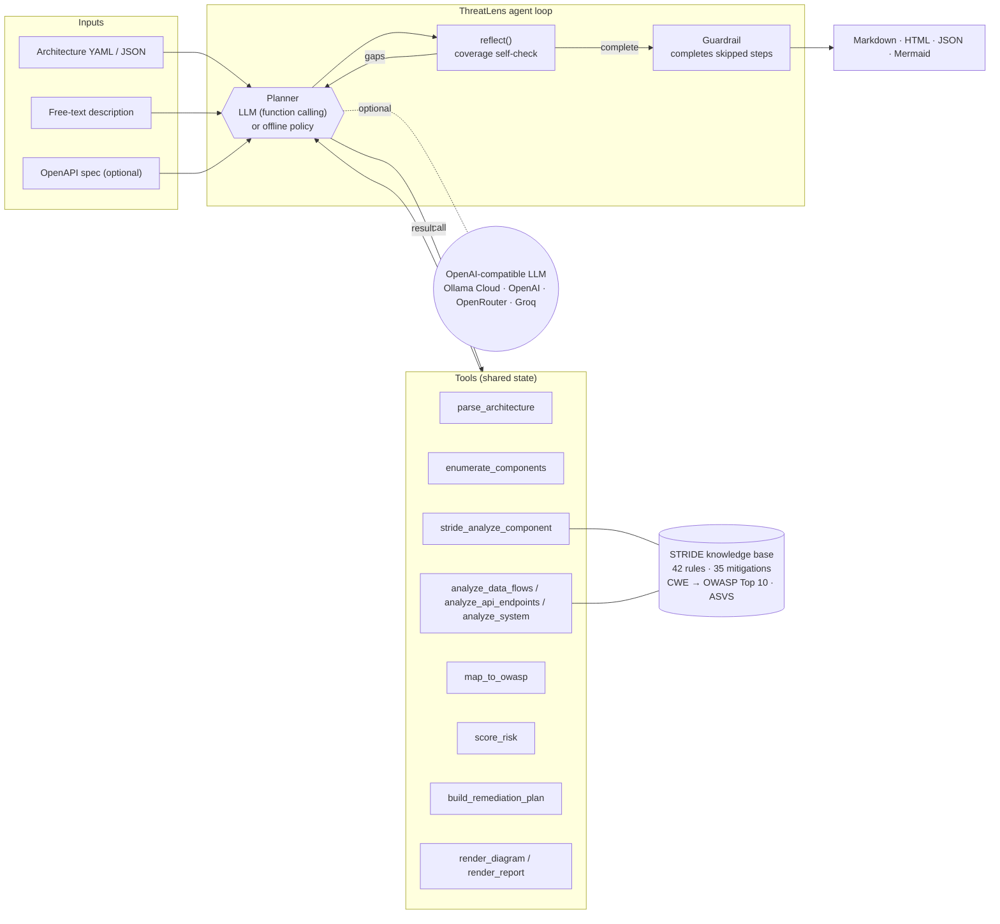

# 🛡️ ThreatLens — an AI threat-modeling agent for SMEs

> **Untap "Agents at Work" hackathon submission** · Author: **Ahmed Alaa Eldin**, Principal Application Security Consultant · License: MIT

ThreatLens takes a small business's app description (free text, a simple architecture YAML/JSON, and optionally an OpenAPI file) and **on its own** produces what an application-security consultant delivers after a 3–5 day threat-modeling engagement:

1. **Asset & data-flow inventory** with trust zones, boundary crossings and crown-jewel data stores
2. **STRIDE threat model** with every threat mapped to **OWASP Top 10 2021**, **OWASP ASVS 4.0.3** and **CWE**
3. **Risk-scored findings** (likelihood × impact, 1–25 → Critical/High/Medium/Low)
4. **Prioritised remediation plan** (Now / Next / Later) with owners and effort in developer-days
5. A **Mermaid data-flow diagram** with trust boundaries and risk hot-spots highlighted
6. Exported **Markdown + HTML + JSON** reports

It runs **fully offline with zero API keys** (a built-in, rule-based STRIDE knowledge base), or with any **OpenAI-compatible LLM**. **Ollama Cloud** is supported out of the box, as are OpenAI, OpenRouter, Groq and local Ollama.

---

## The problem

Most SMEs in Egypt and Saudi Arabia, such as clinics, online stores and HR/fintech start-ups, handle health records, payment flows, national IDs/Iqamas and salaries. Regulation (Egypt PDPL 151/2020, KSA PDPL, PCI DSS, NCA ECC, SAMA) increasingly expects a documented security design. Yet a threat model usually means **hiring a consultant for 3–5 days** (≈ USD 1,500–4,500 under our stated assumptions), waiting **1–3 weeks** to schedule them, and getting a document that is out of date at the next release. So most SMEs never do one, and they ship IDORs, unsigned payment callbacks and internet-exposed admin panels.

## Who it's for

- **SME founders / CTOs** and 2–10 person dev teams without in-house security staff
- **Freelance & agency developers** building client apps (clinics, stores, portals)
- **Security consultants** who want a first draft in seconds and then spend their hours on judgment, not on typing tables

## Workflow it replaces

| Manual engagement (3–5 days) | ThreatLens (minutes, incl. review) |
|---|---|
| Kick-off workshop, collect architecture | `parse_architecture` (YAML/JSON/free text + OpenAPI) |
| Draw the DFD and trust boundaries | `enumerate_components` + `render_diagram` |
| STRIDE session per component and flow | `stride_analyze_component`, `analyze_data_flows`, `analyze_api_endpoints`, `analyze_system` |
| Map to OWASP / ASVS / CWE | `map_to_owasp` |
| Risk-rate findings | `score_risk` |
| Peer review for gaps | `reflect` (self-check, loops back to repair gaps) |
| Write the remediation roadmap and report | `build_remediation_plan` + `render_report` |

---

## Quickstart: offline, no API key, 3 commands

```bash
pip install -r requirements.txt                      # PyYAML + Streamlit + pytest (Python 3.10+)
python -m threatlens examples/clinic_booking.yaml    # runs the agent and prints its trace
open threatlens_output/shifa_care_clinic_booking.html   # (Linux: xdg-open, Windows: start)
```

Web UI:

```bash
streamlit run app.py          # → http://localhost:8501, pick an example, click "Run threat model"
```

More inputs:

```bash
# E-commerce store + its OpenAPI spec (endpoint-level BOLA / unsigned-webhook / admin checks)
python -m threatlens examples/ecommerce_store.yaml --openapi examples/ecommerce_openapi.yaml
# Saudi HR & payroll portal (JSON)
python -m threatlens examples/hr_payroll_portal.json
# Free-text description only
python -m threatlens examples/pharmacy_delivery.txt
python -m threatlens --text "Laravel API + Flutter app for our clinic, MySQL, Paymob payments, WhatsApp reminders"
```

Run the tests and the impact benchmark:

```bash
python -m pytest -q                              # 12 tests, all offline (includes Streamlit AppTest + fake LLM server)
python benchmarks/impact_benchmark.py --runs 20  # rewrites docs/impact.md
```

Docker (optional): `docker build -t threatlens . && docker run -p 8501:8501 threatlens`

---

## LLM mode (optional)

ThreatLens auto-detects a key. With none it runs offline (or force it with `--offline`). Config lives in env vars or a `.env` file (see [`.env.example`](.env.example)):

| Variable | Meaning |
|---|---|
| `OPENAI_API_KEY` | Key for any OpenAI-compatible provider |
| `OPENAI_BASE_URL` | Provider endpoint (default `https://api.openai.com/v1`) |
| `MODEL` | Model name |
| `OLLAMA_API_KEY` | Alias for Ollama Cloud: base URL defaults to `https://ollama.com/v1`, model to `gpt-oss:120b` |

### ⭐ Ollama Cloud (first-class)

```bash
# either the explicit OpenAI-compatible form …
export OPENAI_BASE_URL=https://ollama.com/v1
export OPENAI_API_KEY=<your-ollama-api-key>
export MODEL=gpt-oss:120b            # any tool-calling cloud model, e.g. qwen3-coder:480b, deepseek-v3.1:671b
# … or simply
export OLLAMA_API_KEY=<your-ollama-api-key>

python -m threatlens examples/pharmacy_delivery.txt
# ThreatLens 1.0.0 — mode: LLM via ollama-cloud · gpt-oss:120b @ https://ollama.com/v1
```

Model names for direct API calls are the ones returned by `curl https://ollama.com/api/tags` (for example `gpt-oss:120b`, without the `-cloud` suffix the local CLI uses).

Other providers:

```bash
# OpenAI
export OPENAI_API_KEY=sk-...  MODEL=gpt-4o-mini
# OpenRouter
export OPENAI_API_KEY=sk-or-... OPENAI_BASE_URL=https://openrouter.ai/api/v1 MODEL=openai/gpt-4o-mini
# Groq
export OPENAI_API_KEY=gsk_... OPENAI_BASE_URL=https://api.groq.com/openai/v1 MODEL=llama-3.3-70b-versatile
# Local Ollama
export OPENAI_API_KEY=ollama OPENAI_BASE_URL=http://localhost:11434/v1 MODEL=gpt-oss:20b
```

What the LLM adds:
- **Drives the agent loop** through native function calling (it picks the tools, the order and the arguments).
- **Extracts architecture from free text** into the structured schema (the offline mode uses a keyword heuristic instead).
- **Adds context-specific threats** the rule base can't know, such as business-logic abuse like bots hoarding a popular doctor's appointment slots. These go in via `stride_analyze_component(additional_threats=[…])`, are validated, then mapped and scored like every other finding and tagged *LLM-proposed* in the report.
- **Writes an executive summary.**

**Guardrail:** after the LLM finishes, the deterministic planner checks the state and runs any step the model skipped. It also refuses a premature `render_report`. So a weak or flaky model can never produce a partial report, and any LLM/network error falls back to offline mode.

---

## Architecture



```
threatlens/
  agent.py    agent loop: plan → tool calls → reflect → repair → report; LLM + offline planners, guardrail
  tools.py    12 tools operating on a shared AgentState; OpenAI tool schemas
  kb.py       rule-based STRIDE knowledge base, mitigation catalogue, CWE→OWASP Top 10 map, ASVS refs
  parser.py   YAML/JSON architecture, free-text heuristic extractor, OpenAPI endpoint parser
  llm.py      stdlib OpenAI-compatible client (no SDK), Ollama Cloud alias, free-text extraction prompt
  report.py   Markdown / HTML / JSON / Mermaid rendering
  cli.py      `python -m threatlens`
app.py        Streamlit UI
```

**Input schema** (see `examples/clinic_booking.yaml`): `components[]` with `id, name, type, zone, tech, data, auth, internet_facing, controls, features, category`, plus `flows[]` with `from, to, protocol, data, auth`, plus optional `global_controls` and `compliance`. Types: `user, web_frontend, mobile_app, api, service, admin_panel, database, object_storage, cache, queue, identity_provider, third_party`. Zones: `internet, dmz, internal, data, third_party`. **Controls you document suppress the matching threats**. Anything undocumented is conservatively treated as absent.

**Risk model:** likelihood 1–5 (rule base rate, +1 when internet-facing or crossing from an untrusted zone) × impact 1–5 (from data classification: PHI/payment/credentials = 5, national ID/financial/PII = 4; −1 when the blast radius is a single user). Critical ≥ 20, High ≥ 12, Medium ≥ 6.

---

## Sample output

Pre-generated reports are in [`examples/output/`](examples/output/):

| Example | Input | Findings (C/H/M/L) | Fix plan | Report |
|---|---|---|---|---|
| 🏥 Shifa Care clinic booking (Cairo/Alexandria) | YAML | 43 (4/25/14/0) | 30 actions · 54 dev-days | [md](examples/output/shifa_care_clinic_booking.md) · [html](examples/output/shifa_care_clinic_booking.html) |
| 🛍️ Nile Threads e-commerce, Paymob + Fawry (Egypt) | YAML + OpenAPI | 43 (10/22/11/0) | 25 actions · 43 dev-days | [md](examples/output/nile_threads_e_commerce_store.md) · [html](examples/output/nile_threads_e_commerce_store.html) |
| 💼 Masar HR & payroll portal (Riyadh) | JSON | 25 (1/15/9/0) | 19 actions · 34.5 dev-days | [md](examples/output/masar_hr_payroll_portal.md) · [html](examples/output/masar_hr_payroll_portal.html) |
| 💊 Dawaa Express pharmacy delivery (Riyadh) | free text | 33 (4/18/11/0) | 26 actions · 49.5 dev-days | [md](examples/output/dawaa_express.md) · [html](examples/output/dawaa_express.html) |

The HR portal documents MFA via SSO, RBAC, audit logging, a WAF and monitoring, and ThreatLens correctly reports fewer, lower-severity findings for it.

Top findings for the clinic, as the report prints them:

| ID | Severity | Risk | STRIDE | Threat | OWASP | CWE |
|---|---|---|---|---|---|---|
| TL-001 | Critical | 25 | Spoofing | Forged webhook / callback from third party (Paymob → Booking API) | A08:2021 | CWE-345 |
| TL-002 | Critical | 25 | Spoofing | Internet-exposed admin panel without MFA (Clinic Admin Dashboard) | A07:2021 | CWE-308, CWE-306 |
| TL-003 | Critical | 25 | Information Disclosure | IDOR / broken object-level authorization (Booking API) | A01:2021 | CWE-639, CWE-862 |
| TL-004 | Critical | 20 | Tampering | Payment amount / order tampering (Booking API) | A04:2021 | CWE-602, CWE-840 |

---

## Measured impact

From [`docs/impact.md`](docs/impact.md), produced by `benchmarks/impact_benchmark.py` (offline, 20 runs per example). The assumptions are stated in that file and can be edited in the script.

- **Agent time to a full threat model:** ~13 ms median (4–18 ms per example), against **24–40 consultant hours** for a manual 3–5 day engagement
- **With a recommended 2–4 h expert review:** **83–95% less security-expert time**
- **Cost per threat model:** ~USD 125–450 (review time only; offline mode has no API cost), against **USD 1,500–4,500** (assumed USD 500–900/day)
- **Lead time:** minutes instead of 1–3 weeks, and it can be re-run on every architecture change
- **Coverage:** **37/38 (97%)** of author-defined expert-checklist threats found; all 6 STRIDE categories in every example; 8–10 of 10 OWASP Top 10 categories

---

## Demo

A 2.5-minute narrated demo script (English + Arabic) is in [`docs/demo_script.md`](docs/demo_script.md). The short version:

1. `streamlit run app.py`, pick the **clinic** example, then **Run threat model**. Show the live tool-call trace.
2. Severity cards, then open **TL-001 forged Paymob callback**, then the OWASP/ASVS/CWE mapping.
3. **Remediation plan** tab: the "Now" actions and their dev-days.
4. **Diagram** tab: trust zones and red hot-spots.
5. Switch to **free-text pharmacy** to show that a plain paragraph works too. Download the HTML report.
6. The terminal shows `python -m threatlens …`, then `pytest`, then `docs/impact.md`.

## About the examples

All example organisations (Shifa Care, Nile Threads, Masar, Dawaa Express) are **fictional** and their architectures are invented for demonstration. Third-party names such as Paymob, Fawry, Moyasar, Unifonic, WhatsApp, GOSI and Mudad appear only as typical integrations; no finding describes a real vulnerability in those services or in any real company. Trademarks belong to their owners. No real personal data is included.

## Limitations

- It is a **design-level** threat model, not a penetration test or code review. Critical and High items should be validated.
- The offline knowledge base is **conservative**: controls that aren't documented are assumed absent, so expect to close some findings with evidence.
- Offline free-text extraction is keyword-based. For messy descriptions use LLM mode or the YAML schema.
- The benchmark's expert checklist was written by the author and is **not independent ground truth**. The consultant day rates and lead times are stated assumptions.
- ASVS references are at section level (ASVS 4.0.3), not individual requirement IDs. Regulatory notes are context, not legal advice.
- The HTML report loads Mermaid from a CDN to draw the diagram. Offline, the diagram source still shows (and the `.mmd` file renders in any Mermaid viewer).

## License

MIT © 2026 Ahmed Alaa Eldin
