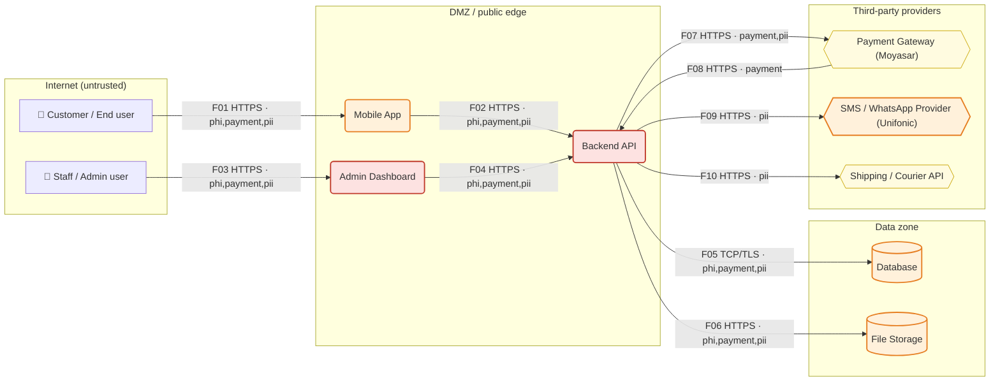

# Threat Model Report — Dawaa Express

*Generated by ThreatLens v1.0.0 on 2026-10-08 20:22 · mode: `offline` · methodology: STRIDE + OWASP Top 10 2021 / ASVS 4.0.3 / CWE*

> Dawaa Express — pharmacy delivery app in Riyadh, Saudi Arabia.
> 
> Customers order medicines through our Android and iOS mobile app (built with Flutter) and can upload a
> photo of their prescription. A Node.js backend API stores orders, customer names, phone numbers,
> delivery addresses and prescription images in PostgreSQL and an S3 bucket. Pharmacists review
> prescriptions in a web admin dashboard. Payments go through Moyasar (mada, Apple Pay, cards) and
> we send order updates and login OTP codes by SMS through Unifonic. Drivers are dispatched through
> a courier API. We are a team of 4 developers and host everything on AWS. We use Cloudflare in front
> of the API.

## 1. Executive summary

ThreatLens analysed **10 components** and **10 data flows** (8 crossing trust boundaries) of *Dawaa Express* and identified **33 threats**: 4 Critical, 18 High, 11 Medium, 0 Low, covering 8 of the 10 OWASP Top 10 2021 categories. The highest risks are **Forged webhook / callback from third party — Payment Gateway (Moyasar) → Backend API** (risk 25/25); **Internet-exposed admin panel without MFA — Admin Dashboard** (risk 25/25); **IDOR / Broken object-level authorization — Backend API** (risk 25/25). Doing the **17 'Now' actions** (~29.0 developer-days) removes the most risk per day of effort; the full plan is ~49.5 developer-days.

| Critical | High | Medium | Low | Total | Remediation effort |
|---|---|---|---|---|---|
| 4 | 18 | 11 | 0 | 33 | 49.5 dev-days (29.0 urgent) |

## 2. Asset & data-flow inventory

### 2.1 Components

| ID | Component | Type | Trust zone | Data | Auth | Internet-facing | Documented controls |
|---|---|---|---|---|---|---|---|
| `end_user` | Customer / End user | External entity (human actor) | internet | — | none | no | — |
| `staff` | Staff / Admin user | External entity (human actor) | internet | — | none | no | — |
| `mobile_app` | Mobile App | Mobile app (Android / iOS) | dmz | Health data (PHI), Payment data, Personal data (PII), Credentials / tokens | password | yes | — |
| `admin_panel` | Admin Dashboard | Back-office / admin dashboard | dmz | Health data (PHI), Payment data, Personal data (PII), Credentials / tokens | password | yes | — |
| `backend_api` | Backend API | Backend API | dmz | Health data (PHI), Payment data, Personal data (PII), Credentials / tokens | jwt | yes | — |
| `database` | Database | Database | data | Health data (PHI), Payment data, Personal data (PII) | none | no | — |
| `file_storage` | File Storage | Object / file storage | data | Health data (PHI), Payment data, Personal data (PII) | none | no | — |
| `payment_gateway` | Payment Gateway (Moyasar) | Third-party service | third_party | Payment data, Personal data (PII) | api_key | no | — |
| `messaging` | SMS / WhatsApp Provider (Unifonic) | Third-party service | third_party | Personal data (PII) | api_key | no | — |
| `shipping` | Shipping / Courier API | Third-party service | third_party | Personal data (PII) | api_key | no | — |

### 2.2 Data flows

| ID | From → To | Protocol | Data | Auth | Crosses boundary |
|---|---|---|---|---|---|
| F01 | Customer / End user → Mobile App | HTTPS | phi, payment, pii, credentials | none | internet -> dmz |
| F02 | Mobile App → Backend API | HTTPS | phi, payment, pii, credentials | jwt | — |
| F03 | Staff / Admin user → Admin Dashboard | HTTPS | phi, payment, pii, credentials | none | internet -> dmz |
| F04 | Admin Dashboard → Backend API | HTTPS | phi, payment, pii | session | — |
| F05 | Backend API → Database | TCP/TLS | phi, payment, pii | password | dmz -> data |
| F06 | Backend API → File Storage | HTTPS | phi, payment, pii | api_key | dmz -> data |
| F07 | Backend API → Payment Gateway (Moyasar) | HTTPS | payment, pii | api_key | dmz -> third_party |
| F08 | Payment Gateway (Moyasar) → Backend API | HTTPS | payment | none | third_party -> dmz |
| F09 | Backend API → SMS / WhatsApp Provider (Unifonic) | HTTPS | pii | api_key | dmz -> third_party |
| F10 | Backend API → Shipping / Courier API | HTTPS | pii | api_key | dmz -> third_party |

### 2.3 Trust boundaries

- **Internet (untrusted)**: Customer / End user, Staff / Admin user
- **DMZ / public edge**: Mobile App, Admin Dashboard, Backend API
- **Data zone**: Database, File Storage
- **Third-party providers**: Payment Gateway (Moyasar), SMS / WhatsApp Provider (Unifonic), Shipping / Courier API
- **Crown-jewel data stores**: Database, File Storage

## 3. Data-flow diagram

Dashed arrows = unencrypted transport. Red/orange/yellow nodes = worst open Critical/High/Medium risk.

## 4. Findings (risk-ranked)

| ID | Severity | Risk (L×I) | STRIDE | Threat | Target | OWASP Top 10 | CWE |
|---|---|---|---|---|---|---|---|
| TL-001 | **Critical** | 25 (5×5) | Spoofing | Forged webhook / callback from third party — Payment Gateway (Moyasar) → Backend API | F08: Payment Gateway (Moyasar) → Backend API | A08:2021 | CWE-345 |
| TL-002 | **Critical** | 25 (5×5) | Spoofing | Internet-exposed admin panel without MFA — Admin Dashboard | Admin Dashboard | A07:2021 | CWE-308, CWE-306 |
| TL-003 | **Critical** | 25 (5×5) | Information Disclosure | IDOR / Broken object-level authorization — Backend API | Backend API | A01:2021 | CWE-639, CWE-862 |
| TL-004 | **Critical** | 20 (4×5) | Tampering | Payment amount / order tampering — Backend API | Backend API | A04:2021 | CWE-602, CWE-840 |
| TL-005 | **High** | 16 (4×4) | Spoofing | Weak session / token lifecycle — Backend API | Backend API | A07:2021 | CWE-613 |
| TL-006 | **High** | 16 (4×4) | Spoofing | Account takeover via single-factor authentication — Backend API | Backend API | A07:2021 | CWE-308, CWE-287 |
| TL-007 | **High** | 16 (4×4) | Spoofing | Account takeover via single-factor authentication — Mobile App | Mobile App | A07:2021 | CWE-308, CWE-287 |
| TL-008 | **High** | 16 (4×4) | Spoofing | Credential stuffing / brute force on login and OTP — Admin Dashboard | Admin Dashboard | A07:2021 | CWE-307 |
| TL-009 | **High** | 16 (4×4) | Spoofing | Credential stuffing / brute force on login and OTP — Backend API | Backend API | A07:2021 | CWE-307 |
| TL-010 | **High** | 16 (4×4) | Tampering | Stored / reflected XSS in browser UI — Admin Dashboard | Admin Dashboard | A03:2021 | CWE-79 |
| TL-011 | **High** | 15 (3×5) | Tampering | SQL / NoSQL injection into backend data store — Backend API | Backend API | A03:2021 | CWE-89 |
| TL-012 | **High** | 15 (3×5) | Tampering | Malicious file upload — Backend API | Backend API | A04:2021 | CWE-434 |
| TL-013 | **High** | 15 (3×5) | Information Disclosure | Publicly readable storage bucket / predictable file URLs — File Storage | File Storage | A01:2021 | CWE-732, CWE-200 |
| TL-014 | **High** | 15 (3×5) | Information Disclosure | Secrets in source code / server env files | System-wide | A07:2021 | CWE-798 |
| TL-015 | **High** | 15 (3×5) | Denial of Service | No tested backups for crown-jewel data (ransomware) — Database | Database | A04:2021 | CWE-657 |
| TL-016 | **High** | 15 (3×5) | Elevation of Privilege | Broken function-level authorization (user reaches admin functions) — Backend API | Backend API | A01:2021 | CWE-285, CWE-863 |
| TL-017 | **High** | 15 (3×5) | Elevation of Privilege | Mass assignment of privileged fields — Backend API | Backend API | A08:2021 | CWE-915 |
| TL-018 | **High** | 12 (3×4) | Spoofing | Secrets extractable from the client app — Mobile App | Mobile App | A07:2021 | CWE-798 |
| TL-019 | **High** | 12 (3×4) | Tampering | Vulnerable third-party libraries (no SCA) | System-wide | A06:2021 | CWE-1104 |
| TL-020 | **High** | 12 (3×4) | Repudiation | No centralized security monitoring / alerting | System-wide | A09:2021 | CWE-778 |
| TL-021 | **High** | 12 (4×3) | Denial of Service | Resource exhaustion on public API — Backend API | Backend API | A04:2021 | CWE-770 |
| TL-022 | **High** | 12 (4×3) | Denial of Service | SMS/WhatsApp OTP pumping & messaging abuse — SMS / WhatsApp Provider (Unifonic) | SMS / WhatsApp Provider (Unifonic) | A04:2021 | CWE-799 |
| TL-023 | **Medium** | 10 (2×5) | Information Disclosure | Sensitive data stored unencrypted at rest — Database | Database | A02:2021 | CWE-311, CWE-312 |
| TL-024 | **Medium** | 10 (2×5) | Information Disclosure | Sensitive data stored unencrypted at rest — File Storage | File Storage | A02:2021 | CWE-311, CWE-312 |
| TL-025 | **Medium** | 10 (2×5) | Elevation of Privilege | Over-privileged database account — Database | Database | A01:2021 | CWE-250 |
| TL-026 | **Medium** | 9 (3×3) | Repudiation | No audit trail for access to sensitive records — Admin Dashboard | Admin Dashboard | A09:2021 | CWE-778 |
| TL-027 | **Medium** | 9 (3×3) | Repudiation | No audit trail for access to sensitive records — Backend API | Backend API | A09:2021 | CWE-778 |
| TL-028 | **Medium** | 9 (3×3) | Information Disclosure | Personal data shared with third party beyond need — SMS / WhatsApp Provider (Unifonic) | SMS / WhatsApp Provider (Unifonic) | A01:2021 | CWE-359 |
| TL-029 | **Medium** | 9 (3×3) | Information Disclosure | Personal data shared with third party beyond need — Payment Gateway (Moyasar) | Payment Gateway (Moyasar) | A01:2021 | CWE-359 |
| TL-030 | **Medium** | 9 (3×3) | Information Disclosure | Personal data shared with third party beyond need — Shipping / Courier API | Shipping / Courier API | A01:2021 | CWE-359 |
| TL-031 | **Medium** | 8 (4×2) | Information Disclosure | Verbose errors / debug mode in production — Admin Dashboard | Admin Dashboard | A04:2021 | CWE-209 |
| TL-032 | **Medium** | 8 (4×2) | Information Disclosure | Verbose errors / debug mode in production — Backend API | Backend API | A04:2021 | CWE-209 |
| TL-033 | **Medium** | 8 (2×4) | Information Disclosure | Sensitive data stored insecurely on device — Mobile App | Mobile App | A02:2021 | CWE-312 |

### 4.1 Finding details

#### TL-001 — Forged webhook / callback from third party — Payment Gateway (Moyasar) → Backend API

- **Severity:** Critical (likelihood 5/5 × impact 5/5 = 25/25)
- **STRIDE:** Spoofing · **Target:** F08: Payment Gateway (Moyasar) → Backend API
- **OWASP Top 10 2021:** A08:2021 Software and Data Integrity Failures
- **OWASP ASVS 4.0.3:** V10.3 Application Integrity; V13.1 Generic Web Service Security
- **CWE:** CWE-345
- **Description:** Backend API accepts callbacks from Payment Gateway (Moyasar) (Payment data). Without signature verification an attacker can forge 'payment successful' or status events.
- **Evidence / basis:** `F08: https auth=none third_party->dmz`
- **Mitigation:** Verify payment & partner webhook signatures.

#### TL-002 — Internet-exposed admin panel without MFA — Admin Dashboard

- **Severity:** Critical (likelihood 5/5 × impact 5/5 = 25/25)
- **STRIDE:** Spoofing · **Target:** Admin Dashboard
- **OWASP Top 10 2021:** A07:2021 Identification and Authentication Failures
- **OWASP ASVS 4.0.3:** V4.3 Other Access Control Considerations; V2.8 One Time Verifier
- **CWE:** CWE-308, CWE-306
- **Description:** Admin Dashboard is reachable from the internet and protected only by password. Staff accounts are the highest-value phishing target.
- **Evidence / basis:** `type=admin_panel, zone=dmz, auth=password, controls=none documented`
- **Mitigation:** Enforce MFA for privileged and staff accounts. Restrict admin panel to VPN / IP allow-list.

#### TL-003 — IDOR / Broken object-level authorization — Backend API

- **Severity:** Critical (likelihood 5/5 × impact 5/5 = 25/25)
- **STRIDE:** Information Disclosure · **Target:** Backend API
- **OWASP Top 10 2021:** A01:2021 Broken Access Control
- **OWASP ASVS 4.0.3:** V4.2 Operation Level Access Control
- **CWE:** CWE-639, CWE-862
- **Description:** Backend API exposes records by ID (Health data (PHI), Payment data, Personal data (PII), Credentials / tokens). If ownership is not checked server-side, changing an ID returns another customer's data.
- **Evidence / basis:** `type=api, zone=dmz, auth=jwt, controls=none documented`
- **Mitigation:** Object-level authorization on every record access (anti-IDOR/BOLA).

#### TL-004 — Payment amount / order tampering — Backend API

- **Severity:** Critical (likelihood 4/5 × impact 5/5 = 20/25)
- **STRIDE:** Tampering · **Target:** Backend API
- **OWASP Top 10 2021:** A04:2021 Insecure Design
- **OWASP ASVS 4.0.3:** V11.1 Business Logic Security
- **CWE:** CWE-602, CWE-840
- **Description:** Backend API handles payments. If totals, discounts or amounts are accepted from the client, attackers can pay less than the real price.
- **Evidence / basis:** `type=api, zone=dmz, auth=jwt, controls=none documented`
- **Mitigation:** Recompute amounts and prices server-side.

#### TL-005 — Weak session / token lifecycle — Backend API

- **Severity:** High (likelihood 4/5 × impact 4/5 = 16/25)
- **STRIDE:** Spoofing · **Target:** Backend API
- **OWASP Top 10 2021:** A07:2021 Identification and Authentication Failures
- **OWASP ASVS 4.0.3:** V3.3 Session Termination; V3.5 Token-based Session Management
- **CWE:** CWE-613
- **Description:** Backend API uses jwt tokens; without expiry, rotation and server-side revocation a stolen token stays valid indefinitely.
- **Evidence / basis:** `type=api, zone=dmz, auth=jwt, controls=none documented`
- **Mitigation:** Harden session & token lifecycle.

#### TL-006 — Account takeover via single-factor authentication — Backend API

- **Severity:** High (likelihood 4/5 × impact 4/5 = 16/25)
- **STRIDE:** Spoofing · **Target:** Backend API
- **OWASP Top 10 2021:** A07:2021 Identification and Authentication Failures
- **OWASP ASVS 4.0.3:** V2.1 Password Security; V2.8 One Time Verifier
- **CWE:** CWE-308, CWE-287
- **Description:** Backend API authenticates users with jwt only. Phished, reused or leaked passwords give an attacker full access to Health data (PHI), Payment data, Personal data (PII), Credentials / tokens.
- **Evidence / basis:** `type=api, zone=dmz, auth=jwt, controls=none documented`
- **Mitigation:** Enforce MFA for privileged and staff accounts.

#### TL-007 — Account takeover via single-factor authentication — Mobile App

- **Severity:** High (likelihood 4/5 × impact 4/5 = 16/25)
- **STRIDE:** Spoofing · **Target:** Mobile App
- **OWASP Top 10 2021:** A07:2021 Identification and Authentication Failures
- **OWASP ASVS 4.0.3:** V2.1 Password Security; V2.8 One Time Verifier
- **CWE:** CWE-308, CWE-287
- **Description:** Mobile App authenticates users with password only. Phished, reused or leaked passwords give an attacker full access to Health data (PHI), Payment data, Personal data (PII), Credentials / tokens.
- **Evidence / basis:** `type=mobile_app, zone=dmz, auth=password, controls=none documented`
- **Mitigation:** Enforce MFA for privileged and staff accounts.

#### TL-008 — Credential stuffing / brute force on login and OTP — Admin Dashboard

- **Severity:** High (likelihood 4/5 × impact 4/5 = 16/25)
- **STRIDE:** Spoofing · **Target:** Admin Dashboard
- **OWASP Top 10 2021:** A07:2021 Identification and Authentication Failures
- **OWASP ASVS 4.0.3:** V2.2 General Authenticator Security
- **CWE:** CWE-307
- **Description:** No rate limiting is documented for Admin Dashboard. Automated credential-stuffing or OTP guessing can take over accounts.
- **Evidence / basis:** `type=admin_panel, zone=dmz, auth=password, controls=none documented`
- **Mitigation:** Rate limiting & anti-automation on auth/OTP/sensitive endpoints. Account lockout & credential-stuffing detection.

#### TL-009 — Credential stuffing / brute force on login and OTP — Backend API

- **Severity:** High (likelihood 4/5 × impact 4/5 = 16/25)
- **STRIDE:** Spoofing · **Target:** Backend API
- **OWASP Top 10 2021:** A07:2021 Identification and Authentication Failures
- **OWASP ASVS 4.0.3:** V2.2 General Authenticator Security
- **CWE:** CWE-307
- **Description:** No rate limiting is documented for Backend API. Automated credential-stuffing or OTP guessing can take over accounts.
- **Evidence / basis:** `type=api, zone=dmz, auth=jwt, controls=none documented`
- **Mitigation:** Rate limiting & anti-automation on auth/OTP/sensitive endpoints. Account lockout & credential-stuffing detection.

#### TL-010 — Stored / reflected XSS in browser UI — Admin Dashboard

- **Severity:** High (likelihood 4/5 × impact 4/5 = 16/25)
- **STRIDE:** Tampering · **Target:** Admin Dashboard
- **OWASP Top 10 2021:** A03:2021 Injection
- **OWASP ASVS 4.0.3:** V5.3 Output Encoding and Injection Prevention; V14.4 HTTP Security Headers
- **CWE:** CWE-79
- **Description:** Admin Dashboard renders user-supplied content. Without output encoding and CSP, script injection can steal sessions of staff or customers.
- **Evidence / basis:** `type=admin_panel, zone=dmz, auth=password, controls=none documented`
- **Mitigation:** Output encoding + Content-Security-Policy.

#### TL-011 — SQL / NoSQL injection into backend data store — Backend API

- **Severity:** High (likelihood 3/5 × impact 5/5 = 15/25)
- **STRIDE:** Tampering · **Target:** Backend API
- **OWASP Top 10 2021:** A03:2021 Injection
- **OWASP ASVS 4.0.3:** V5.3 Output Encoding and Injection Prevention
- **CWE:** CWE-89
- **Description:** Backend API builds queries against a data store and no input-validation / parameterization control is documented.
- **Evidence / basis:** `type=api, zone=dmz, auth=jwt, controls=none documented`
- **Mitigation:** Parameterized queries / ORM-only data access. Schema-based input validation & allow-listed fields.

#### TL-012 — Malicious file upload — Backend API

- **Severity:** High (likelihood 3/5 × impact 5/5 = 15/25)
- **STRIDE:** Tampering · **Target:** Backend API
- **OWASP Top 10 2021:** A04:2021 Insecure Design
- **OWASP ASVS 4.0.3:** V12.1 File Upload; V12.2 File Integrity
- **CWE:** CWE-434
- **Description:** Backend API accepts file uploads (e.g. documents, images, lab results). Unrestricted uploads enable web shells, malware hosting and stored XSS.
- **Evidence / basis:** `type=api, zone=dmz, auth=jwt, controls=none documented`
- **Mitigation:** Harden file uploads.

#### TL-013 — Publicly readable storage bucket / predictable file URLs — File Storage

- **Severity:** High (likelihood 3/5 × impact 5/5 = 15/25)
- **STRIDE:** Information Disclosure · **Target:** File Storage
- **OWASP Top 10 2021:** A01:2021 Broken Access Control
- **OWASP ASVS 4.0.3:** V12.4 File Storage; V4.1 General Access Control Design
- **CWE:** CWE-732, CWE-200
- **Description:** File Storage holds files (Health data (PHI), Payment data, Personal data (PII)). Misconfigured public access or guessable URLs are a top cause of SME data leaks.
- **Evidence / basis:** `type=object_storage, zone=data, auth=none, controls=none documented`
- **Mitigation:** Private buckets + short-lived signed URLs.

#### TL-014 — Secrets in source code / server env files

- **Severity:** High (likelihood 3/5 × impact 5/5 = 15/25)
- **STRIDE:** Information Disclosure · **Target:** System-wide
- **OWASP Top 10 2021:** A07:2021 Identification and Authentication Failures
- **OWASP ASVS 4.0.3:** V6.4 Secret Management; V14.1 Build and Deploy
- **CWE:** CWE-798
- **Description:** No secrets manager is documented. Payment-gateway keys, DB passwords and JWT signing keys tend to live in git or .env files.
- **Evidence / basis:** `global_controls=['waf']`
- **Mitigation:** Move secrets to a secrets manager & rotate.

#### TL-015 — No tested backups for crown-jewel data (ransomware) — Database

- **Severity:** High (likelihood 3/5 × impact 5/5 = 15/25)
- **STRIDE:** Denial of Service · **Target:** Database
- **OWASP Top 10 2021:** A04:2021 Insecure Design
- **OWASP ASVS 4.0.3:** V8.1 General Data Protection
- **CWE:** CWE-657
- **Description:** Database holds Health data (PHI), Payment data, Personal data (PII) with no documented backup/restore. Ransomware or an accidental delete is a business-ending event.
- **Evidence / basis:** `type=database, zone=data, auth=none, controls=none documented`
- **Mitigation:** Encrypted, tested, off-site backups (ransomware-resilient).

#### TL-016 — Broken function-level authorization (user reaches admin functions) — Backend API

- **Severity:** High (likelihood 3/5 × impact 5/5 = 15/25)
- **STRIDE:** Elevation of Privilege · **Target:** Backend API
- **OWASP Top 10 2021:** A01:2021 Broken Access Control
- **OWASP ASVS 4.0.3:** V4.1 General Access Control Design; V4.2 Operation Level Access Control
- **CWE:** CWE-285, CWE-863
- **Description:** Backend API serves both end users and staff/admin functions. Missing server-side role checks let normal users call privileged endpoints.
- **Evidence / basis:** `type=api, zone=dmz, auth=jwt, controls=none documented`
- **Mitigation:** Role-based access control on every privileged function.

#### TL-017 — Mass assignment of privileged fields — Backend API

- **Severity:** High (likelihood 3/5 × impact 5/5 = 15/25)
- **STRIDE:** Elevation of Privilege · **Target:** Backend API
- **OWASP Top 10 2021:** A08:2021 Software and Data Integrity Failures
- **OWASP ASVS 4.0.3:** V5.1 Input Validation
- **CWE:** CWE-915
- **Description:** Backend API binds request bodies to models. Without explicit DTOs a user can set fields such as role, is_admin, salary or price.
- **Evidence / basis:** `type=api, zone=dmz, auth=jwt, controls=none documented`
- **Mitigation:** Schema-based input validation & allow-listed fields.

#### TL-018 — Secrets extractable from the client app — Mobile App

- **Severity:** High (likelihood 3/5 × impact 4/5 = 12/25)
- **STRIDE:** Spoofing · **Target:** Mobile App
- **OWASP Top 10 2021:** A07:2021 Identification and Authentication Failures
- **OWASP ASVS 4.0.3:** V14.3 Unintended Security Disclosure; V6.4 Secret Management
- **CWE:** CWE-798
- **Description:** Mobile App ships to user devices. API keys or partner credentials embedded in the bundle can be extracted and abused to impersonate the app.
- **Evidence / basis:** `type=mobile_app, zone=dmz, auth=password, controls=none documented`
- **Mitigation:** Remove secrets from mobile/web clients.

#### TL-019 — Vulnerable third-party libraries (no SCA)

- **Severity:** High (likelihood 3/5 × impact 4/5 = 12/25)
- **STRIDE:** Tampering · **Target:** System-wide
- **OWASP Top 10 2021:** A06:2021 Vulnerable and Outdated Components
- **OWASP ASVS 4.0.3:** V14.2 Dependency
- **CWE:** CWE-1104
- **Description:** No dependency scanning is documented for the custom code (npm/composer/pip/pub). Known-vulnerable packages are a common entry point.
- **Evidence / basis:** `global_controls=['waf']`
- **Mitigation:** Dependency scanning & patching cadence (SCA).

#### TL-020 — No centralized security monitoring / alerting

- **Severity:** High (likelihood 3/5 × impact 4/5 = 12/25)
- **STRIDE:** Repudiation · **Target:** System-wide
- **OWASP Top 10 2021:** A09:2021 Security Logging and Monitoring Failures
- **OWASP ASVS 4.0.3:** V7.2 Log Processing; V7.3 Log Protection
- **CWE:** CWE-778
- **Description:** There is no documented security monitoring. Breaches at SMEs are typically discovered months later, by customers or regulators.
- **Evidence / basis:** `global_controls=['waf']`
- **Mitigation:** Centralized security monitoring & alerting.

#### TL-021 — Resource exhaustion on public API — Backend API

- **Severity:** High (likelihood 4/5 × impact 3/5 = 12/25)
- **STRIDE:** Denial of Service · **Target:** Backend API
- **OWASP Top 10 2021:** A04:2021 Insecure Design
- **OWASP ASVS 4.0.3:** V11.1 Business Logic Security; V13.1 Generic Web Service Security
- **CWE:** CWE-770
- **Description:** Backend API is internet-facing without documented rate limits; scraping or floods can take the service down or inflate cloud bills.
- **Evidence / basis:** `type=api, zone=dmz, auth=jwt, controls=none documented`
- **Mitigation:** Rate limiting & anti-automation on auth/OTP/sensitive endpoints.

#### TL-022 — SMS/WhatsApp OTP pumping & messaging abuse — SMS / WhatsApp Provider (Unifonic)

- **Severity:** High (likelihood 4/5 × impact 3/5 = 12/25)
- **STRIDE:** Denial of Service · **Target:** SMS / WhatsApp Provider (Unifonic)
- **OWASP Top 10 2021:** A04:2021 Insecure Design
- **OWASP ASVS 4.0.3:** V2.2 General Authenticator Security
- **CWE:** CWE-799
- **Description:** SMS / WhatsApp Provider (Unifonic) sends OTP / notifications. Bots can trigger thousands of messages (toll fraud) or spam patients/customers.
- **Evidence / basis:** `type=third_party, zone=third_party, auth=api_key, controls=none documented`
- **Mitigation:** OTP/SMS pumping controls.

#### TL-023 — Sensitive data stored unencrypted at rest — Database

- **Severity:** Medium (likelihood 2/5 × impact 5/5 = 10/25)
- **STRIDE:** Information Disclosure · **Target:** Database
- **OWASP Top 10 2021:** A02:2021 Cryptographic Failures
- **OWASP ASVS 4.0.3:** V6.1 Data Classification; V8.3 Sensitive Private Data
- **CWE:** CWE-311, CWE-312
- **Description:** Database stores Health data (PHI), Payment data, Personal data (PII) without documented encryption at rest. A stolen backup, snapshot or disk exposes everything.
- **Evidence / basis:** `type=database, zone=data, auth=none, controls=none documented`
- **Mitigation:** Encrypt sensitive data at rest.

#### TL-024 — Sensitive data stored unencrypted at rest — File Storage

- **Severity:** Medium (likelihood 2/5 × impact 5/5 = 10/25)
- **STRIDE:** Information Disclosure · **Target:** File Storage
- **OWASP Top 10 2021:** A02:2021 Cryptographic Failures
- **OWASP ASVS 4.0.3:** V6.1 Data Classification; V8.3 Sensitive Private Data
- **CWE:** CWE-311, CWE-312
- **Description:** File Storage stores Health data (PHI), Payment data, Personal data (PII) without documented encryption at rest. A stolen backup, snapshot or disk exposes everything.
- **Evidence / basis:** `type=object_storage, zone=data, auth=none, controls=none documented`
- **Mitigation:** Encrypt sensitive data at rest.

#### TL-025 — Over-privileged database account — Database

- **Severity:** Medium (likelihood 2/5 × impact 5/5 = 10/25)
- **STRIDE:** Elevation of Privilege · **Target:** Database
- **OWASP Top 10 2021:** A01:2021 Broken Access Control
- **OWASP ASVS 4.0.3:** V1.4 Access Control Architecture
- **CWE:** CWE-250
- **Description:** Database: applications typically connect with owner/DBA rights; any injection becomes full database compromise.
- **Evidence / basis:** `type=database, zone=data, auth=none, controls=none documented`
- **Mitigation:** Least-privilege database accounts.

#### TL-026 — No audit trail for access to sensitive records — Admin Dashboard

- **Severity:** Medium (likelihood 3/5 × impact 3/5 = 9/25)
- **STRIDE:** Repudiation · **Target:** Admin Dashboard
- **OWASP Top 10 2021:** A09:2021 Security Logging and Monitoring Failures
- **OWASP ASVS 4.0.3:** V7.1 Log Content; V7.2 Log Processing
- **CWE:** CWE-778
- **Description:** Admin Dashboard processes Health data (PHI), Payment data, Personal data (PII), Credentials / tokens but no audit logging is documented. Insider misuse or a breach cannot be investigated or proven.
- **Evidence / basis:** `type=admin_panel, zone=dmz, auth=password, controls=none documented`
- **Mitigation:** Tamper-evident audit log for sensitive actions.

#### TL-027 — No audit trail for access to sensitive records — Backend API

- **Severity:** Medium (likelihood 3/5 × impact 3/5 = 9/25)
- **STRIDE:** Repudiation · **Target:** Backend API
- **OWASP Top 10 2021:** A09:2021 Security Logging and Monitoring Failures
- **OWASP ASVS 4.0.3:** V7.1 Log Content; V7.2 Log Processing
- **CWE:** CWE-778
- **Description:** Backend API processes Health data (PHI), Payment data, Personal data (PII), Credentials / tokens but no audit logging is documented. Insider misuse or a breach cannot be investigated or proven.
- **Evidence / basis:** `type=api, zone=dmz, auth=jwt, controls=none documented`
- **Mitigation:** Tamper-evident audit log for sensitive actions.

#### TL-028 — Personal data shared with third party beyond need — SMS / WhatsApp Provider (Unifonic)

- **Severity:** Medium (likelihood 3/5 × impact 3/5 = 9/25)
- **STRIDE:** Information Disclosure · **Target:** SMS / WhatsApp Provider (Unifonic)
- **OWASP Top 10 2021:** A01:2021 Broken Access Control
- **OWASP ASVS 4.0.3:** V8.3 Sensitive Private Data
- **CWE:** CWE-359
- **Description:** SMS / WhatsApp Provider (Unifonic) receives Personal data (PII). Over-sharing with processors without a DPA creates privacy and regulatory exposure (Egypt PDPL / KSA PDPL).
- **Evidence / basis:** `type=third_party, zone=third_party, auth=api_key, controls=none documented`
- **Mitigation:** Data minimization & DPA with third parties.

#### TL-029 — Personal data shared with third party beyond need — Payment Gateway (Moyasar)

- **Severity:** Medium (likelihood 3/5 × impact 3/5 = 9/25)
- **STRIDE:** Information Disclosure · **Target:** Payment Gateway (Moyasar)
- **OWASP Top 10 2021:** A01:2021 Broken Access Control
- **OWASP ASVS 4.0.3:** V8.3 Sensitive Private Data
- **CWE:** CWE-359
- **Description:** Payment Gateway (Moyasar) receives Payment data, Personal data (PII). Over-sharing with processors without a DPA creates privacy and regulatory exposure (Egypt PDPL / KSA PDPL).
- **Evidence / basis:** `type=third_party, zone=third_party, auth=api_key, controls=none documented`
- **Mitigation:** Data minimization & DPA with third parties.

#### TL-030 — Personal data shared with third party beyond need — Shipping / Courier API

- **Severity:** Medium (likelihood 3/5 × impact 3/5 = 9/25)
- **STRIDE:** Information Disclosure · **Target:** Shipping / Courier API
- **OWASP Top 10 2021:** A01:2021 Broken Access Control
- **OWASP ASVS 4.0.3:** V8.3 Sensitive Private Data
- **CWE:** CWE-359
- **Description:** Shipping / Courier API receives Personal data (PII). Over-sharing with processors without a DPA creates privacy and regulatory exposure (Egypt PDPL / KSA PDPL).
- **Evidence / basis:** `type=third_party, zone=third_party, auth=api_key, controls=none documented`
- **Mitigation:** Data minimization & DPA with third parties.

#### TL-031 — Verbose errors / debug mode in production — Admin Dashboard

- **Severity:** Medium (likelihood 4/5 × impact 2/5 = 8/25)
- **STRIDE:** Information Disclosure · **Target:** Admin Dashboard
- **OWASP Top 10 2021:** A04:2021 Insecure Design
- **OWASP ASVS 4.0.3:** V7.4 Error Handling
- **CWE:** CWE-209
- **Description:** Admin Dashboard: stack traces and framework debug pages disclose internals and sometimes secrets.
- **Evidence / basis:** `type=admin_panel, zone=dmz, auth=password, controls=none documented`
- **Mitigation:** Generic error responses, no stack traces in production.

#### TL-032 — Verbose errors / debug mode in production — Backend API

- **Severity:** Medium (likelihood 4/5 × impact 2/5 = 8/25)
- **STRIDE:** Information Disclosure · **Target:** Backend API
- **OWASP Top 10 2021:** A04:2021 Insecure Design
- **OWASP ASVS 4.0.3:** V7.4 Error Handling
- **CWE:** CWE-209
- **Description:** Backend API: stack traces and framework debug pages disclose internals and sometimes secrets.
- **Evidence / basis:** `type=api, zone=dmz, auth=jwt, controls=none documented`
- **Mitigation:** Generic error responses, no stack traces in production.

#### TL-033 — Sensitive data stored insecurely on device — Mobile App

- **Severity:** Medium (likelihood 2/5 × impact 4/5 = 8/25)
- **STRIDE:** Information Disclosure · **Target:** Mobile App
- **OWASP Top 10 2021:** A02:2021 Cryptographic Failures
- **OWASP ASVS 4.0.3:** V8.2 Client-side Data Protection
- **CWE:** CWE-312
- **Description:** Mobile App may cache tokens or Health data (PHI), Payment data, Personal data (PII), Credentials / tokens on the device in plain storage, exposed on lost/rooted phones.
- **Evidence / basis:** `type=mobile_app, zone=dmz, auth=password, controls=none documented`
- **Mitigation:** Use Keystore/Keychain for on-device sensitive data.

## 5. Prioritised remediation plan

Ordered by phase, then by the highest risk each action closes, then by risk removed per developer-day. Effort assumes a small (2-5 developer) SME team.

| # | Phase | Action | Owner | Effort (dev-days) | Fixes | Risk points removed |
|---|---|---|---|---|---|---|
| 1 | Now (0-2 weeks) | **Enforce MFA for privileged and staff accounts** — TOTP / passkeys for admin, doctor, finance and HR roles; SMS OTP only as fallback. | Backend | 2 | TL-002, TL-006, TL-007 | 57 |
| 2 | Now (0-2 weeks) | **Verify payment & partner webhook signatures** — Validate HMAC (e.g. Paymob HMAC, Fawry signature) and re-query transaction status server-to-server before fulfilling. | Backend | 1 | TL-001 | 25 |
| 3 | Now (0-2 weeks) | **Restrict admin panel to VPN / IP allow-list** — Serve the back office on a separate host, behind VPN or Cloudflare Access / Zero-Trust. | DevOps | 1 | TL-002 | 25 |
| 4 | Now (0-2 weeks) | **Object-level authorization on every record access (anti-IDOR/BOLA)** — Central policy check that the caller owns / may access the record; use non-guessable IDs; add automated authz tests. | Backend | 4 | TL-003 | 25 |
| 5 | Now (0-2 weeks) | **Recompute amounts and prices server-side** — Never trust totals, discounts or amounts from the client; sign the order before redirecting to the gateway. | Backend | 2 | TL-004 | 20 |
| 6 | Now (0-2 weeks) | **Rate limiting & anti-automation on auth/OTP/sensitive endpoints** — Per-IP and per-account limits at the gateway (e.g. Nginx/Cloudflare) plus progressive delays and CAPTCHA after failures. | DevOps | 1 | TL-008, TL-009, TL-021 | 44 |
| 7 | Now (0-2 weeks) | **Account lockout & credential-stuffing detection** — Temporary lockout, breached-password check (HIBP k-anonymity), alert on spikes of failed logins. | Backend | 1 | TL-008, TL-009 | 32 |
| 8 | Now (0-2 weeks) | **Harden session & token lifecycle** — Short-lived access tokens, refresh token rotation, server-side revocation on logout / password change. | Backend | 2 | TL-005 | 16 |
| 9 | Now (0-2 weeks) | **Output encoding + Content-Security-Policy** — Framework auto-escaping, strict CSP, sanitize rich text (DOMPurify). | Frontend | 2 | TL-010 | 16 |
| 10 | Now (0-2 weeks) | **Private buckets + short-lived signed URLs** — Block public access, per-object authorization, URL expiry <= 15 min. | DevOps | 1 | TL-013 | 15 |
| 11 | Now (0-2 weeks) | **Parameterized queries / ORM-only data access** — Ban string-built SQL, add SAST rule (Semgrep) in CI. | Backend | 2 | TL-011 | 15 |
| 12 | Now (0-2 weeks) | **Harden file uploads** — Type/size allow-list, re-encode images, malware scan, store outside web root with random names, serve via signed URLs. | Backend | 2 | TL-012 | 15 |
| 13 | Now (0-2 weeks) | **Move secrets to a secrets manager & rotate** — Vault / AWS Secrets Manager / Doppler, no keys in git or .env on servers, secret scanning in CI. | DevOps | 2 | TL-014 | 15 |
| 14 | Now (0-2 weeks) | **Encrypted, tested, off-site backups (ransomware-resilient)** — Daily encrypted backups, immutable copy, quarterly restore test, documented RPO/RTO. | DevOps | 2 | TL-015 | 15 |
| 15 | Now (0-2 weeks) | **Dependency scanning & patching cadence (SCA)** — Dependabot/Renovate + OSV/Trivy in CI, monthly patch window. | DevOps | 1 | TL-019 | 12 |
| 16 | Now (0-2 weeks) | **OTP/SMS pumping controls** — Per-number and per-country limits, CAPTCHA before sending, alert on SMS spend anomalies. | Backend | 1 | TL-022 | 12 |
| 17 | Now (0-2 weeks) | **Remove secrets from mobile/web clients** — Move third-party keys server-side, use short-lived tokens, enable Play Integrity / App Attest. | Mobile | 2 | TL-018 | 12 |
| 18 | Next (30 days) | **Schema-based input validation & allow-listed fields** — Validate every request body against a schema (pydantic/Joi/FormRequest); block mass assignment with explicit DTOs. | Backend | 3 | TL-011, TL-017 | 30 |
| 19 | Next (30 days) | **Role-based access control on every privileged function** — Deny-by-default middleware, role checks on server for admin APIs, tests per role. | Backend | 3 | TL-016 | 15 |
| 20 | Next (30 days) | **Centralized security monitoring & alerting** — Ship auth, admin and payment events to a SIEM/log platform; alert on anomalies; on-call runbook. | DevOps | 3 | TL-020 | 12 |
| 21 | Next (30 days) | **Least-privilege database accounts** — Separate read/write accounts per service, no app access with DBA rights, no direct internet exposure. | DevOps | 1 | TL-025 | 10 |
| 22 | Next (30 days) | **Generic error responses, no stack traces in production** — Global exception handler, debug mode off, correlation IDs instead of details. | Backend | 0.5 | TL-031, TL-032 | 16 |
| 23 | Later (90 days) | **Encrypt sensitive data at rest** — Managed disk/DB encryption plus field-level encryption for national IDs, IBANs, medical notes. | Backend | 3 | TL-023, TL-024 | 20 |
| 24 | Later (90 days) | **Data minimization & DPA with third parties** — Send only the fields the provider needs; sign a data-processing agreement (Egypt PDPL 151/2020, KSA PDPL). | Product/Legal | 2 | TL-028, TL-029, TL-030 | 27 |
| 25 | Later (90 days) | **Tamper-evident audit log for sensitive actions** — Log who/what/when for access to patient/employee/payment records and admin changes; ship to append-only storage. | Backend | 3 | TL-026, TL-027 | 18 |
| 26 | Later (90 days) | **Use Keystore/Keychain for on-device sensitive data** — No tokens or PHI in SharedPreferences/AsyncStorage; encrypted storage, wipe on logout. | Mobile | 2 | TL-033 | 8 |

**Effort by phase:** Now (0-2 weeks): 29 dev-days · Next (30 days): 10.5 dev-days · Later (90 days): 10 dev-days

## 6. Coverage

| STRIDE category | Findings |
|---|---|
| Spoofing | 8 |
| Tampering | 5 |
| Repudiation | 3 |
| Information Disclosure | 11 |
| Denial of Service | 3 |
| Elevation of Privilege | 3 |

**OWASP Top 10 2021 categories hit:** A01:2021 Broken Access Control, A02:2021 Cryptographic Failures, A03:2021 Injection, A04:2021 Insecure Design, A06:2021 Vulnerable and Outdated Components, A07:2021 Identification and Authentication Failures, A08:2021 Software and Data Integrity Failures, A09:2021 Security Logging and Monitoring Failures

**CWE ids referenced:** CWE-79, CWE-89, CWE-200, CWE-209, CWE-250, CWE-285, CWE-287, CWE-306, CWE-307, CWE-308, CWE-311, CWE-312, CWE-345, CWE-359, CWE-434, CWE-602, CWE-613, CWE-639, CWE-657, CWE-732, CWE-770, CWE-778, CWE-798, CWE-799, CWE-840, CWE-862, CWE-863, CWE-915, CWE-1104

## 7. Assumptions, limitations & reviewer notes

- Architecture inferred from free text by the offline heuristic extractor; review components and flows.
- Controls not explicitly mentioned in the description are assumed absent (conservative).
- No controls documented for: Mobile App, Admin Dashboard, Backend API, Database, File Storage. Conservative assumptions were applied.
- Controls not listed in the input are treated as absent; findings for controls that already exist can be closed with evidence.
- This is a design-level threat model, not a penetration test. Validate Critical/High items with testing.

## 8. Agent trace

How the agent reached these results (plan → tools → reflect)

| Step | Actor | Tool / action | Reasoning | Result |
|---|---|---|---|---|
| 1 | agent | plan | Plan: parse input -> inventory assets & trust boundaries -> STRIDE per component -> data flows -> system checks -> map OWASP/ASVS/CWE -> score risk -> reflect & repair gaps -> remediation plan -> DFD  | |
| 2 | planner | `parse_architecture` | Normalise the input into components and flows. | `{"system": "Dawaa Express", "components": 10, "flows": 10, "endpoints": 0, "source": "text", "component_ids": ` |
| 3 | planner | `enumerate_components` | Inventory assets, data classes and trust boundaries. | `{"assets": 10, "trust_zones": ["internet", "dmz", "data", "third_party"], "boundary_crossings": 8, "crown_jewe` |
| 4 | planner | `stride_analyze_component`(component_id=mobile_app) | Apply STRIDE to Mobile App (mobile_app). | `{"component": "mobile_app", "new_findings": [{"id": "TMP-001", "stride": "S", "title": "Account takeover via s` |
| 5 | planner | `stride_analyze_component`(component_id=admin_panel) | Apply STRIDE to Admin Dashboard (admin_panel). | `{"component": "admin_panel", "new_findings": [{"id": "TMP-004", "stride": "S", "title": "Credential stuffing /` |
| 6 | planner | `stride_analyze_component`(component_id=backend_api) | Apply STRIDE to Backend API (api). | `{"component": "backend_api", "new_findings": [{"id": "TMP-009", "stride": "S", "title": "Account takeover via ` |
| 7 | planner | `stride_analyze_component`(component_id=database) | Apply STRIDE to Database (database). | `{"component": "database", "new_findings": [{"id": "TMP-021", "stride": "I", "title": "Sensitive data stored un` |
| 8 | planner | `stride_analyze_component`(component_id=file_storage) | Apply STRIDE to File Storage (object_storage). | `{"component": "file_storage", "new_findings": [{"id": "TMP-024", "stride": "I", "title": "Sensitive data store` |
| 9 | planner | `stride_analyze_component`(component_id=payment_gateway) | Apply STRIDE to Payment Gateway (Moyasar) (third_party). | `{"component": "payment_gateway", "new_findings": [{"id": "TMP-026", "stride": "I", "title": "Personal data sha` |
| 10 | planner | `stride_analyze_component`(component_id=messaging) | Apply STRIDE to SMS / WhatsApp Provider (Unifonic) (third_party). | `{"component": "messaging", "new_findings": [{"id": "TMP-027", "stride": "I", "title": "Personal data shared wi` |
| 11 | planner | `stride_analyze_component`(component_id=shipping) | Apply STRIDE to Shipping / Courier API (third_party). | `{"component": "shipping", "new_findings": [{"id": "TMP-029", "stride": "I", "title": "Personal data shared wit` |
| 12 | planner | `analyze_data_flows` | Check every data flow and boundary crossing. | `{"flows_checked": 10, "new_findings": [{"id": "TMP-030", "title": "Forged webhook / callback from third party ` |
| 13 | planner | `analyze_system` | System-wide checks (secrets, monitoring, dependencies). | `{"new_findings": [{"id": "TMP-031", "title": "Secrets in source code / server env files"}, {"id": "TMP-032", "` |
| 14 | planner | `map_to_owasp` | Map findings to OWASP Top 10 / ASVS / CWE. | `{"mapped": 33, "total": 33}` |
| 15 | planner | `score_risk` | Score likelihood x impact. | `{"scored": 33, "by_severity": {"Critical": 4, "High": 18, "Medium": 11, "Low": 0}, "top": [{"id": "TL-001", "r` |
| 16 | planner | `reflect` | Self-check coverage before writing the plan. | `{"iteration": 1, "gaps": [], "notes": ["No controls documented for: Mobile App, Admin Dashboard, Backend API, ` |
| 17 | planner | `build_remediation_plan` | Prioritise fixes by risk reduced per effort-day. | `{"actions": 26, "effort_days_by_phase": {"Now (0-2 weeks)": 29.0, "Next (30 days)": 10.5, "Later (90 days)": 1` |
| 18 | planner | `render_diagram` | Draw the data-flow diagram with trust boundaries. | `{"lines": 35, "highlighted": 9}` |

---
*ThreatLens — AI threat modeling for SMEs. Author: Ahmed Alaa Eldin. MIT License.*
