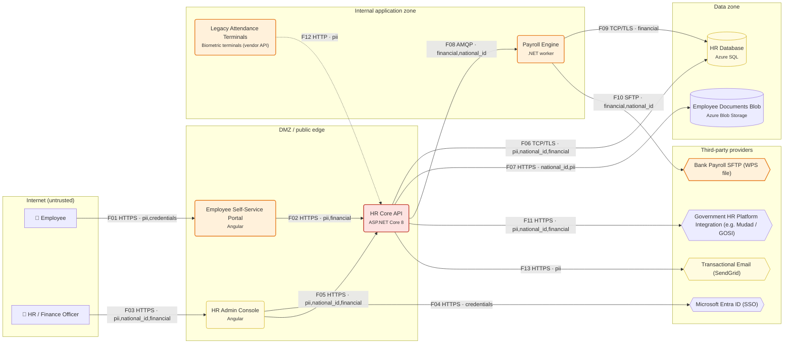

# Threat Model Report — Masar HR & Payroll Portal

*Generated by ThreatLens v1.0.0 on 2026-10-08 20:22 · mode: `offline` · methodology: STRIDE + OWASP Top 10 2021 / ASVS 4.0.3 / CWE*

> Cloud HR and payroll portal for a 350-employee Saudi contracting company. Employees view payslips, request leave and upload documents; HR manages contracts, Iqama/ID expiry and salaries; Finance generates the monthly WPS payroll file for the bank and syncs headcount with government platforms. Hosted on a KSA cloud region.

## 1. Executive summary

ThreatLens analysed **13 components** and **13 data flows** (11 crossing trust boundaries) of *Masar HR & Payroll Portal* and identified **25 threats**: 1 Critical, 15 High, 9 Medium, 0 Low, covering 8 of the 10 OWASP Top 10 2021 categories. The highest risks are **IDOR / Broken object-level authorization — HR Core API** (risk 25/25); **Weak session / token lifecycle — HR Core API** (risk 16/25); **Account takeover via single-factor authentication — HR Core API** (risk 16/25). Doing the **11 'Now' actions** (~19.0 developer-days) removes the most risk per day of effort; the full plan is ~34.5 developer-days.

| Critical | High | Medium | Low | Total | Remediation effort |
|---|---|---|---|---|---|
| 1 | 15 | 9 | 0 | 25 | 34.5 dev-days (19.0 urgent) |

| Context | |
|---|---|
| Industry | Fintech / HR SaaS |
| Region | Saudi Arabia (Riyadh) |
| Users | 350 employees, 6 HR & finance staff |
| Compliance context | Saudi PDPL (SDAIA), NCA Essential Cybersecurity Controls (ECC-2:2024), Wage Protection System (WPS / Mudad) payroll file requirements |

## 2. Asset & data-flow inventory

### 2.1 Components

| ID | Component | Type | Trust zone | Data | Auth | Internet-facing | Documented controls |
|---|---|---|---|---|---|---|---|
| `employee` | Employee | External entity (human actor) | internet | — | none | no | — |
| `hr_staff` | HR / Finance Officer | External entity (human actor) | internet | — | none | no | — |
| `portal` | Employee Self-Service Portal (Angular) | Web front end (SPA / server-rendered) | dmz | Personal data (PII), Financial data, Credentials / tokens | session | yes | tls, csp |
| `api` | HR Core API (ASP.NET Core 8) | Backend API | dmz | Personal data (PII), National ID / Iqama, Financial data, Credentials / tokens | jwt | yes | tls, rbac, input_validation, audit_logging, logging |
| `hr_admin` | HR Admin Console (Angular) | Back-office / admin dashboard | dmz | Personal data (PII), National ID / Iqama, Financial data | sso | yes | tls, mfa, csp |
| `entra` | Microsoft Entra ID (SSO) | Identity provider (SSO / OAuth) | third_party | Credentials / tokens | oauth | no | mfa |
| `payroll` | Payroll Engine (.NET worker) | Internal service / worker | internal | Financial data, National ID / Iqama, Personal data (PII) | none | no | — |
| `sql` | HR Database (Azure SQL) | Database | data | Personal data (PII), National ID / Iqama, Financial data | none | no | encryption_at_rest, backups |
| `docs` | Employee Documents Blob (Azure Blob Storage) | Object / file storage | data | National ID / Iqama, Personal data (PII) | none | no | encryption_at_rest, private_bucket |
| `attendance` | Legacy Attendance Terminals (Biometric terminals (vendor API)) | Internal service / worker | internal | Personal data (PII) | none | no | — |
| `bank_sftp` | Bank Payroll SFTP (WPS file) | Third-party service | third_party | Financial data, National ID / Iqama | api_key | no | — |
| `gov` | Government HR Platform Integration (e.g. Mudad / GOSI) | Third-party service | third_party | Personal data (PII), National ID / Iqama, Financial data | api_key | no | dpa |
| `email` | Transactional Email (SendGrid) | Third-party service | third_party | Personal data (PII) | api_key | no | otp_limits |

### 2.2 Data flows

| ID | From → To | Protocol | Data | Auth | Crosses boundary |
|---|---|---|---|---|---|
| F01 | Employee → Employee Self-Service Portal | HTTPS | pii, credentials | none | internet -> dmz |
| F02 | Employee Self-Service Portal → HR Core API | HTTPS | pii, financial | jwt | — |
| F03 | HR / Finance Officer → HR Admin Console | HTTPS | pii, national_id, financial | none | internet -> dmz |
| F04 | HR Admin Console → Microsoft Entra ID (SSO) | HTTPS | credentials | oauth | dmz -> third_party |
| F05 | HR Admin Console → HR Core API | HTTPS | pii, national_id, financial | jwt | — |
| F06 | HR Core API → HR Database | TCP/TLS | pii, national_id, financial | password | dmz -> data |
| F07 | HR Core API → Employee Documents Blob | HTTPS | national_id, pii | api_key | dmz -> data |
| F08 | HR Core API → Payroll Engine | AMQP | financial, national_id | none | dmz -> internal |
| F09 | Payroll Engine → HR Database | TCP/TLS | financial | password | internal -> data |
| F10 | Payroll Engine → Bank Payroll SFTP (WPS file) | SFTP | financial, national_id | api_key | internal -> third_party |
| F11 | HR Core API → Government HR Platform Integration (e.g. Mudad / GOSI) | HTTPS | pii, national_id, financial | api_key | dmz -> third_party |
| F12 | Legacy Attendance Terminals → HR Core API | HTTP | pii | none | internal -> dmz |
| F13 | HR Core API → Transactional Email (SendGrid) | HTTPS | pii | api_key | dmz -> third_party |

### 2.3 Trust boundaries

- **Internet (untrusted)**: Employee, HR / Finance Officer
- **DMZ / public edge**: Employee Self-Service Portal, HR Core API, HR Admin Console
- **Internal application zone**: Payroll Engine, Legacy Attendance Terminals
- **Data zone**: HR Database, Employee Documents Blob
- **Third-party providers**: Microsoft Entra ID (SSO), Bank Payroll SFTP (WPS file), Government HR Platform Integration (e.g. Mudad / GOSI), Transactional Email (SendGrid)
- **Crown-jewel data stores**: HR Database, Employee Documents Blob

## 3. Data-flow diagram

Dashed arrows = unencrypted transport. Red/orange/yellow nodes = worst open Critical/High/Medium risk.

## 4. Findings (risk-ranked)

| ID | Severity | Risk (L×I) | STRIDE | Threat | Target | OWASP Top 10 | CWE |
|---|---|---|---|---|---|---|---|
| TL-001 | **Critical** | 25 (5×5) | Information Disclosure | IDOR / Broken object-level authorization — HR Core API | HR Core API | A01:2021 | CWE-639, CWE-862 |
| TL-002 | **High** | 16 (4×4) | Spoofing | Weak session / token lifecycle — HR Core API | HR Core API | A07:2021 | CWE-613 |
| TL-003 | **High** | 16 (4×4) | Spoofing | Account takeover via single-factor authentication — HR Core API | HR Core API | A07:2021 | CWE-308, CWE-287 |
| TL-004 | **High** | 16 (4×4) | Spoofing | Account takeover via single-factor authentication — Employee Self-Service Portal | Employee Self-Service Portal | A07:2021 | CWE-308, CWE-287 |
| TL-005 | **High** | 16 (4×4) | Spoofing | Credential stuffing / brute force on login and OTP — HR Core API | HR Core API | A07:2021 | CWE-307 |
| TL-006 | **High** | 16 (4×4) | Spoofing | Credential stuffing / brute force on login and OTP — Employee Self-Service Portal | Employee Self-Service Portal | A07:2021 | CWE-307 |
| TL-007 | **High** | 16 (4×4) | Tampering | Cross-site request forgery on cookie-based session — Employee Self-Service Portal | Employee Self-Service Portal | A01:2021 | CWE-352 |
| TL-008 | **High** | 15 (3×5) | Tampering | Batch payment / payroll file tampering before upload — Payroll Engine → Bank Payroll SFTP (WPS file) | F10: Payroll Engine → Bank Payroll SFTP (WPS file) | A08:2021 | CWE-345, CWE-494 |
| TL-009 | **High** | 15 (3×5) | Tampering | Malicious file upload — HR Core API | HR Core API | A04:2021 | CWE-434 |
| TL-010 | **High** | 15 (3×5) | Information Disclosure | Secrets in source code / server env files | System-wide | A07:2021 | CWE-798 |
| TL-011 | **High** | 12 (3×4) | Spoofing | Unauthenticated call across a trust boundary — HR Core API → Payroll Engine | F08: HR Core API → Payroll Engine | A07:2021 | CWE-306 |
| TL-012 | **High** | 12 (3×4) | Spoofing | Unauthenticated access to internal service — Legacy Attendance Terminals | Legacy Attendance Terminals | A07:2021 | CWE-306 |
| TL-013 | **High** | 12 (3×4) | Spoofing | Unauthenticated access to internal service — Payroll Engine | Payroll Engine | A07:2021 | CWE-306 |
| TL-014 | **High** | 12 (3×4) | Tampering | Vulnerable third-party libraries (no SCA) | System-wide | A06:2021 | CWE-1104 |
| TL-015 | **High** | 12 (3×4) | Information Disclosure | Sensitive data sent in cleartext — Legacy Attendance Terminals → HR Core API | F12: Legacy Attendance Terminals → HR Core API | A02:2021 | CWE-319 |
| TL-016 | **High** | 12 (4×3) | Denial of Service | Resource exhaustion on public API — HR Core API | HR Core API | A04:2021 | CWE-770 |
| TL-017 | **Medium** | 10 (2×5) | Repudiation | Sensitive logs leak data — HR Core API | HR Core API | A09:2021 | CWE-532 |
| TL-018 | **Medium** | 9 (3×3) | Repudiation | No audit trail for access to sensitive records — HR Admin Console | HR Admin Console | A09:2021 | CWE-778 |
| TL-019 | **Medium** | 9 (3×3) | Information Disclosure | Personal data shared with third party beyond need — Bank Payroll SFTP (WPS file) | Bank Payroll SFTP (WPS file) | A01:2021 | CWE-359 |
| TL-020 | **Medium** | 9 (3×3) | Information Disclosure | Personal data shared with third party beyond need — Transactional Email (SendGrid) | Transactional Email (SendGrid) | A01:2021 | CWE-359 |
| TL-021 | **Medium** | 8 (2×4) | Tampering | SQL / NoSQL injection into backend data store — Payroll Engine | Payroll Engine | A03:2021 | CWE-89 |
| TL-022 | **Medium** | 8 (4×2) | Information Disclosure | Verbose errors / debug mode in production — HR Core API | HR Core API | A04:2021 | CWE-209 |
| TL-023 | **Medium** | 8 (4×2) | Information Disclosure | Verbose errors / debug mode in production — HR Admin Console | HR Admin Console | A04:2021 | CWE-209 |
| TL-024 | **Medium** | 8 (4×2) | Information Disclosure | Verbose errors / debug mode in production — Employee Self-Service Portal | Employee Self-Service Portal | A04:2021 | CWE-209 |
| TL-025 | **Medium** | 8 (2×4) | Elevation of Privilege | Over-privileged database account — HR Database | HR Database | A01:2021 | CWE-250 |

### 4.1 Finding details

#### TL-001 — IDOR / Broken object-level authorization — HR Core API

- **Severity:** Critical (likelihood 5/5 × impact 5/5 = 25/25)
- **STRIDE:** Information Disclosure · **Target:** HR Core API
- **OWASP Top 10 2021:** A01:2021 Broken Access Control
- **OWASP ASVS 4.0.3:** V4.2 Operation Level Access Control
- **CWE:** CWE-639, CWE-862
- **Description:** HR Core API exposes records by ID (Personal data (PII), National ID / Iqama, Financial data, Credentials / tokens). If ownership is not checked server-side, changing an ID returns another customer's data.
- **Evidence / basis:** `type=api, zone=dmz, auth=jwt, controls=['tls', 'rbac', 'input_validation', 'audit_logging', 'logging']`
- **Mitigation:** Object-level authorization on every record access (anti-IDOR/BOLA).

#### TL-002 — Weak session / token lifecycle — HR Core API

- **Severity:** High (likelihood 4/5 × impact 4/5 = 16/25)
- **STRIDE:** Spoofing · **Target:** HR Core API
- **OWASP Top 10 2021:** A07:2021 Identification and Authentication Failures
- **OWASP ASVS 4.0.3:** V3.3 Session Termination; V3.5 Token-based Session Management
- **CWE:** CWE-613
- **Description:** HR Core API uses jwt tokens; without expiry, rotation and server-side revocation a stolen token stays valid indefinitely.
- **Evidence / basis:** `type=api, zone=dmz, auth=jwt, controls=['tls', 'rbac', 'input_validation', 'audit_logging', 'logging']`
- **Mitigation:** Harden session & token lifecycle.

#### TL-003 — Account takeover via single-factor authentication — HR Core API

- **Severity:** High (likelihood 4/5 × impact 4/5 = 16/25)
- **STRIDE:** Spoofing · **Target:** HR Core API
- **OWASP Top 10 2021:** A07:2021 Identification and Authentication Failures
- **OWASP ASVS 4.0.3:** V2.1 Password Security; V2.8 One Time Verifier
- **CWE:** CWE-308, CWE-287
- **Description:** HR Core API authenticates users with jwt only. Phished, reused or leaked passwords give an attacker full access to Personal data (PII), National ID / Iqama, Financial data, Credentials / tokens.
- **Evidence / basis:** `type=api, zone=dmz, auth=jwt, controls=['tls', 'rbac', 'input_validation', 'audit_logging', 'logging']`
- **Mitigation:** Enforce MFA for privileged and staff accounts.

#### TL-004 — Account takeover via single-factor authentication — Employee Self-Service Portal

- **Severity:** High (likelihood 4/5 × impact 4/5 = 16/25)
- **STRIDE:** Spoofing · **Target:** Employee Self-Service Portal
- **OWASP Top 10 2021:** A07:2021 Identification and Authentication Failures
- **OWASP ASVS 4.0.3:** V2.1 Password Security; V2.8 One Time Verifier
- **CWE:** CWE-308, CWE-287
- **Description:** Employee Self-Service Portal authenticates users with session only. Phished, reused or leaked passwords give an attacker full access to Personal data (PII), Financial data, Credentials / tokens.
- **Evidence / basis:** `type=web_frontend, zone=dmz, auth=session, controls=['tls', 'csp']`
- **Mitigation:** Enforce MFA for privileged and staff accounts.

#### TL-005 — Credential stuffing / brute force on login and OTP — HR Core API

- **Severity:** High (likelihood 4/5 × impact 4/5 = 16/25)
- **STRIDE:** Spoofing · **Target:** HR Core API
- **OWASP Top 10 2021:** A07:2021 Identification and Authentication Failures
- **OWASP ASVS 4.0.3:** V2.2 General Authenticator Security
- **CWE:** CWE-307
- **Description:** No rate limiting is documented for HR Core API. Automated credential-stuffing or OTP guessing can take over accounts.
- **Evidence / basis:** `type=api, zone=dmz, auth=jwt, controls=['tls', 'rbac', 'input_validation', 'audit_logging', 'logging']`
- **Mitigation:** Rate limiting & anti-automation on auth/OTP/sensitive endpoints. Account lockout & credential-stuffing detection.

#### TL-006 — Credential stuffing / brute force on login and OTP — Employee Self-Service Portal

- **Severity:** High (likelihood 4/5 × impact 4/5 = 16/25)
- **STRIDE:** Spoofing · **Target:** Employee Self-Service Portal
- **OWASP Top 10 2021:** A07:2021 Identification and Authentication Failures
- **OWASP ASVS 4.0.3:** V2.2 General Authenticator Security
- **CWE:** CWE-307
- **Description:** No rate limiting is documented for Employee Self-Service Portal. Automated credential-stuffing or OTP guessing can take over accounts.
- **Evidence / basis:** `type=web_frontend, zone=dmz, auth=session, controls=['tls', 'csp']`
- **Mitigation:** Rate limiting & anti-automation on auth/OTP/sensitive endpoints. Account lockout & credential-stuffing detection.

#### TL-007 — Cross-site request forgery on cookie-based session — Employee Self-Service Portal

- **Severity:** High (likelihood 4/5 × impact 4/5 = 16/25)
- **STRIDE:** Tampering · **Target:** Employee Self-Service Portal
- **OWASP Top 10 2021:** A01:2021 Broken Access Control
- **OWASP ASVS 4.0.3:** V4.2 Operation Level Access Control; V3.4 Cookie-based Session Management
- **CWE:** CWE-352
- **Description:** Employee Self-Service Portal uses cookie sessions; state-changing requests could be forged from another site.
- **Evidence / basis:** `type=web_frontend, zone=dmz, auth=session, controls=['tls', 'csp']`
- **Mitigation:** CSRF protection for cookie sessions.

#### TL-008 — Batch payment / payroll file tampering before upload — Payroll Engine → Bank Payroll SFTP (WPS file)

- **Severity:** High (likelihood 3/5 × impact 5/5 = 15/25)
- **STRIDE:** Tampering · **Target:** F10: Payroll Engine → Bank Payroll SFTP (WPS file)
- **OWASP Top 10 2021:** A08:2021 Software and Data Integrity Failures
- **OWASP ASVS 4.0.3:** V10.3 Application Integrity; V11.1 Business Logic Security
- **CWE:** CWE-345, CWE-494
- **Description:** Flow Payroll Engine -> Bank Payroll SFTP (WPS file) transfers a SFTP file with Financial data, National ID / Iqama. Without a signature or checksum generated at source, an insider or compromised host can change IBANs or amounts before the bank / government platform processes it.
- **Evidence / basis:** `F10: sftp auth=api_key internal->third_party`
- **Mitigation:** Sign / checksum payroll and payment batch files at source.

#### TL-009 — Malicious file upload — HR Core API

- **Severity:** High (likelihood 3/5 × impact 5/5 = 15/25)
- **STRIDE:** Tampering · **Target:** HR Core API
- **OWASP Top 10 2021:** A04:2021 Insecure Design
- **OWASP ASVS 4.0.3:** V12.1 File Upload; V12.2 File Integrity
- **CWE:** CWE-434
- **Description:** HR Core API accepts file uploads (e.g. documents, images, lab results). Unrestricted uploads enable web shells, malware hosting and stored XSS.
- **Evidence / basis:** `type=api, zone=dmz, auth=jwt, controls=['tls', 'rbac', 'input_validation', 'audit_logging', 'logging']`
- **Mitigation:** Harden file uploads.

#### TL-010 — Secrets in source code / server env files

- **Severity:** High (likelihood 3/5 × impact 5/5 = 15/25)
- **STRIDE:** Information Disclosure · **Target:** System-wide
- **OWASP Top 10 2021:** A07:2021 Identification and Authentication Failures
- **OWASP ASVS 4.0.3:** V6.4 Secret Management; V14.1 Build and Deploy
- **CWE:** CWE-798
- **Description:** No secrets manager is documented. Payment-gateway keys, DB passwords and JWT signing keys tend to live in git or .env files.
- **Evidence / basis:** `global_controls=['tls', 'waf', 'backups', 'monitoring']`
- **Mitigation:** Move secrets to a secrets manager & rotate.

#### TL-011 — Unauthenticated call across a trust boundary — HR Core API → Payroll Engine

- **Severity:** High (likelihood 3/5 × impact 4/5 = 12/25)
- **STRIDE:** Spoofing · **Target:** F08: HR Core API → Payroll Engine
- **OWASP Top 10 2021:** A07:2021 Identification and Authentication Failures
- **OWASP ASVS 4.0.3:** V1.4 Access Control Architecture; V13.1 Generic Web Service Security
- **CWE:** CWE-306
- **Description:** Flow HR Core API -> Payroll Engine crosses from 'dmz' to 'internal' without authentication.
- **Evidence / basis:** `F08: amqp auth=none dmz->internal`
- **Mitigation:** Authenticate service-to-service traffic.

#### TL-012 — Unauthenticated access to internal service — Legacy Attendance Terminals

- **Severity:** High (likelihood 3/5 × impact 4/5 = 12/25)
- **STRIDE:** Spoofing · **Target:** Legacy Attendance Terminals
- **OWASP Top 10 2021:** A07:2021 Identification and Authentication Failures
- **OWASP ASVS 4.0.3:** V1.4 Access Control Architecture; V9.2 Server Communication Security
- **CWE:** CWE-306
- **Description:** Legacy Attendance Terminals accepts connections without authentication. Any foothold in the network can call it directly.
- **Evidence / basis:** `type=service, zone=internal, auth=none, controls=none documented`
- **Mitigation:** Authenticate service-to-service traffic.

#### TL-013 — Unauthenticated access to internal service — Payroll Engine

- **Severity:** High (likelihood 3/5 × impact 4/5 = 12/25)
- **STRIDE:** Spoofing · **Target:** Payroll Engine
- **OWASP Top 10 2021:** A07:2021 Identification and Authentication Failures
- **OWASP ASVS 4.0.3:** V1.4 Access Control Architecture; V9.2 Server Communication Security
- **CWE:** CWE-306
- **Description:** Payroll Engine accepts connections without authentication. Any foothold in the network can call it directly.
- **Evidence / basis:** `type=service, zone=internal, auth=none, controls=none documented`
- **Mitigation:** Authenticate service-to-service traffic.

#### TL-014 — Vulnerable third-party libraries (no SCA)

- **Severity:** High (likelihood 3/5 × impact 4/5 = 12/25)
- **STRIDE:** Tampering · **Target:** System-wide
- **OWASP Top 10 2021:** A06:2021 Vulnerable and Outdated Components
- **OWASP ASVS 4.0.3:** V14.2 Dependency
- **CWE:** CWE-1104
- **Description:** No dependency scanning is documented for the custom code (npm/composer/pip/pub). Known-vulnerable packages are a common entry point.
- **Evidence / basis:** `global_controls=['tls', 'waf', 'backups', 'monitoring']`
- **Mitigation:** Dependency scanning & patching cadence (SCA).

#### TL-015 — Sensitive data sent in cleartext — Legacy Attendance Terminals → HR Core API

- **Severity:** High (likelihood 3/5 × impact 4/5 = 12/25)
- **STRIDE:** Information Disclosure · **Target:** F12: Legacy Attendance Terminals → HR Core API
- **OWASP Top 10 2021:** A02:2021 Cryptographic Failures
- **OWASP ASVS 4.0.3:** V9.1 Client Communication Security; V9.2 Server Communication Security
- **CWE:** CWE-319
- **Description:** Flow Legacy Attendance Terminals -> HR Core API uses HTTP and carries Personal data (PII). Anyone on the path (Wi-Fi, ISP, internal network) can read or modify it.
- **Evidence / basis:** `F12: http auth=none internal->dmz`
- **Mitigation:** Encrypt all data in transit (TLS 1.2+).

#### TL-016 — Resource exhaustion on public API — HR Core API

- **Severity:** High (likelihood 4/5 × impact 3/5 = 12/25)
- **STRIDE:** Denial of Service · **Target:** HR Core API
- **OWASP Top 10 2021:** A04:2021 Insecure Design
- **OWASP ASVS 4.0.3:** V11.1 Business Logic Security; V13.1 Generic Web Service Security
- **CWE:** CWE-770
- **Description:** HR Core API is internet-facing without documented rate limits; scraping or floods can take the service down or inflate cloud bills.
- **Evidence / basis:** `type=api, zone=dmz, auth=jwt, controls=['tls', 'rbac', 'input_validation', 'audit_logging', 'logging']`
- **Mitigation:** Rate limiting & anti-automation on auth/OTP/sensitive endpoints.

#### TL-017 — Sensitive logs leak data — HR Core API

- **Severity:** Medium (likelihood 2/5 × impact 5/5 = 10/25)
- **STRIDE:** Repudiation · **Target:** HR Core API
- **OWASP Top 10 2021:** A09:2021 Security Logging and Monitoring Failures
- **OWASP ASVS 4.0.3:** V7.1 Log Content
- **CWE:** CWE-532
- **Description:** HR Core API logs requests, but log redaction is not documented. Logs become a second, poorly-protected copy of Personal data (PII), National ID / Iqama, Financial data, Credentials / tokens.
- **Evidence / basis:** `type=api, zone=dmz, auth=jwt, controls=['tls', 'rbac', 'input_validation', 'audit_logging', 'logging']`
- **Mitigation:** Redact sensitive fields from logs.

#### TL-018 — No audit trail for access to sensitive records — HR Admin Console

- **Severity:** Medium (likelihood 3/5 × impact 3/5 = 9/25)
- **STRIDE:** Repudiation · **Target:** HR Admin Console
- **OWASP Top 10 2021:** A09:2021 Security Logging and Monitoring Failures
- **OWASP ASVS 4.0.3:** V7.1 Log Content; V7.2 Log Processing
- **CWE:** CWE-778
- **Description:** HR Admin Console processes Personal data (PII), National ID / Iqama, Financial data but no audit logging is documented. Insider misuse or a breach cannot be investigated or proven.
- **Evidence / basis:** `type=admin_panel, zone=dmz, auth=sso, controls=['tls', 'mfa', 'csp']`
- **Mitigation:** Tamper-evident audit log for sensitive actions.

#### TL-019 — Personal data shared with third party beyond need — Bank Payroll SFTP (WPS file)

- **Severity:** Medium (likelihood 3/5 × impact 3/5 = 9/25)
- **STRIDE:** Information Disclosure · **Target:** Bank Payroll SFTP (WPS file)
- **OWASP Top 10 2021:** A01:2021 Broken Access Control
- **OWASP ASVS 4.0.3:** V8.3 Sensitive Private Data
- **CWE:** CWE-359
- **Description:** Bank Payroll SFTP (WPS file) receives Financial data, National ID / Iqama. Over-sharing with processors without a DPA creates privacy and regulatory exposure (Egypt PDPL / KSA PDPL).
- **Evidence / basis:** `type=third_party, zone=third_party, auth=api_key, controls=none documented`
- **Mitigation:** Data minimization & DPA with third parties.

#### TL-020 — Personal data shared with third party beyond need — Transactional Email (SendGrid)

- **Severity:** Medium (likelihood 3/5 × impact 3/5 = 9/25)
- **STRIDE:** Information Disclosure · **Target:** Transactional Email (SendGrid)
- **OWASP Top 10 2021:** A01:2021 Broken Access Control
- **OWASP ASVS 4.0.3:** V8.3 Sensitive Private Data
- **CWE:** CWE-359
- **Description:** Transactional Email (SendGrid) receives Personal data (PII). Over-sharing with processors without a DPA creates privacy and regulatory exposure (Egypt PDPL / KSA PDPL).
- **Evidence / basis:** `type=third_party, zone=third_party, auth=api_key, controls=['otp_limits']`
- **Mitigation:** Data minimization & DPA with third parties.

#### TL-021 — SQL / NoSQL injection into backend data store — Payroll Engine

- **Severity:** Medium (likelihood 2/5 × impact 4/5 = 8/25)
- **STRIDE:** Tampering · **Target:** Payroll Engine
- **OWASP Top 10 2021:** A03:2021 Injection
- **OWASP ASVS 4.0.3:** V5.3 Output Encoding and Injection Prevention
- **CWE:** CWE-89
- **Description:** Payroll Engine builds queries against a data store and no input-validation / parameterization control is documented.
- **Evidence / basis:** `type=service, zone=internal, auth=none, controls=none documented`
- **Mitigation:** Parameterized queries / ORM-only data access. Schema-based input validation & allow-listed fields.

#### TL-022 — Verbose errors / debug mode in production — HR Core API

- **Severity:** Medium (likelihood 4/5 × impact 2/5 = 8/25)
- **STRIDE:** Information Disclosure · **Target:** HR Core API
- **OWASP Top 10 2021:** A04:2021 Insecure Design
- **OWASP ASVS 4.0.3:** V7.4 Error Handling
- **CWE:** CWE-209
- **Description:** HR Core API: stack traces and framework debug pages disclose internals and sometimes secrets.
- **Evidence / basis:** `type=api, zone=dmz, auth=jwt, controls=['tls', 'rbac', 'input_validation', 'audit_logging', 'logging']`
- **Mitigation:** Generic error responses, no stack traces in production.

#### TL-023 — Verbose errors / debug mode in production — HR Admin Console

- **Severity:** Medium (likelihood 4/5 × impact 2/5 = 8/25)
- **STRIDE:** Information Disclosure · **Target:** HR Admin Console
- **OWASP Top 10 2021:** A04:2021 Insecure Design
- **OWASP ASVS 4.0.3:** V7.4 Error Handling
- **CWE:** CWE-209
- **Description:** HR Admin Console: stack traces and framework debug pages disclose internals and sometimes secrets.
- **Evidence / basis:** `type=admin_panel, zone=dmz, auth=sso, controls=['tls', 'mfa', 'csp']`
- **Mitigation:** Generic error responses, no stack traces in production.

#### TL-024 — Verbose errors / debug mode in production — Employee Self-Service Portal

- **Severity:** Medium (likelihood 4/5 × impact 2/5 = 8/25)
- **STRIDE:** Information Disclosure · **Target:** Employee Self-Service Portal
- **OWASP Top 10 2021:** A04:2021 Insecure Design
- **OWASP ASVS 4.0.3:** V7.4 Error Handling
- **CWE:** CWE-209
- **Description:** Employee Self-Service Portal: stack traces and framework debug pages disclose internals and sometimes secrets.
- **Evidence / basis:** `type=web_frontend, zone=dmz, auth=session, controls=['tls', 'csp']`
- **Mitigation:** Generic error responses, no stack traces in production.

#### TL-025 — Over-privileged database account — HR Database

- **Severity:** Medium (likelihood 2/5 × impact 4/5 = 8/25)
- **STRIDE:** Elevation of Privilege · **Target:** HR Database
- **OWASP Top 10 2021:** A01:2021 Broken Access Control
- **OWASP ASVS 4.0.3:** V1.4 Access Control Architecture
- **CWE:** CWE-250
- **Description:** HR Database: applications typically connect with owner/DBA rights; any injection becomes full database compromise.
- **Evidence / basis:** `type=database, zone=data, auth=none, controls=['encryption_at_rest', 'backups']`
- **Mitigation:** Least-privilege database accounts.

## 5. Prioritised remediation plan

Ordered by phase, then by the highest risk each action closes, then by risk removed per developer-day. Effort assumes a small (2-5 developer) SME team.

| # | Phase | Action | Owner | Effort (dev-days) | Fixes | Risk points removed |
|---|---|---|---|---|---|---|
| 1 | Now (0-2 weeks) | **Object-level authorization on every record access (anti-IDOR/BOLA)** — Central policy check that the caller owns / may access the record; use non-guessable IDs; add automated authz tests. | Backend | 4 | TL-001 | 25 |
| 2 | Now (0-2 weeks) | **Rate limiting & anti-automation on auth/OTP/sensitive endpoints** — Per-IP and per-account limits at the gateway (e.g. Nginx/Cloudflare) plus progressive delays and CAPTCHA after failures. | DevOps | 1 | TL-005, TL-006, TL-016 | 44 |
| 3 | Now (0-2 weeks) | **Account lockout & credential-stuffing detection** — Temporary lockout, breached-password check (HIBP k-anonymity), alert on spikes of failed logins. | Backend | 1 | TL-005, TL-006 | 32 |
| 4 | Now (0-2 weeks) | **Enforce MFA for privileged and staff accounts** — TOTP / passkeys for admin, doctor, finance and HR roles; SMS OTP only as fallback. | Backend | 2 | TL-003, TL-004 | 32 |
| 5 | Now (0-2 weeks) | **CSRF protection for cookie sessions** — SameSite=Lax/Strict cookies and anti-CSRF tokens on state-changing requests. | Backend | 1 | TL-007 | 16 |
| 6 | Now (0-2 weeks) | **Harden session & token lifecycle** — Short-lived access tokens, refresh token rotation, server-side revocation on logout / password change. | Backend | 2 | TL-002 | 16 |
| 7 | Now (0-2 weeks) | **Sign / checksum payroll and payment batch files at source** — Generate the WPS/bank file in one service, sign it (or HMAC + maker-checker approval), verify before upload, alert on IBAN changes. | Backend | 2 | TL-008 | 15 |
| 8 | Now (0-2 weeks) | **Harden file uploads** — Type/size allow-list, re-encode images, malware scan, store outside web root with random names, serve via signed URLs. | Backend | 2 | TL-009 | 15 |
| 9 | Now (0-2 weeks) | **Move secrets to a secrets manager & rotate** — Vault / AWS Secrets Manager / Doppler, no keys in git or .env on servers, secret scanning in CI. | DevOps | 2 | TL-010 | 15 |
| 10 | Now (0-2 weeks) | **Dependency scanning & patching cadence (SCA)** — Dependabot/Renovate + OSV/Trivy in CI, monthly patch window. | DevOps | 1 | TL-014 | 12 |
| 11 | Now (0-2 weeks) | **Encrypt all data in transit (TLS 1.2+)** — HTTPS/SFTP/TLS everywhere incl. internal hops carrying sensitive data; HSTS on public sites. | DevOps | 1 | TL-015 | 12 |
| 12 | Next (30 days) | **Authenticate service-to-service traffic** — mTLS or signed service tokens between internal services; network policies. | DevOps | 3 | TL-011, TL-012, TL-013 | 36 |
| 13 | Next (30 days) | **Redact sensitive fields from logs** — Mask national IDs, card data, tokens and medical details in application and gateway logs. | Backend | 1 | TL-017 | 10 |
| 14 | Next (30 days) | **Generic error responses, no stack traces in production** — Global exception handler, debug mode off, correlation IDs instead of details. | Backend | 0.5 | TL-022, TL-023, TL-024 | 24 |
| 15 | Next (30 days) | **Least-privilege database accounts** — Separate read/write accounts per service, no app access with DBA rights, no direct internet exposure. | DevOps | 1 | TL-025 | 8 |
| 16 | Later (90 days) | **Data minimization & DPA with third parties** — Send only the fields the provider needs; sign a data-processing agreement (Egypt PDPL 151/2020, KSA PDPL). | Product/Legal | 2 | TL-019, TL-020 | 18 |
| 17 | Later (90 days) | **Tamper-evident audit log for sensitive actions** — Log who/what/when for access to patient/employee/payment records and admin changes; ship to append-only storage. | Backend | 3 | TL-018 | 9 |
| 18 | Later (90 days) | **Parameterized queries / ORM-only data access** — Ban string-built SQL, add SAST rule (Semgrep) in CI. | Backend | 2 | TL-021 | 8 |
| 19 | Later (90 days) | **Schema-based input validation & allow-listed fields** — Validate every request body against a schema (pydantic/Joi/FormRequest); block mass assignment with explicit DTOs. | Backend | 3 | TL-021 | 8 |

**Effort by phase:** Now (0-2 weeks): 19 dev-days · Next (30 days): 5.5 dev-days · Later (90 days): 10 dev-days

## 6. Coverage

| STRIDE category | Findings |
|---|---|
| Spoofing | 8 |
| Tampering | 5 |
| Repudiation | 2 |
| Information Disclosure | 8 |
| Denial of Service | 1 |
| Elevation of Privilege | 1 |

**OWASP Top 10 2021 categories hit:** A01:2021 Broken Access Control, A02:2021 Cryptographic Failures, A03:2021 Injection, A04:2021 Insecure Design, A06:2021 Vulnerable and Outdated Components, A07:2021 Identification and Authentication Failures, A08:2021 Software and Data Integrity Failures, A09:2021 Security Logging and Monitoring Failures

**CWE ids referenced:** CWE-89, CWE-209, CWE-250, CWE-287, CWE-306, CWE-307, CWE-308, CWE-319, CWE-345, CWE-352, CWE-359, CWE-434, CWE-494, CWE-532, CWE-613, CWE-639, CWE-770, CWE-778, CWE-798, CWE-862, CWE-1104

## 7. Assumptions, limitations & reviewer notes

- Crown-jewel store 'docs' has no findings; confirm its controls with evidence.
- No controls documented for: Payroll Engine, Legacy Attendance Terminals. Conservative assumptions were applied.
- Controls not listed in the input are treated as absent; findings for controls that already exist can be closed with evidence.
- This is a design-level threat model, not a penetration test. Validate Critical/High items with testing.

## 8. Agent trace

How the agent reached these results (plan → tools → reflect)

| Step | Actor | Tool / action | Reasoning | Result |
|---|---|---|---|---|
| 1 | agent | plan | Plan: parse input -> inventory assets & trust boundaries -> STRIDE per component -> data flows -> system checks -> map OWASP/ASVS/CWE -> score risk -> reflect & repair gaps -> remediation plan -> DFD  | |
| 2 | planner | `parse_architecture` | Normalise the input into components and flows. | `{"system": "Masar HR & Payroll Portal", "components": 13, "flows": 13, "endpoints": 0, "source": "yaml", "comp` |
| 3 | planner | `enumerate_components` | Inventory assets, data classes and trust boundaries. | `{"assets": 13, "trust_zones": ["internet", "dmz", "internal", "data", "third_party"], "boundary_crossings": 11` |
| 4 | planner | `stride_analyze_component`(component_id=portal) | Apply STRIDE to Employee Self-Service Portal (web_frontend). | `{"component": "portal", "new_findings": [{"id": "TMP-001", "stride": "S", "title": "Account takeover via singl` |
| 5 | planner | `stride_analyze_component`(component_id=api) | Apply STRIDE to HR Core API (api). | `{"component": "api", "new_findings": [{"id": "TMP-005", "stride": "S", "title": "Account takeover via single-f` |
| 6 | planner | `stride_analyze_component`(component_id=hr_admin) | Apply STRIDE to HR Admin Console (admin_panel). | `{"component": "hr_admin", "new_findings": [{"id": "TMP-013", "stride": "R", "title": "No audit trail for acces` |
| 7 | planner | `stride_analyze_component`(component_id=entra) | Apply STRIDE to Microsoft Entra ID (SSO) (identity_provider). | `{"component": "entra", "new_findings": [], "stride_covered": []}` |
| 8 | planner | `stride_analyze_component`(component_id=payroll) | Apply STRIDE to Payroll Engine (service). | `{"component": "payroll", "new_findings": [{"id": "TMP-015", "stride": "S", "title": "Unauthenticated access to` |
| 9 | planner | `stride_analyze_component`(component_id=sql) | Apply STRIDE to HR Database (database). | `{"component": "sql", "new_findings": [{"id": "TMP-017", "stride": "E", "title": "Over-privileged database acco` |
| 10 | planner | `stride_analyze_component`(component_id=docs) | Apply STRIDE to Employee Documents Blob (object_storage). | `{"component": "docs", "new_findings": [], "stride_covered": []}` |
| 11 | planner | `stride_analyze_component`(component_id=attendance) | Apply STRIDE to Legacy Attendance Terminals (service). | `{"component": "attendance", "new_findings": [{"id": "TMP-018", "stride": "S", "title": "Unauthenticated access` |
| 12 | planner | `stride_analyze_component`(component_id=bank_sftp) | Apply STRIDE to Bank Payroll SFTP (WPS file) (third_party). | `{"component": "bank_sftp", "new_findings": [{"id": "TMP-019", "stride": "I", "title": "Personal data shared wi` |
| 13 | planner | `stride_analyze_component`(component_id=gov) | Apply STRIDE to Government HR Platform Integration (e.g. Mudad / GOSI) (third_party). | `{"component": "gov", "new_findings": [], "stride_covered": []}` |
| 14 | planner | `stride_analyze_component`(component_id=email) | Apply STRIDE to Transactional Email (SendGrid) (third_party). | `{"component": "email", "new_findings": [{"id": "TMP-020", "stride": "I", "title": "Personal data shared with t` |
| 15 | planner | `analyze_data_flows` | Check every data flow and boundary crossing. | `{"flows_checked": 13, "new_findings": [{"id": "TMP-021", "title": "Unauthenticated call across a trust boundar` |
| 16 | planner | `analyze_system` | System-wide checks (secrets, monitoring, dependencies). | `{"new_findings": [{"id": "TMP-024", "title": "Secrets in source code / server env files"}, {"id": "TMP-025", "` |
| 17 | planner | `map_to_owasp` | Map findings to OWASP Top 10 / ASVS / CWE. | `{"mapped": 25, "total": 25}` |
| 18 | planner | `score_risk` | Score likelihood x impact. | `{"scored": 25, "by_severity": {"Critical": 1, "High": 15, "Medium": 9, "Low": 0}, "top": [{"id": "TL-001", "ri` |
| 19 | planner | `reflect` | Self-check coverage before writing the plan. | `{"iteration": 1, "gaps": [], "notes": ["Crown-jewel store 'docs' has no findings; confirm its controls with ev` |
| 20 | planner | `build_remediation_plan` | Prioritise fixes by risk reduced per effort-day. | `{"actions": 19, "effort_days_by_phase": {"Now (0-2 weeks)": 19.0, "Next (30 days)": 5.5, "Later (90 days)": 10` |
| 21 | planner | `render_diagram` | Draw the data-flow diagram with trust boundaries. | `{"lines": 43, "highlighted": 9}` |

---
*ThreatLens — AI threat modeling for SMEs. Author: Ahmed Alaa Eldin. MIT License.*
