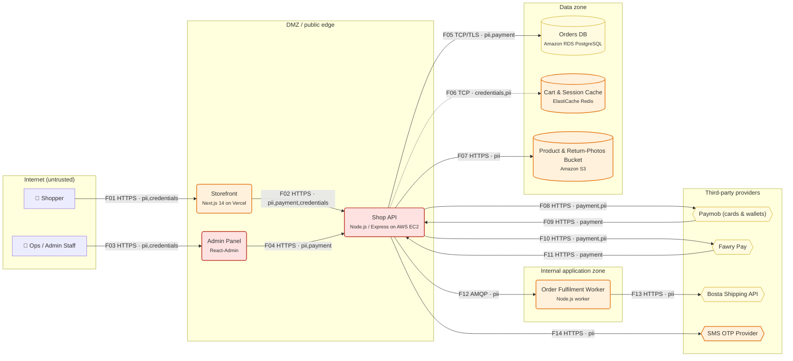

# Threat Model Report — Nile Threads E-commerce Store

*Generated by ThreatLens v1.0.0 on 2026-10-08 20:22 · mode: `offline` · methodology: STRIDE + OWASP Top 10 2021 / ASVS 4.0.3 / CWE*

> D2C fashion brand selling across Egypt. Next.js storefront, Node.js/Express API, PostgreSQL, Redis cart cache, Paymob (cards, Vodafone Cash wallets) and Fawry Pay (pay at kiosk) for payments, Bosta for last-mile delivery, and an admin panel for the 4-person ops team. Peak traffic during Ramadan and White Friday campaigns.

## 1. Executive summary

ThreatLens analysed **13 components** and **14 data flows** (12 crossing trust boundaries) of *Nile Threads E-commerce Store* and identified **43 threats**: 10 Critical, 22 High, 11 Medium, 0 Low, covering 10 of the 10 OWASP Top 10 2021 categories. The highest risks are **API operations without any security requirement (3 endpoints)** (risk 25/25); **Unsigned webhook / callback endpoints (2 endpoints)** (risk 25/25); **Forged webhook / callback from third party — Paymob (cards & wallets) → Shop API** (risk 25/25). Doing the **18 'Now' actions** (~29.5 developer-days) removes the most risk per day of effort; the full plan is ~43.0 developer-days.

| Critical | High | Medium | Low | Total | Remediation effort |
|---|---|---|---|---|---|
| 10 | 22 | 11 | 0 | 43 | 43.0 dev-days (29.5 urgent) |

| Context | |
|---|---|
| Industry | Retail / E-commerce |
| Region | Egypt |
| Users | ~120k customers, 8 staff |
| Compliance context | PCI DSS v4.0 (SAQ A-EP scope; card data entered on Paymob iframe), Egypt Personal Data Protection Law 151/2020, Egypt Consumer Protection Law 181/2018 |

## 2. Asset & data-flow inventory

### 2.1 Components

| ID | Component | Type | Trust zone | Data | Auth | Internet-facing | Documented controls |
|---|---|---|---|---|---|---|---|
| `shopper` | Shopper | External entity (human actor) | internet | — | none | no | — |
| `ops` | Ops / Admin Staff | External entity (human actor) | internet | — | none | no | — |
| `storefront` | Storefront (Next.js 14 on Vercel) | Web front end (SPA / server-rendered) | dmz | Personal data (PII), Credentials / tokens | jwt | yes | tls, csp |
| `api` | Shop API (Node.js / Express on AWS EC2) | Backend API | dmz | Personal data (PII), Payment data, Credentials / tokens | jwt | yes | tls, logging, input_validation |
| `admin` | Admin Panel (React-Admin) | Back-office / admin dashboard | dmz | Personal data (PII), Payment data | password | yes | tls |
| `worker` | Order Fulfilment Worker (Node.js worker) | Internal service / worker | internal | Personal data (PII) | none | no | — |
| `pg` | Orders DB (Amazon RDS PostgreSQL) | Database | data | Personal data (PII), Payment data | none | no | encryption_at_rest, backups |
| `redis` | Cart & Session Cache (ElastiCache Redis) | Cache | data | Credentials / tokens, Personal data (PII) | none | no | — |
| `s3` | Product & Return-Photos Bucket (Amazon S3) | Object / file storage | data | Personal data (PII) | none | no | encryption_at_rest |
| `paymob` | Paymob (cards & wallets) | Third-party service | third_party | Payment data, Personal data (PII) | api_key | no | — |
| `fawry` | Fawry Pay | Third-party service | third_party | Payment data, Personal data (PII) | api_key | no | — |
| `bosta` | Bosta Shipping API | Third-party service | third_party | Personal data (PII) | api_key | no | — |
| `sms` | SMS OTP Provider | Third-party service | third_party | Personal data (PII) | api_key | no | — |

### 2.2 Data flows

| ID | From → To | Protocol | Data | Auth | Crosses boundary |
|---|---|---|---|---|---|
| F01 | Shopper → Storefront | HTTPS | pii, credentials | none | internet -> dmz |
| F02 | Storefront → Shop API | HTTPS | pii, payment, credentials | jwt | — |
| F03 | Ops / Admin Staff → Admin Panel | HTTPS | pii, credentials | none | internet -> dmz |
| F04 | Admin Panel → Shop API | HTTPS | pii, payment | jwt | — |
| F05 | Shop API → Orders DB | TCP/TLS | pii, payment | password | dmz -> data |
| F06 | Shop API → Cart & Session Cache | TCP | credentials, pii | none | dmz -> data |
| F07 | Shop API → Product & Return-Photos Bucket | HTTPS | pii | api_key | dmz -> data |
| F08 | Shop API → Paymob (cards & wallets) | HTTPS | payment, pii | api_key | dmz -> third_party |
| F09 | Paymob (cards & wallets) → Shop API | HTTPS | payment | none | third_party -> dmz |
| F10 | Shop API → Fawry Pay | HTTPS | payment, pii | api_key | dmz -> third_party |
| F11 | Fawry Pay → Shop API | HTTPS | payment | none | third_party -> dmz |
| F12 | Shop API → Order Fulfilment Worker | AMQP | pii | none | dmz -> internal |
| F13 | Order Fulfilment Worker → Bosta Shipping API | HTTPS | pii | api_key | internal -> third_party |
| F14 | Shop API → SMS OTP Provider | HTTPS | pii | api_key | dmz -> third_party |

### 2.3 Trust boundaries

- **Internet (untrusted)**: Shopper, Ops / Admin Staff
- **DMZ / public edge**: Storefront, Shop API, Admin Panel
- **Internal application zone**: Order Fulfilment Worker
- **Data zone**: Orders DB, Cart & Session Cache, Product & Return-Photos Bucket
- **Third-party providers**: Paymob (cards & wallets), Fawry Pay, Bosta Shipping API, SMS OTP Provider
- **Crown-jewel data stores**: Orders DB, Cart & Session Cache, Product & Return-Photos Bucket

### 2.4 API surface (OpenAPI)

16 operations analysed; 8 declare no security scheme.

## 3. Data-flow diagram

Dashed arrows = unencrypted transport. Red/orange/yellow nodes = worst open Critical/High/Medium risk.

## 4. Findings (risk-ranked)

| ID | Severity | Risk (L×I) | STRIDE | Threat | Target | OWASP Top 10 | CWE |
|---|---|---|---|---|---|---|---|
| TL-001 | **Critical** | 25 (5×5) | Spoofing | API operations without any security requirement (3 endpoints) | Shop API | A07:2021 | CWE-306 |
| TL-002 | **Critical** | 25 (5×5) | Spoofing | Unsigned webhook / callback endpoints (2 endpoints) | Shop API | A08:2021 | CWE-345 |
| TL-003 | **Critical** | 25 (5×5) | Spoofing | Forged webhook / callback from third party — Paymob (cards & wallets) → Shop API | F09: Paymob (cards & wallets) → Shop API | A08:2021 | CWE-345 |
| TL-004 | **Critical** | 25 (5×5) | Spoofing | Forged webhook / callback from third party — Fawry Pay → Shop API | F11: Fawry Pay → Shop API | A08:2021 | CWE-345 |
| TL-005 | **Critical** | 25 (5×5) | Spoofing | Internet-exposed admin panel without MFA — Admin Panel | Admin Panel | A07:2021 | CWE-308, CWE-306 |
| TL-006 | **Critical** | 25 (5×5) | Information Disclosure | Endpoints addressing objects by ID (BOLA candidates) (6 endpoints) | Shop API | A01:2021 | CWE-639 |
| TL-007 | **Critical** | 25 (5×5) | Information Disclosure | IDOR / Broken object-level authorization — Shop API | Shop API | A01:2021 | CWE-639, CWE-862 |
| TL-008 | **Critical** | 20 (4×5) | Tampering | File-upload operations (1 endpoint) | Shop API | A04:2021 | CWE-434 |
| TL-009 | **Critical** | 20 (4×5) | Tampering | Payment amount / order tampering — Shop API | Shop API | A04:2021 | CWE-602, CWE-840 |
| TL-010 | **Critical** | 20 (4×5) | Elevation of Privilege | Server-side request forgery via outbound integrations — Shop API | Shop API | A10:2021 | CWE-918 |
| TL-011 | **High** | 16 (4×4) | Spoofing | Authentication / OTP endpoints need anti-automation (2 endpoints) | Shop API | A07:2021 | CWE-307 |
| TL-012 | **High** | 16 (4×4) | Spoofing | Weak session / token lifecycle — Shop API | Shop API | A07:2021 | CWE-613 |
| TL-013 | **High** | 16 (4×4) | Spoofing | Account takeover via single-factor authentication — Shop API | Shop API | A07:2021 | CWE-308, CWE-287 |
| TL-014 | **High** | 16 (4×4) | Spoofing | Account takeover via single-factor authentication — Storefront | Storefront | A07:2021 | CWE-308, CWE-287 |
| TL-015 | **High** | 16 (4×4) | Spoofing | Credential stuffing / brute force on login and OTP — Admin Panel | Admin Panel | A07:2021 | CWE-307 |
| TL-016 | **High** | 16 (4×4) | Spoofing | Credential stuffing / brute force on login and OTP — Shop API | Shop API | A07:2021 | CWE-307 |
| TL-017 | **High** | 16 (4×4) | Spoofing | Credential stuffing / brute force on login and OTP — Storefront | Storefront | A07:2021 | CWE-307 |
| TL-018 | **High** | 16 (4×4) | Tampering | Stored / reflected XSS in browser UI — Admin Panel | Admin Panel | A03:2021 | CWE-79 |
| TL-019 | **High** | 15 (3×5) | Spoofing | Unauthenticated call across a trust boundary — Shop API → Cart & Session Cache | F06: Shop API → Cart & Session Cache | A07:2021 | CWE-306 |
| TL-020 | **High** | 15 (3×5) | Tampering | Malicious file upload — Shop API | Shop API | A04:2021 | CWE-434 |
| TL-021 | **High** | 15 (3×5) | Information Disclosure | Sensitive data sent in cleartext — Shop API → Cart & Session Cache | F06: Shop API → Cart & Session Cache | A02:2021 | CWE-319 |
| TL-022 | **High** | 15 (3×5) | Information Disclosure | Unauthenticated cache exposes session / personal data — Cart & Session Cache | Cart & Session Cache | A05:2021, A07:2021 | CWE-524, CWE-306 |
| TL-023 | **High** | 15 (3×5) | Information Disclosure | Secrets in source code / server env files | System-wide | A07:2021 | CWE-798 |
| TL-024 | **High** | 15 (3×5) | Elevation of Privilege | Administrative API operations (3 endpoints) | Shop API | A01:2021 | CWE-285 |
| TL-025 | **High** | 15 (3×5) | Elevation of Privilege | Broken function-level authorization (user reaches admin functions) — Shop API | Shop API | A01:2021 | CWE-285, CWE-863 |
| TL-026 | **High** | 12 (3×4) | Spoofing | Unauthenticated call across a trust boundary — Shop API → Order Fulfilment Worker | F12: Shop API → Order Fulfilment Worker | A07:2021 | CWE-306 |
| TL-027 | **High** | 12 (3×4) | Spoofing | Unauthenticated access to internal service — Order Fulfilment Worker | Order Fulfilment Worker | A07:2021 | CWE-306 |
| TL-028 | **High** | 12 (3×4) | Tampering | Vulnerable third-party libraries (no SCA) | System-wide | A06:2021 | CWE-1104 |
| TL-029 | **High** | 12 (3×4) | Repudiation | No centralized security monitoring / alerting | System-wide | A09:2021 | CWE-778 |
| TL-030 | **High** | 12 (3×4) | Information Disclosure | Publicly readable storage bucket / predictable file URLs — Product & Return-Photos Bucket | Product & Return-Photos Bucket | A01:2021 | CWE-732, CWE-200 |
| TL-031 | **High** | 12 (4×3) | Denial of Service | Resource exhaustion on public API — Shop API | Shop API | A04:2021 | CWE-770 |
| TL-032 | **High** | 12 (4×3) | Denial of Service | SMS/WhatsApp OTP pumping & messaging abuse — SMS OTP Provider | SMS OTP Provider | A04:2021 | CWE-799 |
| TL-033 | **Medium** | 10 (2×5) | Repudiation | Sensitive logs leak data — Shop API | Shop API | A09:2021 | CWE-532 |
| TL-034 | **Medium** | 10 (2×5) | Elevation of Privilege | Over-privileged database account — Orders DB | Orders DB | A01:2021 | CWE-250 |
| TL-035 | **Medium** | 9 (3×3) | Repudiation | No audit trail for access to sensitive records — Admin Panel | Admin Panel | A09:2021 | CWE-778 |
| TL-036 | **Medium** | 9 (3×3) | Repudiation | No audit trail for access to sensitive records — Shop API | Shop API | A09:2021 | CWE-778 |
| TL-037 | **Medium** | 9 (3×3) | Information Disclosure | Personal data shared with third party beyond need — Bosta Shipping API | Bosta Shipping API | A01:2021 | CWE-359 |
| TL-038 | **Medium** | 9 (3×3) | Information Disclosure | Personal data shared with third party beyond need — Fawry Pay | Fawry Pay | A01:2021 | CWE-359 |
| TL-039 | **Medium** | 9 (3×3) | Information Disclosure | Personal data shared with third party beyond need — Paymob (cards & wallets) | Paymob (cards & wallets) | A01:2021 | CWE-359 |
| TL-040 | **Medium** | 9 (3×3) | Information Disclosure | Personal data shared with third party beyond need — SMS OTP Provider | SMS OTP Provider | A01:2021 | CWE-359 |
| TL-041 | **Medium** | 8 (4×2) | Information Disclosure | Verbose errors / debug mode in production — Admin Panel | Admin Panel | A04:2021 | CWE-209 |
| TL-042 | **Medium** | 8 (4×2) | Information Disclosure | Verbose errors / debug mode in production — Shop API | Shop API | A04:2021 | CWE-209 |
| TL-043 | **Medium** | 8 (4×2) | Information Disclosure | Verbose errors / debug mode in production — Storefront | Storefront | A04:2021 | CWE-209 |

### 4.1 Finding details

#### TL-001 — API operations without any security requirement (3 endpoints)

- **Severity:** Critical (likelihood 5/5 × impact 5/5 = 25/25)
- **STRIDE:** Spoofing · **Target:** Shop API
- **OWASP Top 10 2021:** A07:2021 Identification and Authentication Failures
- **OWASP ASVS 4.0.3:** V13.1 Generic Web Service Security; V4.1 General Access Control Design
- **CWE:** CWE-306
- **Description:** The OpenAPI spec declares no authentication on: `GET /orders/{orderId}/invoice`, `POST /payments/fawry/notify`, `GET /admin/export/customers`.
- **Evidence / basis:** `OpenAPI: 3 matching operations`
- **Mitigation:** Role-based access control on every privileged function.

#### TL-002 — Unsigned webhook / callback endpoints (2 endpoints)

- **Severity:** Critical (likelihood 5/5 × impact 5/5 = 25/25)
- **STRIDE:** Spoofing · **Target:** Shop API
- **OWASP Top 10 2021:** A08:2021 Software and Data Integrity Failures
- **OWASP ASVS 4.0.3:** V10.3 Application Integrity
- **CWE:** CWE-345
- **Description:** Callback operations without a declared security scheme must verify HMAC signatures: `POST /payments/paymob/callback`, `POST /payments/fawry/notify`.
- **Evidence / basis:** `OpenAPI: 2 matching operations`
- **Mitigation:** Verify payment & partner webhook signatures.

#### TL-003 — Forged webhook / callback from third party — Paymob (cards & wallets) → Shop API

- **Severity:** Critical (likelihood 5/5 × impact 5/5 = 25/25)
- **STRIDE:** Spoofing · **Target:** F09: Paymob (cards & wallets) → Shop API
- **OWASP Top 10 2021:** A08:2021 Software and Data Integrity Failures
- **OWASP ASVS 4.0.3:** V10.3 Application Integrity; V13.1 Generic Web Service Security
- **CWE:** CWE-345
- **Description:** Shop API accepts callbacks from Paymob (cards & wallets) (Payment data). Without signature verification an attacker can forge 'payment successful' or status events.
- **Evidence / basis:** `F09: https auth=none third_party->dmz`
- **Mitigation:** Verify payment & partner webhook signatures.

#### TL-004 — Forged webhook / callback from third party — Fawry Pay → Shop API

- **Severity:** Critical (likelihood 5/5 × impact 5/5 = 25/25)
- **STRIDE:** Spoofing · **Target:** F11: Fawry Pay → Shop API
- **OWASP Top 10 2021:** A08:2021 Software and Data Integrity Failures
- **OWASP ASVS 4.0.3:** V10.3 Application Integrity; V13.1 Generic Web Service Security
- **CWE:** CWE-345
- **Description:** Shop API accepts callbacks from Fawry Pay (Payment data). Without signature verification an attacker can forge 'payment successful' or status events.
- **Evidence / basis:** `F11: https auth=none third_party->dmz`
- **Mitigation:** Verify payment & partner webhook signatures.

#### TL-005 — Internet-exposed admin panel without MFA — Admin Panel

- **Severity:** Critical (likelihood 5/5 × impact 5/5 = 25/25)
- **STRIDE:** Spoofing · **Target:** Admin Panel
- **OWASP Top 10 2021:** A07:2021 Identification and Authentication Failures
- **OWASP ASVS 4.0.3:** V4.3 Other Access Control Considerations; V2.8 One Time Verifier
- **CWE:** CWE-308, CWE-306
- **Description:** Admin Panel is reachable from the internet and protected only by password. Staff accounts are the highest-value phishing target.
- **Evidence / basis:** `type=admin_panel, zone=dmz, auth=password, controls=['tls']`
- **Mitigation:** Enforce MFA for privileged and staff accounts. Restrict admin panel to VPN / IP allow-list.

#### TL-006 — Endpoints addressing objects by ID (BOLA candidates) (6 endpoints)

- **Severity:** Critical (likelihood 5/5 × impact 5/5 = 25/25)
- **STRIDE:** Information Disclosure · **Target:** Shop API
- **OWASP Top 10 2021:** A01:2021 Broken Access Control
- **OWASP ASVS 4.0.3:** V4.2 Operation Level Access Control
- **CWE:** CWE-639
- **Description:** These operations take an object identifier and must enforce ownership checks: `GET /orders/{orderId}`, `GET /orders/{orderId}/invoice`, `GET /users/{userId}/addresses`, `PUT /users/{userId}/addresses`, `POST /returns/{orderId}/photos`, `POST /admin/orders/{orderId}/refund`.
- **Evidence / basis:** `OpenAPI: 6 matching operations`
- **Mitigation:** Object-level authorization on every record access (anti-IDOR/BOLA).

#### TL-007 — IDOR / Broken object-level authorization — Shop API

- **Severity:** Critical (likelihood 5/5 × impact 5/5 = 25/25)
- **STRIDE:** Information Disclosure · **Target:** Shop API
- **OWASP Top 10 2021:** A01:2021 Broken Access Control
- **OWASP ASVS 4.0.3:** V4.2 Operation Level Access Control
- **CWE:** CWE-639, CWE-862
- **Description:** Shop API exposes records by ID (Personal data (PII), Payment data, Credentials / tokens). If ownership is not checked server-side, changing an ID returns another customer's data.
- **Evidence / basis:** `type=api, zone=dmz, auth=jwt, controls=['tls', 'logging', 'input_validation']`
- **Mitigation:** Object-level authorization on every record access (anti-IDOR/BOLA).

#### TL-008 — File-upload operations (1 endpoint)

- **Severity:** Critical (likelihood 4/5 × impact 5/5 = 20/25)
- **STRIDE:** Tampering · **Target:** Shop API
- **OWASP Top 10 2021:** A04:2021 Insecure Design
- **OWASP ASVS 4.0.3:** V12.1 File Upload
- **CWE:** CWE-434
- **Description:** Multipart upload operations need type/size validation and malware scanning: `POST /returns/{orderId}/photos`.
- **Evidence / basis:** `OpenAPI: 1 matching operations`
- **Mitigation:** Harden file uploads.

#### TL-009 — Payment amount / order tampering — Shop API

- **Severity:** Critical (likelihood 4/5 × impact 5/5 = 20/25)
- **STRIDE:** Tampering · **Target:** Shop API
- **OWASP Top 10 2021:** A04:2021 Insecure Design
- **OWASP ASVS 4.0.3:** V11.1 Business Logic Security
- **CWE:** CWE-602, CWE-840
- **Description:** Shop API handles payments. If totals, discounts or amounts are accepted from the client, attackers can pay less than the real price.
- **Evidence / basis:** `type=api, zone=dmz, auth=jwt, controls=['tls', 'logging', 'input_validation']`
- **Mitigation:** Recompute amounts and prices server-side.

#### TL-010 — Server-side request forgery via outbound integrations — Shop API

- **Severity:** Critical (likelihood 4/5 × impact 5/5 = 20/25)
- **STRIDE:** Elevation of Privilege · **Target:** Shop API
- **OWASP Top 10 2021:** A10:2021 Server-Side Request Forgery
- **OWASP ASVS 4.0.3:** V12.6 SSRF Protection
- **CWE:** CWE-918
- **Description:** Shop API fetches URLs or calls user/partner-configurable endpoints. SSRF can reach cloud metadata and internal services.
- **Evidence / basis:** `type=api, zone=dmz, auth=jwt, controls=['tls', 'logging', 'input_validation']`
- **Mitigation:** SSRF protection for outbound requests.

#### TL-011 — Authentication / OTP endpoints need anti-automation (2 endpoints)

- **Severity:** High (likelihood 4/5 × impact 4/5 = 16/25)
- **STRIDE:** Spoofing · **Target:** Shop API
- **OWASP Top 10 2021:** A07:2021 Identification and Authentication Failures
- **OWASP ASVS 4.0.3:** V2.2 General Authenticator Security
- **CWE:** CWE-307
- **Description:** Login, OTP and password-reset operations are brute-force targets: `POST /auth/login`, `POST /auth/otp/verify`.
- **Evidence / basis:** `OpenAPI: 2 matching operations`
- **Mitigation:** Rate limiting & anti-automation on auth/OTP/sensitive endpoints. Account lockout & credential-stuffing detection.

#### TL-012 — Weak session / token lifecycle — Shop API

- **Severity:** High (likelihood 4/5 × impact 4/5 = 16/25)
- **STRIDE:** Spoofing · **Target:** Shop API
- **OWASP Top 10 2021:** A07:2021 Identification and Authentication Failures
- **OWASP ASVS 4.0.3:** V3.3 Session Termination; V3.5 Token-based Session Management
- **CWE:** CWE-613
- **Description:** Shop API uses jwt tokens; without expiry, rotation and server-side revocation a stolen token stays valid indefinitely.
- **Evidence / basis:** `type=api, zone=dmz, auth=jwt, controls=['tls', 'logging', 'input_validation']`
- **Mitigation:** Harden session & token lifecycle.

#### TL-013 — Account takeover via single-factor authentication — Shop API

- **Severity:** High (likelihood 4/5 × impact 4/5 = 16/25)
- **STRIDE:** Spoofing · **Target:** Shop API
- **OWASP Top 10 2021:** A07:2021 Identification and Authentication Failures
- **OWASP ASVS 4.0.3:** V2.1 Password Security; V2.8 One Time Verifier
- **CWE:** CWE-308, CWE-287
- **Description:** Shop API authenticates users with jwt only. Phished, reused or leaked passwords give an attacker full access to Personal data (PII), Payment data, Credentials / tokens.
- **Evidence / basis:** `type=api, zone=dmz, auth=jwt, controls=['tls', 'logging', 'input_validation']`
- **Mitigation:** Enforce MFA for privileged and staff accounts.

#### TL-014 — Account takeover via single-factor authentication — Storefront

- **Severity:** High (likelihood 4/5 × impact 4/5 = 16/25)
- **STRIDE:** Spoofing · **Target:** Storefront
- **OWASP Top 10 2021:** A07:2021 Identification and Authentication Failures
- **OWASP ASVS 4.0.3:** V2.1 Password Security; V2.8 One Time Verifier
- **CWE:** CWE-308, CWE-287
- **Description:** Storefront authenticates users with jwt only. Phished, reused or leaked passwords give an attacker full access to Personal data (PII), Credentials / tokens.
- **Evidence / basis:** `type=web_frontend, zone=dmz, auth=jwt, controls=['tls', 'csp']`
- **Mitigation:** Enforce MFA for privileged and staff accounts.

#### TL-015 — Credential stuffing / brute force on login and OTP — Admin Panel

- **Severity:** High (likelihood 4/5 × impact 4/5 = 16/25)
- **STRIDE:** Spoofing · **Target:** Admin Panel
- **OWASP Top 10 2021:** A07:2021 Identification and Authentication Failures
- **OWASP ASVS 4.0.3:** V2.2 General Authenticator Security
- **CWE:** CWE-307
- **Description:** No rate limiting is documented for Admin Panel. Automated credential-stuffing or OTP guessing can take over accounts.
- **Evidence / basis:** `type=admin_panel, zone=dmz, auth=password, controls=['tls']`
- **Mitigation:** Rate limiting & anti-automation on auth/OTP/sensitive endpoints. Account lockout & credential-stuffing detection.

#### TL-016 — Credential stuffing / brute force on login and OTP — Shop API

- **Severity:** High (likelihood 4/5 × impact 4/5 = 16/25)
- **STRIDE:** Spoofing · **Target:** Shop API
- **OWASP Top 10 2021:** A07:2021 Identification and Authentication Failures
- **OWASP ASVS 4.0.3:** V2.2 General Authenticator Security
- **CWE:** CWE-307
- **Description:** No rate limiting is documented for Shop API. Automated credential-stuffing or OTP guessing can take over accounts.
- **Evidence / basis:** `type=api, zone=dmz, auth=jwt, controls=['tls', 'logging', 'input_validation']`
- **Mitigation:** Rate limiting & anti-automation on auth/OTP/sensitive endpoints. Account lockout & credential-stuffing detection.

#### TL-017 — Credential stuffing / brute force on login and OTP — Storefront

- **Severity:** High (likelihood 4/5 × impact 4/5 = 16/25)
- **STRIDE:** Spoofing · **Target:** Storefront
- **OWASP Top 10 2021:** A07:2021 Identification and Authentication Failures
- **OWASP ASVS 4.0.3:** V2.2 General Authenticator Security
- **CWE:** CWE-307
- **Description:** No rate limiting is documented for Storefront. Automated credential-stuffing or OTP guessing can take over accounts.
- **Evidence / basis:** `type=web_frontend, zone=dmz, auth=jwt, controls=['tls', 'csp']`
- **Mitigation:** Rate limiting & anti-automation on auth/OTP/sensitive endpoints. Account lockout & credential-stuffing detection.

#### TL-018 — Stored / reflected XSS in browser UI — Admin Panel

- **Severity:** High (likelihood 4/5 × impact 4/5 = 16/25)
- **STRIDE:** Tampering · **Target:** Admin Panel
- **OWASP Top 10 2021:** A03:2021 Injection
- **OWASP ASVS 4.0.3:** V5.3 Output Encoding and Injection Prevention; V14.4 HTTP Security Headers
- **CWE:** CWE-79
- **Description:** Admin Panel renders user-supplied content. Without output encoding and CSP, script injection can steal sessions of staff or customers.
- **Evidence / basis:** `type=admin_panel, zone=dmz, auth=password, controls=['tls']`
- **Mitigation:** Output encoding + Content-Security-Policy.

#### TL-019 — Unauthenticated call across a trust boundary — Shop API → Cart & Session Cache

- **Severity:** High (likelihood 3/5 × impact 5/5 = 15/25)
- **STRIDE:** Spoofing · **Target:** F06: Shop API → Cart & Session Cache
- **OWASP Top 10 2021:** A07:2021 Identification and Authentication Failures
- **OWASP ASVS 4.0.3:** V1.4 Access Control Architecture; V13.1 Generic Web Service Security
- **CWE:** CWE-306
- **Description:** Flow Shop API -> Cart & Session Cache crosses from 'dmz' to 'data' without authentication.
- **Evidence / basis:** `F06: tcp auth=none dmz->data`
- **Mitigation:** Authenticate service-to-service traffic.

#### TL-020 — Malicious file upload — Shop API

- **Severity:** High (likelihood 3/5 × impact 5/5 = 15/25)
- **STRIDE:** Tampering · **Target:** Shop API
- **OWASP Top 10 2021:** A04:2021 Insecure Design
- **OWASP ASVS 4.0.3:** V12.1 File Upload; V12.2 File Integrity
- **CWE:** CWE-434
- **Description:** Shop API accepts file uploads (e.g. documents, images, lab results). Unrestricted uploads enable web shells, malware hosting and stored XSS.
- **Evidence / basis:** `type=api, zone=dmz, auth=jwt, controls=['tls', 'logging', 'input_validation']`
- **Mitigation:** Harden file uploads.

#### TL-021 — Sensitive data sent in cleartext — Shop API → Cart & Session Cache

- **Severity:** High (likelihood 3/5 × impact 5/5 = 15/25)
- **STRIDE:** Information Disclosure · **Target:** F06: Shop API → Cart & Session Cache
- **OWASP Top 10 2021:** A02:2021 Cryptographic Failures
- **OWASP ASVS 4.0.3:** V9.1 Client Communication Security; V9.2 Server Communication Security
- **CWE:** CWE-319
- **Description:** Flow Shop API -> Cart & Session Cache uses TCP and carries Credentials / tokens, Personal data (PII). Anyone on the path (Wi-Fi, ISP, internal network) can read or modify it.
- **Evidence / basis:** `F06: tcp auth=none dmz->data`
- **Mitigation:** Encrypt all data in transit (TLS 1.2+).

#### TL-022 — Unauthenticated cache exposes session / personal data — Cart & Session Cache

- **Severity:** High (likelihood 3/5 × impact 5/5 = 15/25)
- **STRIDE:** Information Disclosure · **Target:** Cart & Session Cache
- **OWASP Top 10 2021:** A05:2021 Security Misconfiguration; A07:2021 Identification and Authentication Failures
- **OWASP ASVS 4.0.3:** V8.1 General Data Protection
- **CWE:** CWE-524, CWE-306
- **Description:** Cart & Session Cache caches Credentials / tokens, Personal data (PII) with auth 'none'. Unauthenticated Redis/Memcached is routinely found and dumped.
- **Evidence / basis:** `type=cache, zone=data, auth=none, controls=none documented`
- **Mitigation:** Lock down the cache.

#### TL-023 — Secrets in source code / server env files

- **Severity:** High (likelihood 3/5 × impact 5/5 = 15/25)
- **STRIDE:** Information Disclosure · **Target:** System-wide
- **OWASP Top 10 2021:** A07:2021 Identification and Authentication Failures
- **OWASP ASVS 4.0.3:** V6.4 Secret Management; V14.1 Build and Deploy
- **CWE:** CWE-798
- **Description:** No secrets manager is documented. Payment-gateway keys, DB passwords and JWT signing keys tend to live in git or .env files.
- **Evidence / basis:** `global_controls=['tls', 'cdn', 'backups']`
- **Mitigation:** Move secrets to a secrets manager & rotate.

#### TL-024 — Administrative API operations (3 endpoints)

- **Severity:** High (likelihood 3/5 × impact 5/5 = 15/25)
- **STRIDE:** Elevation of Privilege · **Target:** Shop API
- **OWASP Top 10 2021:** A01:2021 Broken Access Control
- **OWASP ASVS 4.0.3:** V4.1 General Access Control Design
- **CWE:** CWE-285
- **Description:** Admin operations exposed on the public API need server-side role checks and MFA-backed sessions: `POST /admin/products`, `POST /admin/orders/{orderId}/refund`, `GET /admin/export/customers`.
- **Evidence / basis:** `OpenAPI: 3 matching operations`
- **Mitigation:** Role-based access control on every privileged function. Enforce MFA for privileged and staff accounts.

#### TL-025 — Broken function-level authorization (user reaches admin functions) — Shop API

- **Severity:** High (likelihood 3/5 × impact 5/5 = 15/25)
- **STRIDE:** Elevation of Privilege · **Target:** Shop API
- **OWASP Top 10 2021:** A01:2021 Broken Access Control
- **OWASP ASVS 4.0.3:** V4.1 General Access Control Design; V4.2 Operation Level Access Control
- **CWE:** CWE-285, CWE-863
- **Description:** Shop API serves both end users and staff/admin functions. Missing server-side role checks let normal users call privileged endpoints.
- **Evidence / basis:** `type=api, zone=dmz, auth=jwt, controls=['tls', 'logging', 'input_validation']`
- **Mitigation:** Role-based access control on every privileged function.

#### TL-026 — Unauthenticated call across a trust boundary — Shop API → Order Fulfilment Worker

- **Severity:** High (likelihood 3/5 × impact 4/5 = 12/25)
- **STRIDE:** Spoofing · **Target:** F12: Shop API → Order Fulfilment Worker
- **OWASP Top 10 2021:** A07:2021 Identification and Authentication Failures
- **OWASP ASVS 4.0.3:** V1.4 Access Control Architecture; V13.1 Generic Web Service Security
- **CWE:** CWE-306
- **Description:** Flow Shop API -> Order Fulfilment Worker crosses from 'dmz' to 'internal' without authentication.
- **Evidence / basis:** `F12: amqp auth=none dmz->internal`
- **Mitigation:** Authenticate service-to-service traffic.

#### TL-027 — Unauthenticated access to internal service — Order Fulfilment Worker

- **Severity:** High (likelihood 3/5 × impact 4/5 = 12/25)
- **STRIDE:** Spoofing · **Target:** Order Fulfilment Worker
- **OWASP Top 10 2021:** A07:2021 Identification and Authentication Failures
- **OWASP ASVS 4.0.3:** V1.4 Access Control Architecture; V9.2 Server Communication Security
- **CWE:** CWE-306
- **Description:** Order Fulfilment Worker accepts connections without authentication. Any foothold in the network can call it directly.
- **Evidence / basis:** `type=service, zone=internal, auth=none, controls=none documented`
- **Mitigation:** Authenticate service-to-service traffic.

#### TL-028 — Vulnerable third-party libraries (no SCA)

- **Severity:** High (likelihood 3/5 × impact 4/5 = 12/25)
- **STRIDE:** Tampering · **Target:** System-wide
- **OWASP Top 10 2021:** A06:2021 Vulnerable and Outdated Components
- **OWASP ASVS 4.0.3:** V14.2 Dependency
- **CWE:** CWE-1104
- **Description:** No dependency scanning is documented for the custom code (npm/composer/pip/pub). Known-vulnerable packages are a common entry point.
- **Evidence / basis:** `global_controls=['tls', 'cdn', 'backups']`
- **Mitigation:** Dependency scanning & patching cadence (SCA).

#### TL-029 — No centralized security monitoring / alerting

- **Severity:** High (likelihood 3/5 × impact 4/5 = 12/25)
- **STRIDE:** Repudiation · **Target:** System-wide
- **OWASP Top 10 2021:** A09:2021 Security Logging and Monitoring Failures
- **OWASP ASVS 4.0.3:** V7.2 Log Processing; V7.3 Log Protection
- **CWE:** CWE-778
- **Description:** There is no documented security monitoring. Breaches at SMEs are typically discovered months later, by customers or regulators.
- **Evidence / basis:** `global_controls=['tls', 'cdn', 'backups']`
- **Mitigation:** Centralized security monitoring & alerting.

#### TL-030 — Publicly readable storage bucket / predictable file URLs — Product & Return-Photos Bucket

- **Severity:** High (likelihood 3/5 × impact 4/5 = 12/25)
- **STRIDE:** Information Disclosure · **Target:** Product & Return-Photos Bucket
- **OWASP Top 10 2021:** A01:2021 Broken Access Control
- **OWASP ASVS 4.0.3:** V12.4 File Storage; V4.1 General Access Control Design
- **CWE:** CWE-732, CWE-200
- **Description:** Product & Return-Photos Bucket holds files (Personal data (PII)). Misconfigured public access or guessable URLs are a top cause of SME data leaks.
- **Evidence / basis:** `type=object_storage, zone=data, auth=none, controls=['encryption_at_rest']`
- **Mitigation:** Private buckets + short-lived signed URLs.

#### TL-031 — Resource exhaustion on public API — Shop API

- **Severity:** High (likelihood 4/5 × impact 3/5 = 12/25)
- **STRIDE:** Denial of Service · **Target:** Shop API
- **OWASP Top 10 2021:** A04:2021 Insecure Design
- **OWASP ASVS 4.0.3:** V11.1 Business Logic Security; V13.1 Generic Web Service Security
- **CWE:** CWE-770
- **Description:** Shop API is internet-facing without documented rate limits; scraping or floods can take the service down or inflate cloud bills.
- **Evidence / basis:** `type=api, zone=dmz, auth=jwt, controls=['tls', 'logging', 'input_validation']`
- **Mitigation:** Rate limiting & anti-automation on auth/OTP/sensitive endpoints.

#### TL-032 — SMS/WhatsApp OTP pumping & messaging abuse — SMS OTP Provider

- **Severity:** High (likelihood 4/5 × impact 3/5 = 12/25)
- **STRIDE:** Denial of Service · **Target:** SMS OTP Provider
- **OWASP Top 10 2021:** A04:2021 Insecure Design
- **OWASP ASVS 4.0.3:** V2.2 General Authenticator Security
- **CWE:** CWE-799
- **Description:** SMS OTP Provider sends OTP / notifications. Bots can trigger thousands of messages (toll fraud) or spam patients/customers.
- **Evidence / basis:** `type=third_party, zone=third_party, auth=api_key, controls=none documented`
- **Mitigation:** OTP/SMS pumping controls.

#### TL-033 — Sensitive logs leak data — Shop API

- **Severity:** Medium (likelihood 2/5 × impact 5/5 = 10/25)
- **STRIDE:** Repudiation · **Target:** Shop API
- **OWASP Top 10 2021:** A09:2021 Security Logging and Monitoring Failures
- **OWASP ASVS 4.0.3:** V7.1 Log Content
- **CWE:** CWE-532
- **Description:** Shop API logs requests, but log redaction is not documented. Logs become a second, poorly-protected copy of Personal data (PII), Payment data, Credentials / tokens.
- **Evidence / basis:** `type=api, zone=dmz, auth=jwt, controls=['tls', 'logging', 'input_validation']`
- **Mitigation:** Redact sensitive fields from logs.

#### TL-034 — Over-privileged database account — Orders DB

- **Severity:** Medium (likelihood 2/5 × impact 5/5 = 10/25)
- **STRIDE:** Elevation of Privilege · **Target:** Orders DB
- **OWASP Top 10 2021:** A01:2021 Broken Access Control
- **OWASP ASVS 4.0.3:** V1.4 Access Control Architecture
- **CWE:** CWE-250
- **Description:** Orders DB: applications typically connect with owner/DBA rights; any injection becomes full database compromise.
- **Evidence / basis:** `type=database, zone=data, auth=none, controls=['encryption_at_rest', 'backups']`
- **Mitigation:** Least-privilege database accounts.

#### TL-035 — No audit trail for access to sensitive records — Admin Panel

- **Severity:** Medium (likelihood 3/5 × impact 3/5 = 9/25)
- **STRIDE:** Repudiation · **Target:** Admin Panel
- **OWASP Top 10 2021:** A09:2021 Security Logging and Monitoring Failures
- **OWASP ASVS 4.0.3:** V7.1 Log Content; V7.2 Log Processing
- **CWE:** CWE-778
- **Description:** Admin Panel processes Personal data (PII), Payment data but no audit logging is documented. Insider misuse or a breach cannot be investigated or proven.
- **Evidence / basis:** `type=admin_panel, zone=dmz, auth=password, controls=['tls']`
- **Mitigation:** Tamper-evident audit log for sensitive actions.

#### TL-036 — No audit trail for access to sensitive records — Shop API

- **Severity:** Medium (likelihood 3/5 × impact 3/5 = 9/25)
- **STRIDE:** Repudiation · **Target:** Shop API
- **OWASP Top 10 2021:** A09:2021 Security Logging and Monitoring Failures
- **OWASP ASVS 4.0.3:** V7.1 Log Content; V7.2 Log Processing
- **CWE:** CWE-778
- **Description:** Shop API processes Personal data (PII), Payment data, Credentials / tokens but no audit logging is documented. Insider misuse or a breach cannot be investigated or proven.
- **Evidence / basis:** `type=api, zone=dmz, auth=jwt, controls=['tls', 'logging', 'input_validation']`
- **Mitigation:** Tamper-evident audit log for sensitive actions.

#### TL-037 — Personal data shared with third party beyond need — Bosta Shipping API

- **Severity:** Medium (likelihood 3/5 × impact 3/5 = 9/25)
- **STRIDE:** Information Disclosure · **Target:** Bosta Shipping API
- **OWASP Top 10 2021:** A01:2021 Broken Access Control
- **OWASP ASVS 4.0.3:** V8.3 Sensitive Private Data
- **CWE:** CWE-359
- **Description:** Bosta Shipping API receives Personal data (PII). Over-sharing with processors without a DPA creates privacy and regulatory exposure (Egypt PDPL / KSA PDPL).
- **Evidence / basis:** `type=third_party, zone=third_party, auth=api_key, controls=none documented`
- **Mitigation:** Data minimization & DPA with third parties.

#### TL-038 — Personal data shared with third party beyond need — Fawry Pay

- **Severity:** Medium (likelihood 3/5 × impact 3/5 = 9/25)
- **STRIDE:** Information Disclosure · **Target:** Fawry Pay
- **OWASP Top 10 2021:** A01:2021 Broken Access Control
- **OWASP ASVS 4.0.3:** V8.3 Sensitive Private Data
- **CWE:** CWE-359
- **Description:** Fawry Pay receives Payment data, Personal data (PII). Over-sharing with processors without a DPA creates privacy and regulatory exposure (Egypt PDPL / KSA PDPL).
- **Evidence / basis:** `type=third_party, zone=third_party, auth=api_key, controls=none documented`
- **Mitigation:** Data minimization & DPA with third parties.

#### TL-039 — Personal data shared with third party beyond need — Paymob (cards & wallets)

- **Severity:** Medium (likelihood 3/5 × impact 3/5 = 9/25)
- **STRIDE:** Information Disclosure · **Target:** Paymob (cards & wallets)
- **OWASP Top 10 2021:** A01:2021 Broken Access Control
- **OWASP ASVS 4.0.3:** V8.3 Sensitive Private Data
- **CWE:** CWE-359
- **Description:** Paymob (cards & wallets) receives Payment data, Personal data (PII). Over-sharing with processors without a DPA creates privacy and regulatory exposure (Egypt PDPL / KSA PDPL).
- **Evidence / basis:** `type=third_party, zone=third_party, auth=api_key, controls=none documented`
- **Mitigation:** Data minimization & DPA with third parties.

#### TL-040 — Personal data shared with third party beyond need — SMS OTP Provider

- **Severity:** Medium (likelihood 3/5 × impact 3/5 = 9/25)
- **STRIDE:** Information Disclosure · **Target:** SMS OTP Provider
- **OWASP Top 10 2021:** A01:2021 Broken Access Control
- **OWASP ASVS 4.0.3:** V8.3 Sensitive Private Data
- **CWE:** CWE-359
- **Description:** SMS OTP Provider receives Personal data (PII). Over-sharing with processors without a DPA creates privacy and regulatory exposure (Egypt PDPL / KSA PDPL).
- **Evidence / basis:** `type=third_party, zone=third_party, auth=api_key, controls=none documented`
- **Mitigation:** Data minimization & DPA with third parties.

#### TL-041 — Verbose errors / debug mode in production — Admin Panel

- **Severity:** Medium (likelihood 4/5 × impact 2/5 = 8/25)
- **STRIDE:** Information Disclosure · **Target:** Admin Panel
- **OWASP Top 10 2021:** A04:2021 Insecure Design
- **OWASP ASVS 4.0.3:** V7.4 Error Handling
- **CWE:** CWE-209
- **Description:** Admin Panel: stack traces and framework debug pages disclose internals and sometimes secrets.
- **Evidence / basis:** `type=admin_panel, zone=dmz, auth=password, controls=['tls']`
- **Mitigation:** Generic error responses, no stack traces in production.

#### TL-042 — Verbose errors / debug mode in production — Shop API

- **Severity:** Medium (likelihood 4/5 × impact 2/5 = 8/25)
- **STRIDE:** Information Disclosure · **Target:** Shop API
- **OWASP Top 10 2021:** A04:2021 Insecure Design
- **OWASP ASVS 4.0.3:** V7.4 Error Handling
- **CWE:** CWE-209
- **Description:** Shop API: stack traces and framework debug pages disclose internals and sometimes secrets.
- **Evidence / basis:** `type=api, zone=dmz, auth=jwt, controls=['tls', 'logging', 'input_validation']`
- **Mitigation:** Generic error responses, no stack traces in production.

#### TL-043 — Verbose errors / debug mode in production — Storefront

- **Severity:** Medium (likelihood 4/5 × impact 2/5 = 8/25)
- **STRIDE:** Information Disclosure · **Target:** Storefront
- **OWASP Top 10 2021:** A04:2021 Insecure Design
- **OWASP ASVS 4.0.3:** V7.4 Error Handling
- **CWE:** CWE-209
- **Description:** Storefront: stack traces and framework debug pages disclose internals and sometimes secrets.
- **Evidence / basis:** `type=web_frontend, zone=dmz, auth=jwt, controls=['tls', 'csp']`
- **Mitigation:** Generic error responses, no stack traces in production.

## 5. Prioritised remediation plan

Ordered by phase, then by the highest risk each action closes, then by risk removed per developer-day. Effort assumes a small (2-5 developer) SME team.

| # | Phase | Action | Owner | Effort (dev-days) | Fixes | Risk points removed |
|---|---|---|---|---|---|---|
| 1 | Now (0-2 weeks) | **Verify payment & partner webhook signatures** — Validate HMAC (e.g. Paymob HMAC, Fawry signature) and re-query transaction status server-to-server before fulfilling. | Backend | 1 | TL-002, TL-003, TL-004 | 75 |
| 2 | Now (0-2 weeks) | **Enforce MFA for privileged and staff accounts** — TOTP / passkeys for admin, doctor, finance and HR roles; SMS OTP only as fallback. | Backend | 2 | TL-005, TL-013, TL-014, TL-024 | 72 |
| 3 | Now (0-2 weeks) | **Restrict admin panel to VPN / IP allow-list** — Serve the back office on a separate host, behind VPN or Cloudflare Access / Zero-Trust. | DevOps | 1 | TL-005 | 25 |
| 4 | Now (0-2 weeks) | **Role-based access control on every privileged function** — Deny-by-default middleware, role checks on server for admin APIs, tests per role. | Backend | 3 | TL-001, TL-024, TL-025 | 55 |
| 5 | Now (0-2 weeks) | **Object-level authorization on every record access (anti-IDOR/BOLA)** — Central policy check that the caller owns / may access the record; use non-guessable IDs; add automated authz tests. | Backend | 4 | TL-006, TL-007 | 50 |
| 6 | Now (0-2 weeks) | **Harden file uploads** — Type/size allow-list, re-encode images, malware scan, store outside web root with random names, serve via signed URLs. | Backend | 2 | TL-008, TL-020 | 35 |
| 7 | Now (0-2 weeks) | **Recompute amounts and prices server-side** — Never trust totals, discounts or amounts from the client; sign the order before redirecting to the gateway. | Backend | 2 | TL-009 | 20 |
| 8 | Now (0-2 weeks) | **SSRF protection for outbound requests** — Allow-list destinations, block internal IP ranges/metadata endpoints, use egress proxy. | Backend | 2 | TL-010 | 20 |
| 9 | Now (0-2 weeks) | **Rate limiting & anti-automation on auth/OTP/sensitive endpoints** — Per-IP and per-account limits at the gateway (e.g. Nginx/Cloudflare) plus progressive delays and CAPTCHA after failures. | DevOps | 1 | TL-011, TL-015, TL-016, TL-017, TL-031 | 76 |
| 10 | Now (0-2 weeks) | **Account lockout & credential-stuffing detection** — Temporary lockout, breached-password check (HIBP k-anonymity), alert on spikes of failed logins. | Backend | 1 | TL-011, TL-015, TL-016, TL-017 | 64 |
| 11 | Now (0-2 weeks) | **Harden session & token lifecycle** — Short-lived access tokens, refresh token rotation, server-side revocation on logout / password change. | Backend | 2 | TL-012 | 16 |
| 12 | Now (0-2 weeks) | **Output encoding + Content-Security-Policy** — Framework auto-escaping, strict CSP, sanitize rich text (DOMPurify). | Frontend | 2 | TL-018 | 16 |
| 13 | Now (0-2 weeks) | **Lock down the cache** — Require AUTH/ACLs, private network only, TTLs for sensitive keys. | DevOps | 0.5 | TL-022 | 15 |
| 14 | Now (0-2 weeks) | **Encrypt all data in transit (TLS 1.2+)** — HTTPS/SFTP/TLS everywhere incl. internal hops carrying sensitive data; HSTS on public sites. | DevOps | 1 | TL-021 | 15 |
| 15 | Now (0-2 weeks) | **Move secrets to a secrets manager & rotate** — Vault / AWS Secrets Manager / Doppler, no keys in git or .env on servers, secret scanning in CI. | DevOps | 2 | TL-023 | 15 |
| 16 | Now (0-2 weeks) | **Dependency scanning & patching cadence (SCA)** — Dependabot/Renovate + OSV/Trivy in CI, monthly patch window. | DevOps | 1 | TL-028 | 12 |
| 17 | Now (0-2 weeks) | **Private buckets + short-lived signed URLs** — Block public access, per-object authorization, URL expiry <= 15 min. | DevOps | 1 | TL-030 | 12 |
| 18 | Now (0-2 weeks) | **OTP/SMS pumping controls** — Per-number and per-country limits, CAPTCHA before sending, alert on SMS spend anomalies. | Backend | 1 | TL-032 | 12 |
| 19 | Next (30 days) | **Authenticate service-to-service traffic** — mTLS or signed service tokens between internal services; network policies. | DevOps | 3 | TL-019, TL-026, TL-027 | 39 |
| 20 | Next (30 days) | **Centralized security monitoring & alerting** — Ship auth, admin and payment events to a SIEM/log platform; alert on anomalies; on-call runbook. | DevOps | 3 | TL-029 | 12 |
| 21 | Next (30 days) | **Redact sensitive fields from logs** — Mask national IDs, card data, tokens and medical details in application and gateway logs. | Backend | 1 | TL-033 | 10 |
| 22 | Next (30 days) | **Least-privilege database accounts** — Separate read/write accounts per service, no app access with DBA rights, no direct internet exposure. | DevOps | 1 | TL-034 | 10 |
| 23 | Next (30 days) | **Generic error responses, no stack traces in production** — Global exception handler, debug mode off, correlation IDs instead of details. | Backend | 0.5 | TL-041, TL-042, TL-043 | 24 |
| 24 | Later (90 days) | **Data minimization & DPA with third parties** — Send only the fields the provider needs; sign a data-processing agreement (Egypt PDPL 151/2020, KSA PDPL). | Product/Legal | 2 | TL-037, TL-038, TL-039, TL-040 | 36 |
| 25 | Later (90 days) | **Tamper-evident audit log for sensitive actions** — Log who/what/when for access to patient/employee/payment records and admin changes; ship to append-only storage. | Backend | 3 | TL-035, TL-036 | 18 |

**Effort by phase:** Now (0-2 weeks): 29.5 dev-days · Next (30 days): 8.5 dev-days · Later (90 days): 5 dev-days

## 6. Coverage

| STRIDE category | Findings |
|---|---|
| Spoofing | 15 |
| Tampering | 5 |
| Repudiation | 4 |
| Information Disclosure | 13 |
| Denial of Service | 2 |
| Elevation of Privilege | 4 |

**OWASP Top 10 2021 categories hit:** A01:2021 Broken Access Control, A02:2021 Cryptographic Failures, A03:2021 Injection, A04:2021 Insecure Design, A05:2021 Security Misconfiguration, A06:2021 Vulnerable and Outdated Components, A07:2021 Identification and Authentication Failures, A08:2021 Software and Data Integrity Failures, A09:2021 Security Logging and Monitoring Failures, A10:2021 Server-Side Request Forgery

**CWE ids referenced:** CWE-79, CWE-200, CWE-209, CWE-250, CWE-285, CWE-287, CWE-306, CWE-307, CWE-308, CWE-319, CWE-345, CWE-359, CWE-434, CWE-524, CWE-532, CWE-602, CWE-613, CWE-639, CWE-732, CWE-770, CWE-778, CWE-798, CWE-799, CWE-840, CWE-862, CWE-863, CWE-918, CWE-1104

## 7. Assumptions, limitations & reviewer notes

- No controls documented for: Order Fulfilment Worker, Cart & Session Cache. Conservative assumptions were applied.
- Controls not listed in the input are treated as absent; findings for controls that already exist can be closed with evidence.
- This is a design-level threat model, not a penetration test. Validate Critical/High items with testing.

## 8. Agent trace

How the agent reached these results (plan → tools → reflect)

| Step | Actor | Tool / action | Reasoning | Result |
|---|---|---|---|---|
| 1 | agent | plan | Plan: parse input -> inventory assets & trust boundaries -> STRIDE per component -> data flows -> OpenAPI endpoints -> system checks -> map OWASP/ASVS/CWE -> score risk -> reflect & repair gaps -> rem | |
| 2 | planner | `parse_architecture` | Normalise the input into components and flows. | `{"system": "Nile Threads E-commerce Store", "components": 13, "flows": 14, "endpoints": 16, "source": "yaml", ` |
| 3 | planner | `enumerate_components` | Inventory assets, data classes and trust boundaries. | `{"assets": 13, "trust_zones": ["internet", "dmz", "internal", "data", "third_party"], "boundary_crossings": 12` |
| 4 | planner | `stride_analyze_component`(component_id=storefront) | Apply STRIDE to Storefront (web_frontend). | `{"component": "storefront", "new_findings": [{"id": "TMP-001", "stride": "S", "title": "Account takeover via s` |
| 5 | planner | `stride_analyze_component`(component_id=api) | Apply STRIDE to Shop API (api). | `{"component": "api", "new_findings": [{"id": "TMP-004", "stride": "S", "title": "Account takeover via single-f` |
| 6 | planner | `stride_analyze_component`(component_id=admin) | Apply STRIDE to Admin Panel (admin_panel). | `{"component": "admin", "new_findings": [{"id": "TMP-016", "stride": "S", "title": "Credential stuffing / brute` |
| 7 | planner | `stride_analyze_component`(component_id=worker) | Apply STRIDE to Order Fulfilment Worker (service). | `{"component": "worker", "new_findings": [{"id": "TMP-021", "stride": "S", "title": "Unauthenticated access to ` |
| 8 | planner | `stride_analyze_component`(component_id=pg) | Apply STRIDE to Orders DB (database). | `{"component": "pg", "new_findings": [{"id": "TMP-022", "stride": "E", "title": "Over-privileged database accou` |
| 9 | planner | `stride_analyze_component`(component_id=redis) | Apply STRIDE to Cart & Session Cache (cache). | `{"component": "redis", "new_findings": [{"id": "TMP-023", "stride": "I", "title": "Unauthenticated cache expos` |
| 10 | planner | `stride_analyze_component`(component_id=s3) | Apply STRIDE to Product & Return-Photos Bucket (object_storage). | `{"component": "s3", "new_findings": [{"id": "TMP-024", "stride": "I", "title": "Publicly readable storage buck` |
| 11 | planner | `stride_analyze_component`(component_id=paymob) | Apply STRIDE to Paymob (cards & wallets) (third_party). | `{"component": "paymob", "new_findings": [{"id": "TMP-025", "stride": "I", "title": "Personal data shared with ` |
| 12 | planner | `stride_analyze_component`(component_id=fawry) | Apply STRIDE to Fawry Pay (third_party). | `{"component": "fawry", "new_findings": [{"id": "TMP-026", "stride": "I", "title": "Personal data shared with t` |
| 13 | planner | `stride_analyze_component`(component_id=bosta) | Apply STRIDE to Bosta Shipping API (third_party). | `{"component": "bosta", "new_findings": [{"id": "TMP-027", "stride": "I", "title": "Personal data shared with t` |
| 14 | planner | `stride_analyze_component`(component_id=sms) | Apply STRIDE to SMS OTP Provider (third_party). | `{"component": "sms", "new_findings": [{"id": "TMP-028", "stride": "I", "title": "Personal data shared with thi` |
| 15 | planner | `analyze_data_flows` | Check every data flow and boundary crossing. | `{"flows_checked": 14, "new_findings": [{"id": "TMP-030", "title": "Sensitive data sent in cleartext — Shop API` |
| 16 | planner | `analyze_api_endpoints` | Review 16 OpenAPI operations. | `{"endpoints_checked": 16, "new_findings": [{"id": "TMP-035", "title": "API operations without any security req` |
| 17 | planner | `analyze_system` | System-wide checks (secrets, monitoring, dependencies). | `{"new_findings": [{"id": "TMP-041", "title": "Secrets in source code / server env files"}, {"id": "TMP-042", "` |
| 18 | planner | `map_to_owasp` | Map findings to OWASP Top 10 / ASVS / CWE. | `{"mapped": 43, "total": 43}` |
| 19 | planner | `score_risk` | Score likelihood x impact. | `{"scored": 43, "by_severity": {"Critical": 10, "High": 22, "Medium": 11, "Low": 0}, "top": [{"id": "TL-001", "` |
| 20 | planner | `reflect` | Self-check coverage before writing the plan. | `{"iteration": 1, "gaps": [], "notes": ["No controls documented for: Order Fulfilment Worker, Cart & Session Ca` |
| 21 | planner | `build_remediation_plan` | Prioritise fixes by risk reduced per effort-day. | `{"actions": 25, "effort_days_by_phase": {"Now (0-2 weeks)": 29.5, "Next (30 days)": 8.5, "Later (90 days)": 5.` |
| 22 | planner | `render_diagram` | Draw the data-flow diagram with trust boundaries. | `{"lines": 44, "highlighted": 12}` |

---
*ThreatLens — AI threat modeling for SMEs. Author: Ahmed Alaa Eldin. MIT License.*
