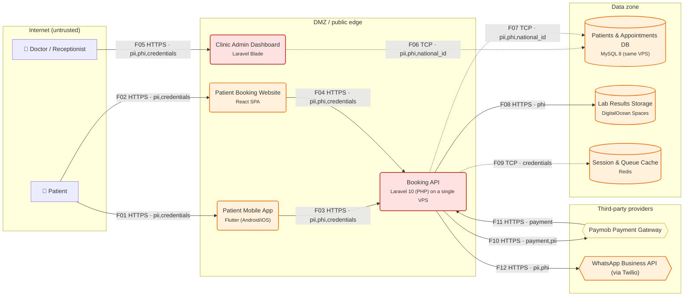

# Threat Model Report — Shifa Care Clinic Booking

*Generated by ThreatLens v1.0.0 on 2026-10-08 20:22 · mode: `offline` · methodology: STRIDE + OWASP Top 10 2021 / ASVS 4.0.3 / CWE*

> Appointment booking for a 6-branch outpatient clinic group. Patients book via a Flutter mobile app or the website, pay the consultation fee online, and receive WhatsApp reminders. Doctors view medical history and upload lab results; receptionists manage schedules in an admin dashboard. Team: 3 developers, no dedicated security staff.

## 1. Executive summary

ThreatLens analysed **11 components** and **12 data flows** (10 crossing trust boundaries) of *Shifa Care Clinic Booking* and identified **43 threats**: 4 Critical, 25 High, 14 Medium, 0 Low, covering 9 of the 10 OWASP Top 10 2021 categories. The highest risks are **Forged webhook / callback from third party — Paymob Payment Gateway → Booking API** (risk 25/25); **Internet-exposed admin panel without MFA — Clinic Admin Dashboard** (risk 25/25); **IDOR / Broken object-level authorization — Booking API** (risk 25/25). Doing the **18 'Now' actions** (~28.5 developer-days) removes the most risk per day of effort; the full plan is ~54.0 developer-days.

| Critical | High | Medium | Low | Total | Remediation effort |
|---|---|---|---|---|---|
| 4 | 25 | 14 | 0 | 43 | 54.0 dev-days (28.5 urgent) |

| Context | |
|---|---|
| Industry | Healthcare |
| Region | Egypt (Cairo, Alexandria) |
| Users | ~40k patients, 60 doctors, 25 receptionists |
| Compliance context | Egypt Personal Data Protection Law 151/2020 (health data = sensitive data), PCI DSS v4.0 scope reduction via hosted payment page |

## 2. Asset & data-flow inventory

### 2.1 Components

| ID | Component | Type | Trust zone | Data | Auth | Internet-facing | Documented controls |
|---|---|---|---|---|---|---|---|
| `patient` | Patient | External entity (human actor) | internet | — | none | no | — |
| `staff` | Doctor / Receptionist | External entity (human actor) | internet | — | none | no | — |
| `mobile` | Patient Mobile App (Flutter (Android/iOS)) | Mobile app (Android / iOS) | dmz | Personal data (PII), Health data (PHI), Credentials / tokens | password | yes | tls |
| `web` | Patient Booking Website (React SPA) | Web front end (SPA / server-rendered) | dmz | Personal data (PII), Health data (PHI), Credentials / tokens | jwt | yes | tls |
| `api` | Booking API (Laravel 10 (PHP) on a single VPS) | Backend API | dmz | Personal data (PII), Health data (PHI), National ID / Iqama, Payment data, Credentials / tokens | jwt | yes | tls, logging, orm |
| `admin` | Clinic Admin Dashboard (Laravel Blade) | Back-office / admin dashboard | dmz | Personal data (PII), Health data (PHI), National ID / Iqama | session | yes | tls, csrf |
| `db` | Patients & Appointments DB (MySQL 8 (same VPS)) | Database | data | Personal data (PII), Health data (PHI), National ID / Iqama | none | no | backups |
| `files` | Lab Results Storage (DigitalOcean Spaces) | Object / file storage | data | Health data (PHI) | none | no | — |
| `redis` | Session & Queue Cache (Redis) | Cache | data | Credentials / tokens | none | no | — |
| `paymob` | Paymob Payment Gateway | Third-party service | third_party | Payment data, Personal data (PII) | api_key | no | — |
| `whatsapp` | WhatsApp Business API (via Twilio) | Third-party service | third_party | Personal data (PII), Health data (PHI) | api_key | no | — |

### 2.2 Data flows

| ID | From → To | Protocol | Data | Auth | Crosses boundary |
|---|---|---|---|---|---|
| F01 | Patient → Patient Mobile App | HTTPS | pii, credentials | none | internet -> dmz |
| F02 | Patient → Patient Booking Website | HTTPS | pii, credentials | none | internet -> dmz |
| F03 | Patient Mobile App → Booking API | HTTPS | pii, phi, credentials | jwt | — |
| F04 | Patient Booking Website → Booking API | HTTPS | pii, phi, credentials | jwt | — |
| F05 | Doctor / Receptionist → Clinic Admin Dashboard | HTTPS | pii, phi, credentials | none | internet -> dmz |
| F06 | Clinic Admin Dashboard → Patients & Appointments DB | TCP | pii, phi, national_id | password | dmz -> data |
| F07 | Booking API → Patients & Appointments DB | TCP | pii, phi, national_id | password | dmz -> data |
| F08 | Booking API → Lab Results Storage | HTTPS | phi | api_key | dmz -> data |
| F09 | Booking API → Session & Queue Cache | TCP | credentials | none | dmz -> data |
| F10 | Booking API → Paymob Payment Gateway | HTTPS | payment, pii | api_key | dmz -> third_party |
| F11 | Paymob Payment Gateway → Booking API | HTTPS | payment | none | third_party -> dmz |
| F12 | Booking API → WhatsApp Business API (via Twilio) | HTTPS | pii, phi | api_key | dmz -> third_party |

### 2.3 Trust boundaries

- **Internet (untrusted)**: Patient, Doctor / Receptionist
- **DMZ / public edge**: Patient Mobile App, Patient Booking Website, Booking API, Clinic Admin Dashboard
- **Data zone**: Patients & Appointments DB, Lab Results Storage, Session & Queue Cache
- **Third-party providers**: Paymob Payment Gateway, WhatsApp Business API (via Twilio)
- **Crown-jewel data stores**: Patients & Appointments DB, Lab Results Storage, Session & Queue Cache

## 3. Data-flow diagram

Dashed arrows = unencrypted transport. Red/orange/yellow nodes = worst open Critical/High/Medium risk.

## 4. Findings (risk-ranked)

| ID | Severity | Risk (L×I) | STRIDE | Threat | Target | OWASP Top 10 | CWE |
|---|---|---|---|---|---|---|---|
| TL-001 | **Critical** | 25 (5×5) | Spoofing | Forged webhook / callback from third party — Paymob Payment Gateway → Booking API | F11: Paymob Payment Gateway → Booking API | A08:2021 | CWE-345 |
| TL-002 | **Critical** | 25 (5×5) | Spoofing | Internet-exposed admin panel without MFA — Clinic Admin Dashboard | Clinic Admin Dashboard | A07:2021 | CWE-308, CWE-306 |
| TL-003 | **Critical** | 25 (5×5) | Information Disclosure | IDOR / Broken object-level authorization — Booking API | Booking API | A01:2021 | CWE-639, CWE-862 |
| TL-004 | **Critical** | 20 (4×5) | Tampering | Payment amount / order tampering — Booking API | Booking API | A04:2021 | CWE-602, CWE-840 |
| TL-005 | **High** | 16 (4×4) | Spoofing | Weak session / token lifecycle — Booking API | Booking API | A07:2021 | CWE-613 |
| TL-006 | **High** | 16 (4×4) | Spoofing | Account takeover via single-factor authentication — Booking API | Booking API | A07:2021 | CWE-308, CWE-287 |
| TL-007 | **High** | 16 (4×4) | Spoofing | Account takeover via single-factor authentication — Patient Mobile App | Patient Mobile App | A07:2021 | CWE-308, CWE-287 |
| TL-008 | **High** | 16 (4×4) | Spoofing | Account takeover via single-factor authentication — Patient Booking Website | Patient Booking Website | A07:2021 | CWE-308, CWE-287 |
| TL-009 | **High** | 16 (4×4) | Spoofing | Credential stuffing / brute force on login and OTP — Clinic Admin Dashboard | Clinic Admin Dashboard | A07:2021 | CWE-307 |
| TL-010 | **High** | 16 (4×4) | Spoofing | Credential stuffing / brute force on login and OTP — Booking API | Booking API | A07:2021 | CWE-307 |
| TL-011 | **High** | 16 (4×4) | Spoofing | Credential stuffing / brute force on login and OTP — Patient Booking Website | Patient Booking Website | A07:2021 | CWE-307 |
| TL-012 | **High** | 16 (4×4) | Tampering | Stored / reflected XSS in browser UI — Clinic Admin Dashboard | Clinic Admin Dashboard | A03:2021 | CWE-79 |
| TL-013 | **High** | 16 (4×4) | Tampering | Stored / reflected XSS in browser UI — Patient Booking Website | Patient Booking Website | A03:2021 | CWE-79 |
| TL-014 | **High** | 15 (3×5) | Spoofing | Unauthenticated call across a trust boundary — Booking API → Session & Queue Cache | F09: Booking API → Session & Queue Cache | A07:2021 | CWE-306 |
| TL-015 | **High** | 15 (3×5) | Tampering | SQL / NoSQL injection into backend data store — Clinic Admin Dashboard | Clinic Admin Dashboard | A03:2021 | CWE-89 |
| TL-016 | **High** | 15 (3×5) | Tampering | Malicious file upload — Booking API | Booking API | A04:2021 | CWE-434 |
| TL-017 | **High** | 15 (3×5) | Information Disclosure | Sensitive data sent in cleartext — Clinic Admin Dashboard → Patients & Appointments DB | F06: Clinic Admin Dashboard → Patients & Appointments DB | A02:2021 | CWE-319 |
| TL-018 | **High** | 15 (3×5) | Information Disclosure | Sensitive data sent in cleartext — Booking API → Patients & Appointments DB | F07: Booking API → Patients & Appointments DB | A02:2021 | CWE-319 |
| TL-019 | **High** | 15 (3×5) | Information Disclosure | Sensitive data sent in cleartext — Booking API → Session & Queue Cache | F09: Booking API → Session & Queue Cache | A02:2021 | CWE-319 |
| TL-020 | **High** | 15 (3×5) | Information Disclosure | Publicly readable storage bucket / predictable file URLs — Lab Results Storage | Lab Results Storage | A01:2021 | CWE-732, CWE-200 |
| TL-021 | **High** | 15 (3×5) | Information Disclosure | Unauthenticated cache exposes session / personal data — Session & Queue Cache | Session & Queue Cache | A05:2021, A07:2021 | CWE-524, CWE-306 |
| TL-022 | **High** | 15 (3×5) | Information Disclosure | Secrets in source code / server env files | System-wide | A07:2021 | CWE-798 |
| TL-023 | **High** | 15 (3×5) | Elevation of Privilege | Broken function-level authorization (user reaches admin functions) — Booking API | Booking API | A01:2021 | CWE-285, CWE-863 |
| TL-024 | **High** | 15 (3×5) | Elevation of Privilege | Mass assignment of privileged fields — Booking API | Booking API | A08:2021 | CWE-915 |
| TL-025 | **High** | 12 (3×4) | Spoofing | Secrets extractable from the client app — Patient Mobile App | Patient Mobile App | A07:2021 | CWE-798 |
| TL-026 | **High** | 12 (3×4) | Tampering | Vulnerable third-party libraries (no SCA) | System-wide | A06:2021 | CWE-1104 |
| TL-027 | **High** | 12 (3×4) | Repudiation | No centralized security monitoring / alerting | System-wide | A09:2021 | CWE-778 |
| TL-028 | **High** | 12 (4×3) | Denial of Service | Resource exhaustion on public API — Booking API | Booking API | A04:2021 | CWE-770 |
| TL-029 | **High** | 12 (4×3) | Denial of Service | SMS/WhatsApp OTP pumping & messaging abuse — WhatsApp Business API (via Twilio) | WhatsApp Business API (via Twilio) | A04:2021 | CWE-799 |
| TL-030 | **Medium** | 10 (2×5) | Repudiation | Sensitive logs leak data — Booking API | Booking API | A09:2021 | CWE-532 |
| TL-031 | **Medium** | 10 (2×5) | Information Disclosure | Sensitive data stored unencrypted at rest — Patients & Appointments DB | Patients & Appointments DB | A02:2021 | CWE-311, CWE-312 |
| TL-032 | **Medium** | 10 (2×5) | Information Disclosure | Sensitive data stored unencrypted at rest — Lab Results Storage | Lab Results Storage | A02:2021 | CWE-311, CWE-312 |
| TL-033 | **Medium** | 10 (2×5) | Elevation of Privilege | Over-privileged database account — Patients & Appointments DB | Patients & Appointments DB | A01:2021 | CWE-250 |
| TL-034 | **Medium** | 9 (3×3) | Repudiation | No audit trail for access to sensitive records — Clinic Admin Dashboard | Clinic Admin Dashboard | A09:2021 | CWE-778 |
| TL-035 | **Medium** | 9 (3×3) | Repudiation | No audit trail for access to sensitive records — Booking API | Booking API | A09:2021 | CWE-778 |
| TL-036 | **Medium** | 9 (3×3) | Information Disclosure | Personal data shared with third party beyond need — Paymob Payment Gateway | Paymob Payment Gateway | A01:2021 | CWE-359 |
| TL-037 | **Medium** | 9 (3×3) | Information Disclosure | Personal data shared with third party beyond need — WhatsApp Business API (via Twilio) | WhatsApp Business API (via Twilio) | A01:2021 | CWE-359 |
| TL-038 | **Medium** | 9 (3×3) | Denial of Service | No WAF / DDoS protection at the edge — Booking API | Booking API | A05:2021 | CWE-400 |
| TL-039 | **Medium** | 9 (3×3) | Denial of Service | No WAF / DDoS protection at the edge — Patient Booking Website | Patient Booking Website | A05:2021 | CWE-400 |
| TL-040 | **Medium** | 8 (4×2) | Information Disclosure | Verbose errors / debug mode in production — Clinic Admin Dashboard | Clinic Admin Dashboard | A04:2021 | CWE-209 |
| TL-041 | **Medium** | 8 (4×2) | Information Disclosure | Verbose errors / debug mode in production — Booking API | Booking API | A04:2021 | CWE-209 |
| TL-042 | **Medium** | 8 (4×2) | Information Disclosure | Verbose errors / debug mode in production — Patient Booking Website | Patient Booking Website | A04:2021 | CWE-209 |
| TL-043 | **Medium** | 8 (2×4) | Information Disclosure | Sensitive data stored insecurely on device — Patient Mobile App | Patient Mobile App | A02:2021 | CWE-312 |

### 4.1 Finding details

#### TL-001 — Forged webhook / callback from third party — Paymob Payment Gateway → Booking API

- **Severity:** Critical (likelihood 5/5 × impact 5/5 = 25/25)
- **STRIDE:** Spoofing · **Target:** F11: Paymob Payment Gateway → Booking API
- **OWASP Top 10 2021:** A08:2021 Software and Data Integrity Failures
- **OWASP ASVS 4.0.3:** V10.3 Application Integrity; V13.1 Generic Web Service Security
- **CWE:** CWE-345
- **Description:** Booking API accepts callbacks from Paymob Payment Gateway (Payment data). Without signature verification an attacker can forge 'payment successful' or status events.
- **Evidence / basis:** `F11: https auth=none third_party->dmz`
- **Mitigation:** Verify payment & partner webhook signatures.

#### TL-002 — Internet-exposed admin panel without MFA — Clinic Admin Dashboard

- **Severity:** Critical (likelihood 5/5 × impact 5/5 = 25/25)
- **STRIDE:** Spoofing · **Target:** Clinic Admin Dashboard
- **OWASP Top 10 2021:** A07:2021 Identification and Authentication Failures
- **OWASP ASVS 4.0.3:** V4.3 Other Access Control Considerations; V2.8 One Time Verifier
- **CWE:** CWE-308, CWE-306
- **Description:** Clinic Admin Dashboard is reachable from the internet and protected only by session. Staff accounts are the highest-value phishing target.
- **Evidence / basis:** `type=admin_panel, zone=dmz, auth=session, controls=['tls', 'csrf']`
- **Mitigation:** Enforce MFA for privileged and staff accounts. Restrict admin panel to VPN / IP allow-list.

#### TL-003 — IDOR / Broken object-level authorization — Booking API

- **Severity:** Critical (likelihood 5/5 × impact 5/5 = 25/25)
- **STRIDE:** Information Disclosure · **Target:** Booking API
- **OWASP Top 10 2021:** A01:2021 Broken Access Control
- **OWASP ASVS 4.0.3:** V4.2 Operation Level Access Control
- **CWE:** CWE-639, CWE-862
- **Description:** Booking API exposes records by ID (Personal data (PII), Health data (PHI), National ID / Iqama, Payment data, Credentials / tokens). If ownership is not checked server-side, changing an ID returns another customer's data.
- **Evidence / basis:** `type=api, zone=dmz, auth=jwt, controls=['tls', 'logging', 'orm']`
- **Mitigation:** Object-level authorization on every record access (anti-IDOR/BOLA).

#### TL-004 — Payment amount / order tampering — Booking API

- **Severity:** Critical (likelihood 4/5 × impact 5/5 = 20/25)
- **STRIDE:** Tampering · **Target:** Booking API
- **OWASP Top 10 2021:** A04:2021 Insecure Design
- **OWASP ASVS 4.0.3:** V11.1 Business Logic Security
- **CWE:** CWE-602, CWE-840
- **Description:** Booking API handles payments. If totals, discounts or amounts are accepted from the client, attackers can pay less than the real price.
- **Evidence / basis:** `type=api, zone=dmz, auth=jwt, controls=['tls', 'logging', 'orm']`
- **Mitigation:** Recompute amounts and prices server-side.

#### TL-005 — Weak session / token lifecycle — Booking API

- **Severity:** High (likelihood 4/5 × impact 4/5 = 16/25)
- **STRIDE:** Spoofing · **Target:** Booking API
- **OWASP Top 10 2021:** A07:2021 Identification and Authentication Failures
- **OWASP ASVS 4.0.3:** V3.3 Session Termination; V3.5 Token-based Session Management
- **CWE:** CWE-613
- **Description:** Booking API uses jwt tokens; without expiry, rotation and server-side revocation a stolen token stays valid indefinitely.
- **Evidence / basis:** `type=api, zone=dmz, auth=jwt, controls=['tls', 'logging', 'orm']`
- **Mitigation:** Harden session & token lifecycle.

#### TL-006 — Account takeover via single-factor authentication — Booking API

- **Severity:** High (likelihood 4/5 × impact 4/5 = 16/25)
- **STRIDE:** Spoofing · **Target:** Booking API
- **OWASP Top 10 2021:** A07:2021 Identification and Authentication Failures
- **OWASP ASVS 4.0.3:** V2.1 Password Security; V2.8 One Time Verifier
- **CWE:** CWE-308, CWE-287
- **Description:** Booking API authenticates users with jwt only. Phished, reused or leaked passwords give an attacker full access to Personal data (PII), Health data (PHI), National ID / Iqama, Payment data, Credentials / tokens.
- **Evidence / basis:** `type=api, zone=dmz, auth=jwt, controls=['tls', 'logging', 'orm']`
- **Mitigation:** Enforce MFA for privileged and staff accounts.

#### TL-007 — Account takeover via single-factor authentication — Patient Mobile App

- **Severity:** High (likelihood 4/5 × impact 4/5 = 16/25)
- **STRIDE:** Spoofing · **Target:** Patient Mobile App
- **OWASP Top 10 2021:** A07:2021 Identification and Authentication Failures
- **OWASP ASVS 4.0.3:** V2.1 Password Security; V2.8 One Time Verifier
- **CWE:** CWE-308, CWE-287
- **Description:** Patient Mobile App authenticates users with password only. Phished, reused or leaked passwords give an attacker full access to Personal data (PII), Health data (PHI), Credentials / tokens.
- **Evidence / basis:** `type=mobile_app, zone=dmz, auth=password, controls=['tls']`
- **Mitigation:** Enforce MFA for privileged and staff accounts.

#### TL-008 — Account takeover via single-factor authentication — Patient Booking Website

- **Severity:** High (likelihood 4/5 × impact 4/5 = 16/25)
- **STRIDE:** Spoofing · **Target:** Patient Booking Website
- **OWASP Top 10 2021:** A07:2021 Identification and Authentication Failures
- **OWASP ASVS 4.0.3:** V2.1 Password Security; V2.8 One Time Verifier
- **CWE:** CWE-308, CWE-287
- **Description:** Patient Booking Website authenticates users with jwt only. Phished, reused or leaked passwords give an attacker full access to Personal data (PII), Health data (PHI), Credentials / tokens.
- **Evidence / basis:** `type=web_frontend, zone=dmz, auth=jwt, controls=['tls']`
- **Mitigation:** Enforce MFA for privileged and staff accounts.

#### TL-009 — Credential stuffing / brute force on login and OTP — Clinic Admin Dashboard

- **Severity:** High (likelihood 4/5 × impact 4/5 = 16/25)
- **STRIDE:** Spoofing · **Target:** Clinic Admin Dashboard
- **OWASP Top 10 2021:** A07:2021 Identification and Authentication Failures
- **OWASP ASVS 4.0.3:** V2.2 General Authenticator Security
- **CWE:** CWE-307
- **Description:** No rate limiting is documented for Clinic Admin Dashboard. Automated credential-stuffing or OTP guessing can take over accounts.
- **Evidence / basis:** `type=admin_panel, zone=dmz, auth=session, controls=['tls', 'csrf']`
- **Mitigation:** Rate limiting & anti-automation on auth/OTP/sensitive endpoints. Account lockout & credential-stuffing detection.

#### TL-010 — Credential stuffing / brute force on login and OTP — Booking API

- **Severity:** High (likelihood 4/5 × impact 4/5 = 16/25)
- **STRIDE:** Spoofing · **Target:** Booking API
- **OWASP Top 10 2021:** A07:2021 Identification and Authentication Failures
- **OWASP ASVS 4.0.3:** V2.2 General Authenticator Security
- **CWE:** CWE-307
- **Description:** No rate limiting is documented for Booking API. Automated credential-stuffing or OTP guessing can take over accounts.
- **Evidence / basis:** `type=api, zone=dmz, auth=jwt, controls=['tls', 'logging', 'orm']`
- **Mitigation:** Rate limiting & anti-automation on auth/OTP/sensitive endpoints. Account lockout & credential-stuffing detection.

#### TL-011 — Credential stuffing / brute force on login and OTP — Patient Booking Website

- **Severity:** High (likelihood 4/5 × impact 4/5 = 16/25)
- **STRIDE:** Spoofing · **Target:** Patient Booking Website
- **OWASP Top 10 2021:** A07:2021 Identification and Authentication Failures
- **OWASP ASVS 4.0.3:** V2.2 General Authenticator Security
- **CWE:** CWE-307
- **Description:** No rate limiting is documented for Patient Booking Website. Automated credential-stuffing or OTP guessing can take over accounts.
- **Evidence / basis:** `type=web_frontend, zone=dmz, auth=jwt, controls=['tls']`
- **Mitigation:** Rate limiting & anti-automation on auth/OTP/sensitive endpoints. Account lockout & credential-stuffing detection.

#### TL-012 — Stored / reflected XSS in browser UI — Clinic Admin Dashboard

- **Severity:** High (likelihood 4/5 × impact 4/5 = 16/25)
- **STRIDE:** Tampering · **Target:** Clinic Admin Dashboard
- **OWASP Top 10 2021:** A03:2021 Injection
- **OWASP ASVS 4.0.3:** V5.3 Output Encoding and Injection Prevention; V14.4 HTTP Security Headers
- **CWE:** CWE-79
- **Description:** Clinic Admin Dashboard renders user-supplied content. Without output encoding and CSP, script injection can steal sessions of staff or customers.
- **Evidence / basis:** `type=admin_panel, zone=dmz, auth=session, controls=['tls', 'csrf']`
- **Mitigation:** Output encoding + Content-Security-Policy.

#### TL-013 — Stored / reflected XSS in browser UI — Patient Booking Website

- **Severity:** High (likelihood 4/5 × impact 4/5 = 16/25)
- **STRIDE:** Tampering · **Target:** Patient Booking Website
- **OWASP Top 10 2021:** A03:2021 Injection
- **OWASP ASVS 4.0.3:** V5.3 Output Encoding and Injection Prevention; V14.4 HTTP Security Headers
- **CWE:** CWE-79
- **Description:** Patient Booking Website renders user-supplied content. Without output encoding and CSP, script injection can steal sessions of staff or customers.
- **Evidence / basis:** `type=web_frontend, zone=dmz, auth=jwt, controls=['tls']`
- **Mitigation:** Output encoding + Content-Security-Policy.

#### TL-014 — Unauthenticated call across a trust boundary — Booking API → Session & Queue Cache

- **Severity:** High (likelihood 3/5 × impact 5/5 = 15/25)
- **STRIDE:** Spoofing · **Target:** F09: Booking API → Session & Queue Cache
- **OWASP Top 10 2021:** A07:2021 Identification and Authentication Failures
- **OWASP ASVS 4.0.3:** V1.4 Access Control Architecture; V13.1 Generic Web Service Security
- **CWE:** CWE-306
- **Description:** Flow Booking API -> Session & Queue Cache crosses from 'dmz' to 'data' without authentication.
- **Evidence / basis:** `F09: tcp auth=none dmz->data`
- **Mitigation:** Authenticate service-to-service traffic.

#### TL-015 — SQL / NoSQL injection into backend data store — Clinic Admin Dashboard

- **Severity:** High (likelihood 3/5 × impact 5/5 = 15/25)
- **STRIDE:** Tampering · **Target:** Clinic Admin Dashboard
- **OWASP Top 10 2021:** A03:2021 Injection
- **OWASP ASVS 4.0.3:** V5.3 Output Encoding and Injection Prevention
- **CWE:** CWE-89
- **Description:** Clinic Admin Dashboard builds queries against a data store and no input-validation / parameterization control is documented.
- **Evidence / basis:** `type=admin_panel, zone=dmz, auth=session, controls=['tls', 'csrf']`
- **Mitigation:** Parameterized queries / ORM-only data access. Schema-based input validation & allow-listed fields.

#### TL-016 — Malicious file upload — Booking API

- **Severity:** High (likelihood 3/5 × impact 5/5 = 15/25)
- **STRIDE:** Tampering · **Target:** Booking API
- **OWASP Top 10 2021:** A04:2021 Insecure Design
- **OWASP ASVS 4.0.3:** V12.1 File Upload; V12.2 File Integrity
- **CWE:** CWE-434
- **Description:** Booking API accepts file uploads (e.g. documents, images, lab results). Unrestricted uploads enable web shells, malware hosting and stored XSS.
- **Evidence / basis:** `type=api, zone=dmz, auth=jwt, controls=['tls', 'logging', 'orm']`
- **Mitigation:** Harden file uploads.

#### TL-017 — Sensitive data sent in cleartext — Clinic Admin Dashboard → Patients & Appointments DB

- **Severity:** High (likelihood 3/5 × impact 5/5 = 15/25)
- **STRIDE:** Information Disclosure · **Target:** F06: Clinic Admin Dashboard → Patients & Appointments DB
- **OWASP Top 10 2021:** A02:2021 Cryptographic Failures
- **OWASP ASVS 4.0.3:** V9.1 Client Communication Security; V9.2 Server Communication Security
- **CWE:** CWE-319
- **Description:** Flow Clinic Admin Dashboard -> Patients & Appointments DB uses TCP and carries Personal data (PII), Health data (PHI), National ID / Iqama. Anyone on the path (Wi-Fi, ISP, internal network) can read or modify it.
- **Evidence / basis:** `F06: tcp auth=password dmz->data`
- **Mitigation:** Encrypt all data in transit (TLS 1.2+).

#### TL-018 — Sensitive data sent in cleartext — Booking API → Patients & Appointments DB

- **Severity:** High (likelihood 3/5 × impact 5/5 = 15/25)
- **STRIDE:** Information Disclosure · **Target:** F07: Booking API → Patients & Appointments DB
- **OWASP Top 10 2021:** A02:2021 Cryptographic Failures
- **OWASP ASVS 4.0.3:** V9.1 Client Communication Security; V9.2 Server Communication Security
- **CWE:** CWE-319
- **Description:** Flow Booking API -> Patients & Appointments DB uses TCP and carries Personal data (PII), Health data (PHI), National ID / Iqama. Anyone on the path (Wi-Fi, ISP, internal network) can read or modify it.
- **Evidence / basis:** `F07: tcp auth=password dmz->data`
- **Mitigation:** Encrypt all data in transit (TLS 1.2+).

#### TL-019 — Sensitive data sent in cleartext — Booking API → Session & Queue Cache

- **Severity:** High (likelihood 3/5 × impact 5/5 = 15/25)
- **STRIDE:** Information Disclosure · **Target:** F09: Booking API → Session & Queue Cache
- **OWASP Top 10 2021:** A02:2021 Cryptographic Failures
- **OWASP ASVS 4.0.3:** V9.1 Client Communication Security; V9.2 Server Communication Security
- **CWE:** CWE-319
- **Description:** Flow Booking API -> Session & Queue Cache uses TCP and carries Credentials / tokens. Anyone on the path (Wi-Fi, ISP, internal network) can read or modify it.
- **Evidence / basis:** `F09: tcp auth=none dmz->data`
- **Mitigation:** Encrypt all data in transit (TLS 1.2+).

#### TL-020 — Publicly readable storage bucket / predictable file URLs — Lab Results Storage

- **Severity:** High (likelihood 3/5 × impact 5/5 = 15/25)
- **STRIDE:** Information Disclosure · **Target:** Lab Results Storage
- **OWASP Top 10 2021:** A01:2021 Broken Access Control
- **OWASP ASVS 4.0.3:** V12.4 File Storage; V4.1 General Access Control Design
- **CWE:** CWE-732, CWE-200
- **Description:** Lab Results Storage holds files (Health data (PHI)). Misconfigured public access or guessable URLs are a top cause of SME data leaks.
- **Evidence / basis:** `type=object_storage, zone=data, auth=none, controls=none documented`
- **Mitigation:** Private buckets + short-lived signed URLs.

#### TL-021 — Unauthenticated cache exposes session / personal data — Session & Queue Cache

- **Severity:** High (likelihood 3/5 × impact 5/5 = 15/25)
- **STRIDE:** Information Disclosure · **Target:** Session & Queue Cache
- **OWASP Top 10 2021:** A05:2021 Security Misconfiguration; A07:2021 Identification and Authentication Failures
- **OWASP ASVS 4.0.3:** V8.1 General Data Protection
- **CWE:** CWE-524, CWE-306
- **Description:** Session & Queue Cache caches Credentials / tokens with auth 'none'. Unauthenticated Redis/Memcached is routinely found and dumped.
- **Evidence / basis:** `type=cache, zone=data, auth=none, controls=none documented`
- **Mitigation:** Lock down the cache.

#### TL-022 — Secrets in source code / server env files

- **Severity:** High (likelihood 3/5 × impact 5/5 = 15/25)
- **STRIDE:** Information Disclosure · **Target:** System-wide
- **OWASP Top 10 2021:** A07:2021 Identification and Authentication Failures
- **OWASP ASVS 4.0.3:** V6.4 Secret Management; V14.1 Build and Deploy
- **CWE:** CWE-798
- **Description:** No secrets manager is documented. Payment-gateway keys, DB passwords and JWT signing keys tend to live in git or .env files.
- **Evidence / basis:** `global_controls=['tls', 'backups']`
- **Mitigation:** Move secrets to a secrets manager & rotate.

#### TL-023 — Broken function-level authorization (user reaches admin functions) — Booking API

- **Severity:** High (likelihood 3/5 × impact 5/5 = 15/25)
- **STRIDE:** Elevation of Privilege · **Target:** Booking API
- **OWASP Top 10 2021:** A01:2021 Broken Access Control
- **OWASP ASVS 4.0.3:** V4.1 General Access Control Design; V4.2 Operation Level Access Control
- **CWE:** CWE-285, CWE-863
- **Description:** Booking API serves both end users and staff/admin functions. Missing server-side role checks let normal users call privileged endpoints.
- **Evidence / basis:** `type=api, zone=dmz, auth=jwt, controls=['tls', 'logging', 'orm']`
- **Mitigation:** Role-based access control on every privileged function.

#### TL-024 — Mass assignment of privileged fields — Booking API

- **Severity:** High (likelihood 3/5 × impact 5/5 = 15/25)
- **STRIDE:** Elevation of Privilege · **Target:** Booking API
- **OWASP Top 10 2021:** A08:2021 Software and Data Integrity Failures
- **OWASP ASVS 4.0.3:** V5.1 Input Validation
- **CWE:** CWE-915
- **Description:** Booking API binds request bodies to models. Without explicit DTOs a user can set fields such as role, is_admin, salary or price.
- **Evidence / basis:** `type=api, zone=dmz, auth=jwt, controls=['tls', 'logging', 'orm']`
- **Mitigation:** Schema-based input validation & allow-listed fields.

#### TL-025 — Secrets extractable from the client app — Patient Mobile App

- **Severity:** High (likelihood 3/5 × impact 4/5 = 12/25)
- **STRIDE:** Spoofing · **Target:** Patient Mobile App
- **OWASP Top 10 2021:** A07:2021 Identification and Authentication Failures
- **OWASP ASVS 4.0.3:** V14.3 Unintended Security Disclosure; V6.4 Secret Management
- **CWE:** CWE-798
- **Description:** Patient Mobile App ships to user devices. API keys or partner credentials embedded in the bundle can be extracted and abused to impersonate the app.
- **Evidence / basis:** `type=mobile_app, zone=dmz, auth=password, controls=['tls']`
- **Mitigation:** Remove secrets from mobile/web clients.

#### TL-026 — Vulnerable third-party libraries (no SCA)

- **Severity:** High (likelihood 3/5 × impact 4/5 = 12/25)
- **STRIDE:** Tampering · **Target:** System-wide
- **OWASP Top 10 2021:** A06:2021 Vulnerable and Outdated Components
- **OWASP ASVS 4.0.3:** V14.2 Dependency
- **CWE:** CWE-1104
- **Description:** No dependency scanning is documented for the custom code (npm/composer/pip/pub). Known-vulnerable packages are a common entry point.
- **Evidence / basis:** `global_controls=['tls', 'backups']`
- **Mitigation:** Dependency scanning & patching cadence (SCA).

#### TL-027 — No centralized security monitoring / alerting

- **Severity:** High (likelihood 3/5 × impact 4/5 = 12/25)
- **STRIDE:** Repudiation · **Target:** System-wide
- **OWASP Top 10 2021:** A09:2021 Security Logging and Monitoring Failures
- **OWASP ASVS 4.0.3:** V7.2 Log Processing; V7.3 Log Protection
- **CWE:** CWE-778
- **Description:** There is no documented security monitoring. Breaches at SMEs are typically discovered months later, by customers or regulators.
- **Evidence / basis:** `global_controls=['tls', 'backups']`
- **Mitigation:** Centralized security monitoring & alerting.

#### TL-028 — Resource exhaustion on public API — Booking API

- **Severity:** High (likelihood 4/5 × impact 3/5 = 12/25)
- **STRIDE:** Denial of Service · **Target:** Booking API
- **OWASP Top 10 2021:** A04:2021 Insecure Design
- **OWASP ASVS 4.0.3:** V11.1 Business Logic Security; V13.1 Generic Web Service Security
- **CWE:** CWE-770
- **Description:** Booking API is internet-facing without documented rate limits; scraping or floods can take the service down or inflate cloud bills.
- **Evidence / basis:** `type=api, zone=dmz, auth=jwt, controls=['tls', 'logging', 'orm']`
- **Mitigation:** Rate limiting & anti-automation on auth/OTP/sensitive endpoints.

#### TL-029 — SMS/WhatsApp OTP pumping & messaging abuse — WhatsApp Business API (via Twilio)

- **Severity:** High (likelihood 4/5 × impact 3/5 = 12/25)
- **STRIDE:** Denial of Service · **Target:** WhatsApp Business API (via Twilio)
- **OWASP Top 10 2021:** A04:2021 Insecure Design
- **OWASP ASVS 4.0.3:** V2.2 General Authenticator Security
- **CWE:** CWE-799
- **Description:** WhatsApp Business API (via Twilio) sends OTP / notifications. Bots can trigger thousands of messages (toll fraud) or spam patients/customers.
- **Evidence / basis:** `type=third_party, zone=third_party, auth=api_key, controls=none documented`
- **Mitigation:** OTP/SMS pumping controls.

#### TL-030 — Sensitive logs leak data — Booking API

- **Severity:** Medium (likelihood 2/5 × impact 5/5 = 10/25)
- **STRIDE:** Repudiation · **Target:** Booking API
- **OWASP Top 10 2021:** A09:2021 Security Logging and Monitoring Failures
- **OWASP ASVS 4.0.3:** V7.1 Log Content
- **CWE:** CWE-532
- **Description:** Booking API logs requests, but log redaction is not documented. Logs become a second, poorly-protected copy of Personal data (PII), Health data (PHI), National ID / Iqama, Payment data, Credentials / tokens.
- **Evidence / basis:** `type=api, zone=dmz, auth=jwt, controls=['tls', 'logging', 'orm']`
- **Mitigation:** Redact sensitive fields from logs.

#### TL-031 — Sensitive data stored unencrypted at rest — Patients & Appointments DB

- **Severity:** Medium (likelihood 2/5 × impact 5/5 = 10/25)
- **STRIDE:** Information Disclosure · **Target:** Patients & Appointments DB
- **OWASP Top 10 2021:** A02:2021 Cryptographic Failures
- **OWASP ASVS 4.0.3:** V6.1 Data Classification; V8.3 Sensitive Private Data
- **CWE:** CWE-311, CWE-312
- **Description:** Patients & Appointments DB stores Personal data (PII), Health data (PHI), National ID / Iqama without documented encryption at rest. A stolen backup, snapshot or disk exposes everything.
- **Evidence / basis:** `type=database, zone=data, auth=none, controls=['backups']`
- **Mitigation:** Encrypt sensitive data at rest.

#### TL-032 — Sensitive data stored unencrypted at rest — Lab Results Storage

- **Severity:** Medium (likelihood 2/5 × impact 5/5 = 10/25)
- **STRIDE:** Information Disclosure · **Target:** Lab Results Storage
- **OWASP Top 10 2021:** A02:2021 Cryptographic Failures
- **OWASP ASVS 4.0.3:** V6.1 Data Classification; V8.3 Sensitive Private Data
- **CWE:** CWE-311, CWE-312
- **Description:** Lab Results Storage stores Health data (PHI) without documented encryption at rest. A stolen backup, snapshot or disk exposes everything.
- **Evidence / basis:** `type=object_storage, zone=data, auth=none, controls=none documented`
- **Mitigation:** Encrypt sensitive data at rest.

#### TL-033 — Over-privileged database account — Patients & Appointments DB

- **Severity:** Medium (likelihood 2/5 × impact 5/5 = 10/25)
- **STRIDE:** Elevation of Privilege · **Target:** Patients & Appointments DB
- **OWASP Top 10 2021:** A01:2021 Broken Access Control
- **OWASP ASVS 4.0.3:** V1.4 Access Control Architecture
- **CWE:** CWE-250
- **Description:** Patients & Appointments DB: applications typically connect with owner/DBA rights; any injection becomes full database compromise.
- **Evidence / basis:** `type=database, zone=data, auth=none, controls=['backups']`
- **Mitigation:** Least-privilege database accounts.

#### TL-034 — No audit trail for access to sensitive records — Clinic Admin Dashboard

- **Severity:** Medium (likelihood 3/5 × impact 3/5 = 9/25)
- **STRIDE:** Repudiation · **Target:** Clinic Admin Dashboard
- **OWASP Top 10 2021:** A09:2021 Security Logging and Monitoring Failures
- **OWASP ASVS 4.0.3:** V7.1 Log Content; V7.2 Log Processing
- **CWE:** CWE-778
- **Description:** Clinic Admin Dashboard processes Personal data (PII), Health data (PHI), National ID / Iqama but no audit logging is documented. Insider misuse or a breach cannot be investigated or proven.
- **Evidence / basis:** `type=admin_panel, zone=dmz, auth=session, controls=['tls', 'csrf']`
- **Mitigation:** Tamper-evident audit log for sensitive actions.

#### TL-035 — No audit trail for access to sensitive records — Booking API

- **Severity:** Medium (likelihood 3/5 × impact 3/5 = 9/25)
- **STRIDE:** Repudiation · **Target:** Booking API
- **OWASP Top 10 2021:** A09:2021 Security Logging and Monitoring Failures
- **OWASP ASVS 4.0.3:** V7.1 Log Content; V7.2 Log Processing
- **CWE:** CWE-778
- **Description:** Booking API processes Personal data (PII), Health data (PHI), National ID / Iqama, Payment data, Credentials / tokens but no audit logging is documented. Insider misuse or a breach cannot be investigated or proven.
- **Evidence / basis:** `type=api, zone=dmz, auth=jwt, controls=['tls', 'logging', 'orm']`
- **Mitigation:** Tamper-evident audit log for sensitive actions.

#### TL-036 — Personal data shared with third party beyond need — Paymob Payment Gateway

- **Severity:** Medium (likelihood 3/5 × impact 3/5 = 9/25)
- **STRIDE:** Information Disclosure · **Target:** Paymob Payment Gateway
- **OWASP Top 10 2021:** A01:2021 Broken Access Control
- **OWASP ASVS 4.0.3:** V8.3 Sensitive Private Data
- **CWE:** CWE-359
- **Description:** Paymob Payment Gateway receives Payment data, Personal data (PII). Over-sharing with processors without a DPA creates privacy and regulatory exposure (Egypt PDPL / KSA PDPL).
- **Evidence / basis:** `type=third_party, zone=third_party, auth=api_key, controls=none documented`
- **Mitigation:** Data minimization & DPA with third parties.

#### TL-037 — Personal data shared with third party beyond need — WhatsApp Business API (via Twilio)

- **Severity:** Medium (likelihood 3/5 × impact 3/5 = 9/25)
- **STRIDE:** Information Disclosure · **Target:** WhatsApp Business API (via Twilio)
- **OWASP Top 10 2021:** A01:2021 Broken Access Control
- **OWASP ASVS 4.0.3:** V8.3 Sensitive Private Data
- **CWE:** CWE-359
- **Description:** WhatsApp Business API (via Twilio) receives Personal data (PII), Health data (PHI). Over-sharing with processors without a DPA creates privacy and regulatory exposure (Egypt PDPL / KSA PDPL).
- **Evidence / basis:** `type=third_party, zone=third_party, auth=api_key, controls=none documented`
- **Mitigation:** Data minimization & DPA with third parties.

#### TL-038 — No WAF / DDoS protection at the edge — Booking API

- **Severity:** Medium (likelihood 3/5 × impact 3/5 = 9/25)
- **STRIDE:** Denial of Service · **Target:** Booking API
- **OWASP Top 10 2021:** A05:2021 Security Misconfiguration
- **OWASP ASVS 4.0.3:** V13.1 Generic Web Service Security
- **CWE:** CWE-400
- **Description:** Booking API is exposed directly. Volumetric and application-layer DDoS (common around Ramadan / White Friday sales) has no absorption layer.
- **Evidence / basis:** `type=api, zone=dmz, auth=jwt, controls=['tls', 'logging', 'orm']`
- **Mitigation:** WAF / CDN with DDoS protection in front of public endpoints.

#### TL-039 — No WAF / DDoS protection at the edge — Patient Booking Website

- **Severity:** Medium (likelihood 3/5 × impact 3/5 = 9/25)
- **STRIDE:** Denial of Service · **Target:** Patient Booking Website
- **OWASP Top 10 2021:** A05:2021 Security Misconfiguration
- **OWASP ASVS 4.0.3:** V13.1 Generic Web Service Security
- **CWE:** CWE-400
- **Description:** Patient Booking Website is exposed directly. Volumetric and application-layer DDoS (common around Ramadan / White Friday sales) has no absorption layer.
- **Evidence / basis:** `type=web_frontend, zone=dmz, auth=jwt, controls=['tls']`
- **Mitigation:** WAF / CDN with DDoS protection in front of public endpoints.

#### TL-040 — Verbose errors / debug mode in production — Clinic Admin Dashboard

- **Severity:** Medium (likelihood 4/5 × impact 2/5 = 8/25)
- **STRIDE:** Information Disclosure · **Target:** Clinic Admin Dashboard
- **OWASP Top 10 2021:** A04:2021 Insecure Design
- **OWASP ASVS 4.0.3:** V7.4 Error Handling
- **CWE:** CWE-209
- **Description:** Clinic Admin Dashboard: stack traces and framework debug pages disclose internals and sometimes secrets.
- **Evidence / basis:** `type=admin_panel, zone=dmz, auth=session, controls=['tls', 'csrf']`
- **Mitigation:** Generic error responses, no stack traces in production.

#### TL-041 — Verbose errors / debug mode in production — Booking API

- **Severity:** Medium (likelihood 4/5 × impact 2/5 = 8/25)
- **STRIDE:** Information Disclosure · **Target:** Booking API
- **OWASP Top 10 2021:** A04:2021 Insecure Design
- **OWASP ASVS 4.0.3:** V7.4 Error Handling
- **CWE:** CWE-209
- **Description:** Booking API: stack traces and framework debug pages disclose internals and sometimes secrets.
- **Evidence / basis:** `type=api, zone=dmz, auth=jwt, controls=['tls', 'logging', 'orm']`
- **Mitigation:** Generic error responses, no stack traces in production.

#### TL-042 — Verbose errors / debug mode in production — Patient Booking Website

- **Severity:** Medium (likelihood 4/5 × impact 2/5 = 8/25)
- **STRIDE:** Information Disclosure · **Target:** Patient Booking Website
- **OWASP Top 10 2021:** A04:2021 Insecure Design
- **OWASP ASVS 4.0.3:** V7.4 Error Handling
- **CWE:** CWE-209
- **Description:** Patient Booking Website: stack traces and framework debug pages disclose internals and sometimes secrets.
- **Evidence / basis:** `type=web_frontend, zone=dmz, auth=jwt, controls=['tls']`
- **Mitigation:** Generic error responses, no stack traces in production.

#### TL-043 — Sensitive data stored insecurely on device — Patient Mobile App

- **Severity:** Medium (likelihood 2/5 × impact 4/5 = 8/25)
- **STRIDE:** Information Disclosure · **Target:** Patient Mobile App
- **OWASP Top 10 2021:** A02:2021 Cryptographic Failures
- **OWASP ASVS 4.0.3:** V8.2 Client-side Data Protection
- **CWE:** CWE-312
- **Description:** Patient Mobile App may cache tokens or Personal data (PII), Health data (PHI), Credentials / tokens on the device in plain storage, exposed on lost/rooted phones.
- **Evidence / basis:** `type=mobile_app, zone=dmz, auth=password, controls=['tls']`
- **Mitigation:** Use Keystore/Keychain for on-device sensitive data.

## 5. Prioritised remediation plan

Ordered by phase, then by the highest risk each action closes, then by risk removed per developer-day. Effort assumes a small (2-5 developer) SME team.

| # | Phase | Action | Owner | Effort (dev-days) | Fixes | Risk points removed |
|---|---|---|---|---|---|---|
| 1 | Now (0-2 weeks) | **Enforce MFA for privileged and staff accounts** — TOTP / passkeys for admin, doctor, finance and HR roles; SMS OTP only as fallback. | Backend | 2 | TL-002, TL-006, TL-007, TL-008 | 73 |
| 2 | Now (0-2 weeks) | **Verify payment & partner webhook signatures** — Validate HMAC (e.g. Paymob HMAC, Fawry signature) and re-query transaction status server-to-server before fulfilling. | Backend | 1 | TL-001 | 25 |
| 3 | Now (0-2 weeks) | **Restrict admin panel to VPN / IP allow-list** — Serve the back office on a separate host, behind VPN or Cloudflare Access / Zero-Trust. | DevOps | 1 | TL-002 | 25 |
| 4 | Now (0-2 weeks) | **Object-level authorization on every record access (anti-IDOR/BOLA)** — Central policy check that the caller owns / may access the record; use non-guessable IDs; add automated authz tests. | Backend | 4 | TL-003 | 25 |
| 5 | Now (0-2 weeks) | **Recompute amounts and prices server-side** — Never trust totals, discounts or amounts from the client; sign the order before redirecting to the gateway. | Backend | 2 | TL-004 | 20 |
| 6 | Now (0-2 weeks) | **Rate limiting & anti-automation on auth/OTP/sensitive endpoints** — Per-IP and per-account limits at the gateway (e.g. Nginx/Cloudflare) plus progressive delays and CAPTCHA after failures. | DevOps | 1 | TL-009, TL-010, TL-011, TL-028 | 60 |
| 7 | Now (0-2 weeks) | **Account lockout & credential-stuffing detection** — Temporary lockout, breached-password check (HIBP k-anonymity), alert on spikes of failed logins. | Backend | 1 | TL-009, TL-010, TL-011 | 48 |
| 8 | Now (0-2 weeks) | **Output encoding + Content-Security-Policy** — Framework auto-escaping, strict CSP, sanitize rich text (DOMPurify). | Frontend | 2 | TL-012, TL-013 | 32 |
| 9 | Now (0-2 weeks) | **Harden session & token lifecycle** — Short-lived access tokens, refresh token rotation, server-side revocation on logout / password change. | Backend | 2 | TL-005 | 16 |
| 10 | Now (0-2 weeks) | **Encrypt all data in transit (TLS 1.2+)** — HTTPS/SFTP/TLS everywhere incl. internal hops carrying sensitive data; HSTS on public sites. | DevOps | 1 | TL-017, TL-018, TL-019 | 45 |
| 11 | Now (0-2 weeks) | **Lock down the cache** — Require AUTH/ACLs, private network only, TTLs for sensitive keys. | DevOps | 0.5 | TL-021 | 15 |
| 12 | Now (0-2 weeks) | **Private buckets + short-lived signed URLs** — Block public access, per-object authorization, URL expiry <= 15 min. | DevOps | 1 | TL-020 | 15 |
| 13 | Now (0-2 weeks) | **Parameterized queries / ORM-only data access** — Ban string-built SQL, add SAST rule (Semgrep) in CI. | Backend | 2 | TL-015 | 15 |
| 14 | Now (0-2 weeks) | **Harden file uploads** — Type/size allow-list, re-encode images, malware scan, store outside web root with random names, serve via signed URLs. | Backend | 2 | TL-016 | 15 |
| 15 | Now (0-2 weeks) | **Move secrets to a secrets manager & rotate** — Vault / AWS Secrets Manager / Doppler, no keys in git or .env on servers, secret scanning in CI. | DevOps | 2 | TL-022 | 15 |
| 16 | Now (0-2 weeks) | **Dependency scanning & patching cadence (SCA)** — Dependabot/Renovate + OSV/Trivy in CI, monthly patch window. | DevOps | 1 | TL-026 | 12 |
| 17 | Now (0-2 weeks) | **OTP/SMS pumping controls** — Per-number and per-country limits, CAPTCHA before sending, alert on SMS spend anomalies. | Backend | 1 | TL-029 | 12 |
| 18 | Now (0-2 weeks) | **Remove secrets from mobile/web clients** — Move third-party keys server-side, use short-lived tokens, enable Play Integrity / App Attest. | Mobile | 2 | TL-025 | 12 |
| 19 | Next (30 days) | **Schema-based input validation & allow-listed fields** — Validate every request body against a schema (pydantic/Joi/FormRequest); block mass assignment with explicit DTOs. | Backend | 3 | TL-015, TL-024 | 30 |
| 20 | Next (30 days) | **Authenticate service-to-service traffic** — mTLS or signed service tokens between internal services; network policies. | DevOps | 3 | TL-014 | 15 |
| 21 | Next (30 days) | **Role-based access control on every privileged function** — Deny-by-default middleware, role checks on server for admin APIs, tests per role. | Backend | 3 | TL-023 | 15 |
| 22 | Next (30 days) | **Centralized security monitoring & alerting** — Ship auth, admin and payment events to a SIEM/log platform; alert on anomalies; on-call runbook. | DevOps | 3 | TL-027 | 12 |
| 23 | Next (30 days) | **Redact sensitive fields from logs** — Mask national IDs, card data, tokens and medical details in application and gateway logs. | Backend | 1 | TL-030 | 10 |
| 24 | Next (30 days) | **Least-privilege database accounts** — Separate read/write accounts per service, no app access with DBA rights, no direct internet exposure. | DevOps | 1 | TL-033 | 10 |
| 25 | Next (30 days) | **WAF / CDN with DDoS protection in front of public endpoints** — Cloudflare / AWS WAF managed rules, bot protection, origin locked to CDN. | DevOps | 1 | TL-038, TL-039 | 18 |
| 26 | Next (30 days) | **Generic error responses, no stack traces in production** — Global exception handler, debug mode off, correlation IDs instead of details. | Backend | 0.5 | TL-040, TL-041, TL-042 | 24 |
| 27 | Later (90 days) | **Encrypt sensitive data at rest** — Managed disk/DB encryption plus field-level encryption for national IDs, IBANs, medical notes. | Backend | 3 | TL-031, TL-032 | 20 |
| 28 | Later (90 days) | **Data minimization & DPA with third parties** — Send only the fields the provider needs; sign a data-processing agreement (Egypt PDPL 151/2020, KSA PDPL). | Product/Legal | 2 | TL-036, TL-037 | 18 |
| 29 | Later (90 days) | **Tamper-evident audit log for sensitive actions** — Log who/what/when for access to patient/employee/payment records and admin changes; ship to append-only storage. | Backend | 3 | TL-034, TL-035 | 18 |
| 30 | Later (90 days) | **Use Keystore/Keychain for on-device sensitive data** — No tokens or PHI in SharedPreferences/AsyncStorage; encrypted storage, wipe on logout. | Mobile | 2 | TL-043 | 8 |

**Effort by phase:** Now (0-2 weeks): 28.5 dev-days · Next (30 days): 15.5 dev-days · Later (90 days): 10 dev-days

## 6. Coverage

| STRIDE category | Findings |
|---|---|
| Spoofing | 11 |
| Tampering | 6 |
| Repudiation | 4 |
| Information Disclosure | 15 |
| Denial of Service | 4 |
| Elevation of Privilege | 3 |

**OWASP Top 10 2021 categories hit:** A01:2021 Broken Access Control, A02:2021 Cryptographic Failures, A03:2021 Injection, A04:2021 Insecure Design, A05:2021 Security Misconfiguration, A06:2021 Vulnerable and Outdated Components, A07:2021 Identification and Authentication Failures, A08:2021 Software and Data Integrity Failures, A09:2021 Security Logging and Monitoring Failures

**CWE ids referenced:** CWE-79, CWE-89, CWE-200, CWE-209, CWE-250, CWE-285, CWE-287, CWE-306, CWE-307, CWE-308, CWE-311, CWE-312, CWE-319, CWE-345, CWE-359, CWE-400, CWE-434, CWE-524, CWE-532, CWE-602, CWE-613, CWE-639, CWE-732, CWE-770, CWE-778, CWE-798, CWE-799, CWE-840, CWE-862, CWE-863, CWE-915, CWE-1104

## 7. Assumptions, limitations & reviewer notes

- No controls documented for: Lab Results Storage, Session & Queue Cache. Conservative assumptions were applied.
- Controls not listed in the input are treated as absent; findings for controls that already exist can be closed with evidence.
- This is a design-level threat model, not a penetration test. Validate Critical/High items with testing.

## 8. Agent trace

How the agent reached these results (plan → tools → reflect)

| Step | Actor | Tool / action | Reasoning | Result |
|---|---|---|---|---|
| 1 | agent | plan | Plan: parse input -> inventory assets & trust boundaries -> STRIDE per component -> data flows -> system checks -> map OWASP/ASVS/CWE -> score risk -> reflect & repair gaps -> remediation plan -> DFD  | |
| 2 | planner | `parse_architecture` | Normalise the input into components and flows. | `{"system": "Shifa Care Clinic Booking", "components": 11, "flows": 12, "endpoints": 0, "source": "yaml", "comp` |
| 3 | planner | `enumerate_components` | Inventory assets, data classes and trust boundaries. | `{"assets": 11, "trust_zones": ["internet", "dmz", "data", "third_party"], "boundary_crossings": 10, "crown_jew` |
| 4 | planner | `stride_analyze_component`(component_id=mobile) | Apply STRIDE to Patient Mobile App (mobile_app). | `{"component": "mobile", "new_findings": [{"id": "TMP-001", "stride": "S", "title": "Account takeover via singl` |
| 5 | planner | `stride_analyze_component`(component_id=web) | Apply STRIDE to Patient Booking Website (web_frontend). | `{"component": "web", "new_findings": [{"id": "TMP-004", "stride": "S", "title": "Account takeover via single-f` |
| 6 | planner | `stride_analyze_component`(component_id=api) | Apply STRIDE to Booking API (api). | `{"component": "api", "new_findings": [{"id": "TMP-009", "stride": "S", "title": "Account takeover via single-f` |
| 7 | planner | `stride_analyze_component`(component_id=admin) | Apply STRIDE to Clinic Admin Dashboard (admin_panel). | `{"component": "admin", "new_findings": [{"id": "TMP-022", "stride": "S", "title": "Credential stuffing / brute` |
| 8 | planner | `stride_analyze_component`(component_id=db) | Apply STRIDE to Patients & Appointments DB (database). | `{"component": "db", "new_findings": [{"id": "TMP-028", "stride": "I", "title": "Sensitive data stored unencryp` |
| 9 | planner | `stride_analyze_component`(component_id=files) | Apply STRIDE to Lab Results Storage (object_storage). | `{"component": "files", "new_findings": [{"id": "TMP-030", "stride": "I", "title": "Sensitive data stored unenc` |
| 10 | planner | `stride_analyze_component`(component_id=redis) | Apply STRIDE to Session & Queue Cache (cache). | `{"component": "redis", "new_findings": [{"id": "TMP-032", "stride": "I", "title": "Unauthenticated cache expos` |
| 11 | planner | `stride_analyze_component`(component_id=paymob) | Apply STRIDE to Paymob Payment Gateway (third_party). | `{"component": "paymob", "new_findings": [{"id": "TMP-033", "stride": "I", "title": "Personal data shared with ` |
| 12 | planner | `stride_analyze_component`(component_id=whatsapp) | Apply STRIDE to WhatsApp Business API (via Twilio) (third_party). | `{"component": "whatsapp", "new_findings": [{"id": "TMP-034", "stride": "I", "title": "Personal data shared wit` |
| 13 | planner | `analyze_data_flows` | Check every data flow and boundary crossing. | `{"flows_checked": 12, "new_findings": [{"id": "TMP-036", "title": "Sensitive data sent in cleartext — Clinic A` |
| 14 | planner | `analyze_system` | System-wide checks (secrets, monitoring, dependencies). | `{"new_findings": [{"id": "TMP-041", "title": "Secrets in source code / server env files"}, {"id": "TMP-042", "` |
| 15 | planner | `map_to_owasp` | Map findings to OWASP Top 10 / ASVS / CWE. | `{"mapped": 43, "total": 43}` |
| 16 | planner | `score_risk` | Score likelihood x impact. | `{"scored": 43, "by_severity": {"Critical": 4, "High": 25, "Medium": 14, "Low": 0}, "top": [{"id": "TL-001", "r` |
| 17 | planner | `reflect` | Self-check coverage before writing the plan. | `{"iteration": 1, "gaps": [], "notes": ["No controls documented for: Lab Results Storage, Session & Queue Cache` |
| 18 | planner | `build_remediation_plan` | Prioritise fixes by risk reduced per effort-day. | `{"actions": 30, "effort_days_by_phase": {"Now (0-2 weeks)": 28.5, "Next (30 days)": 15.5, "Later (90 days)": 1` |
| 19 | planner | `render_diagram` | Draw the data-flow diagram with trust boundaries. | `{"lines": 38, "highlighted": 10}` |

---
*ThreatLens — AI threat modeling for SMEs. Author: Ahmed Alaa Eldin. MIT License.*
